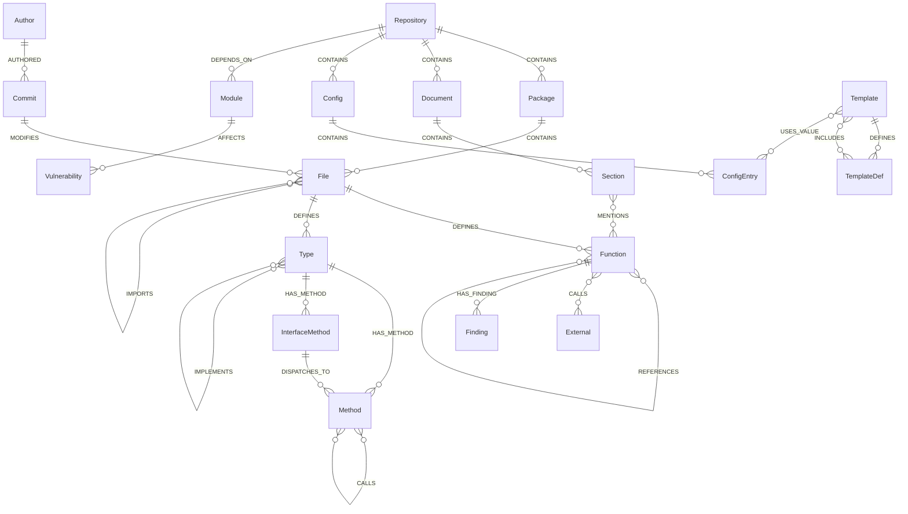
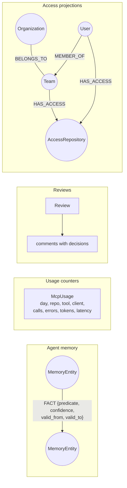

# Graph schema

The schema lives in `internal/model/model.go`. Every code node has the label `Node` plus its kind, and the properties `id`, `repo`, `kind` and `name`. IDs are `repo|Kind|local`.

`AllNodeKinds` and `AllEdgeKinds` are the allowlist for labels and edge labels in Gremlin, because those cannot be passed as bindings.

## Entity relationships

## Node kinds

| Node | Key properties |
|---|---|
| Repository | head, branch, url (no credentials), root, time, metrics (JSON), coverage, license, licenses (JSON) |
| Package | qualified_name, summary |
| File | file, loc, churn, is_test |
| Function / Method | qualified_name, file, start_line, end_line, signature, summary, complexity, loc, body_hash, exported, is_test, security_tags, liveness |
| InterfaceMethod | as Method, no body |
| Type | signature (struct, interface, ...), summary |
| External | qualified_name, security_tags (sensitive APIs only) |
| Document / Section | file, start_line, end_line, level, summary |
| Commit | name (short hash), summary (subject), time |
| Author | name; e-mail only as a hash in the ID |
| Config / ConfigEntry | YAML file; Kubernetes resource (`Kind/name`) or key path, with line range |
| Template / TemplateDef | Go template or Helm file; `{{define}}` block |
| Finding | rule, severity, cwe, file, line, summary (never the secret) |
| Module | path, version, indirect, ecosystem, dev, license (SPDX), license_source |
| Vulnerability | id, aliases, severity, cwe, version, fixed_version, reachability, url |

## Edge kinds

| Edge | Meaning |
|---|---|
| `CONTAINS`, `DEFINES`, `HAS_METHOD` | Structure |
| `CALLS` (`count`) | Static call |
| `DISPATCHES_TO` | Interface method to concrete implementations |
| `IMPLEMENTS` | Type satisfies interface |
| `REFERENCES` | Function used as a value (keeps it live for cleanup) |
| `IMPORTS` | File or package imports |
| `MENTIONS` | Doc section mentions a symbol |
| `MODIFIES` (`count` = lines changed), `AUTHORED` | History |
| `HAS_FINDING` | Code to security finding |
| `DEPENDS_ON`, `AFFECTS` | Dependencies and their vulnerabilities |
| `INCLUDES`, `USES_VALUE` | Template include and `.Values` use |

## Nodes outside the code graph

These are not `:Node` vertices, so re-indexing never touches them.

Access vertices (`Organization`, `User`, `Team`, `AccessRepository`) are never attached to packages or functions. Snapshots hold tenant IDs, opaque subject IDs and permissions, never credentials or e-mail addresses.

## Changing the schema

1. Add the kind to `internal/model/model.go` and to `AllNodeKinds` / `AllEdgeKinds`.
2. New node fields need entries in `internal/store/nodeprops` (both directions; `TestPropsRoundTrip`) and a type in `hugegraphstore/schema.go` (`TestSchemaCoversNodeProps`).
3. New `store.Reader` methods must exist in `memory` and `hugegraphstore`, and be covered by `storetest.Run`.
4. Update `docs/PLAN.md` and `services/web/app/utils/types.ts` if the API shape changes.
