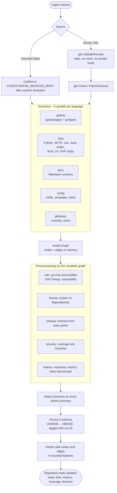
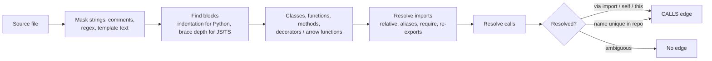

# Ingest pipeline

!!! tip "In plain words"
    Ingest is the step that reads a repository and turns it into the graph. The API runs it as a background job (clone, sync or scheduled sync). On your own machine you can run it directly with `codesynapse ingest`. This page walks through the stages in order.

Ingest turns a checkout into graph nodes and edges. The API runs it as a job (clone, sync, scheduled sync); the CLI runs it directly with `codesynapse ingest`.

## Go extraction

`internal/ingest/golang` loads all packages with tests through `go/packages`.

1. **Pass 1** handles primary packages.
2. **Pass 2** adds `_test.go` files from test variants.
3. For each declaration it records location, signature, doc summary, cyclomatic complexity, a body hash and the calls resolved through `types.Info.Uses`.
4. Calls to sensitive external APIs become `External` nodes with security tags.
5. Interface calls become `DISPATCHES_TO` edges to every implementation; `IMPLEMENTS` edges link types to interfaces.
6. Security rules in `findings.go` run on typed AST and create `Finding` nodes (`HAS_FINDING`).

Extraction runs with `CGO_ENABLED=0`, `GOTOOLCHAIN=local` and `GOPROXY=off` unless the user opts into network access. Do not loosen these defaults.

## Other languages

`internal/ingest/lang` uses pure-Go structural parsers (no cgo, static binaries).

Non-Go call edges are name-based, so dynamic dispatch can be missed. Ambiguous names never create edges. Test code (pytest, `*.test.*`, `*.spec.*`, `__tests__`) is recognised; module-level test code becomes a synthetic `<tests>` function so test reachability works.

## Docs, config and history

| Package | Output |
|---|---|
| `ingest/docs` | `Document` and `Section` nodes with line ranges; inline code spans naming an exported symbol create `MENTIONS` edges |
| `ingest/config` | `Config` / `ConfigEntry` for YAML, `Template` / `TemplateDef` for Go templates and Helm; `INCLUDES` and `USES_VALUE` edges |
| `ingest/githistory` | Last N commits with numstat: `Commit`, `Author`, `MODIFIES` (count = lines changed), churn per file |

Helm templates are scanned by `config.neutralize`: lines holding only template actions become blank and inline actions become a placeholder the rules treat as templated. Line numbers are kept, so findings still point at the right line.

## Persistence

Writes are batched `UNWIND ... MERGE` statements tagged with a run ID. After all batches succeed, stale nodes and edges of that repository (not carrying the current run ID) are deleted in bounded batches. A crashed ingest therefore never leaves a half-replaced graph visible as "current".

## What never reaches the graph

- Source bodies and YAML values: only hashes, signatures, key paths, line ranges and short summaries.
- Secrets: every summary passes through `redact.Summary`; findings describe the problem, never the secret.
- Author e-mail addresses: stored only as hashes inside IDs.
- Dependency data leaving the machine is limited to ecosystem, name and version (osv.dev, deps.dev).
