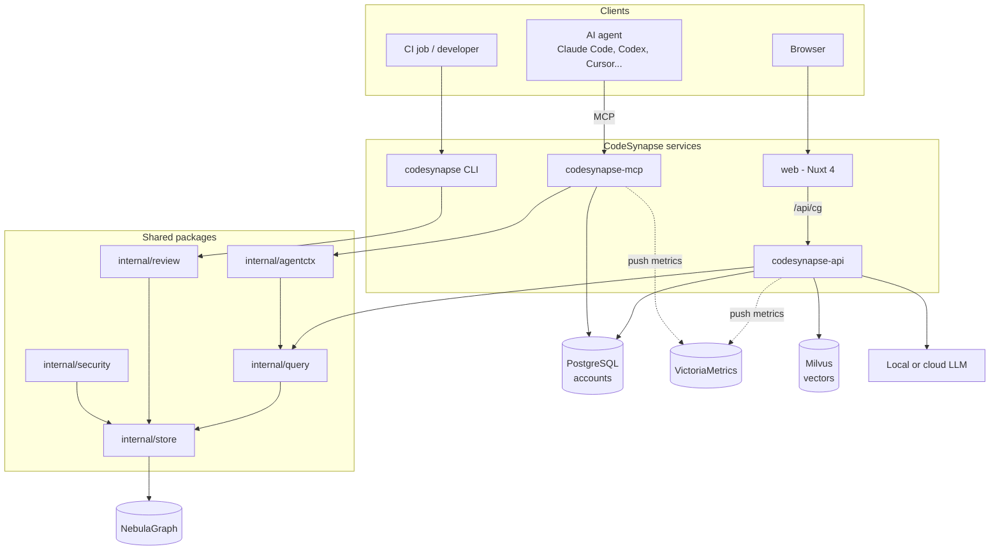
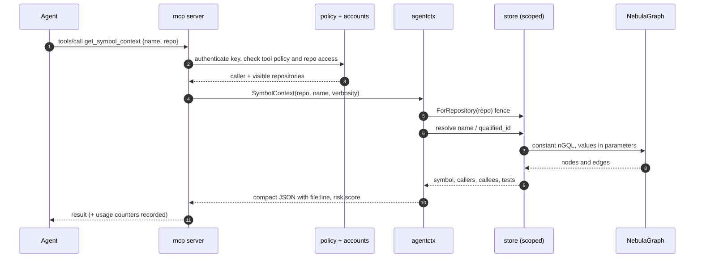
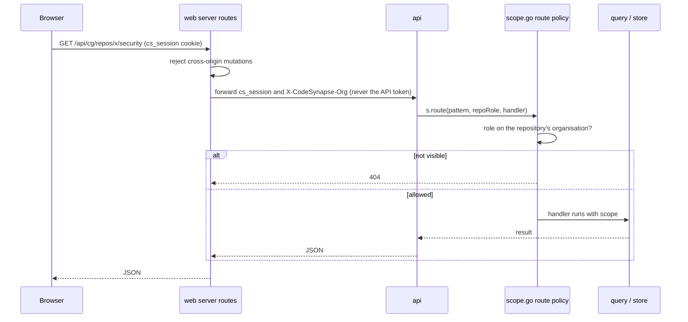
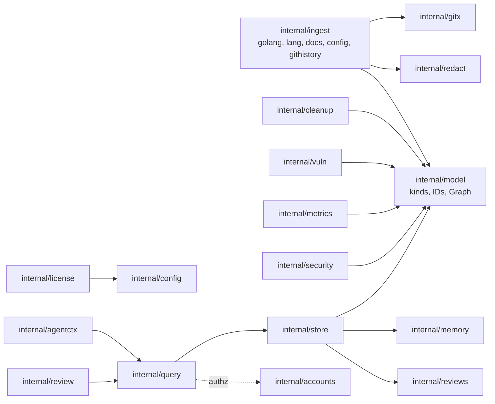

# Architecture overview

## Services

Three services plus the graph database, all defined in `docker-compose.yml`.

| Service | Code | Port | Purpose |
|---|---|---|---|
| `mcp` | `services/mcp` | 8090 | MCP server for AI agents (stdio or streamable HTTP) |
| `api` | `services/api` | 8080 | JSON API for the dashboard; runs ingest, clone and sync jobs |
| `web` | `services/web` (Nuxt 4) | 3000 | Dashboard; proxies to `api` server-side |
| `nebula-graphd` (+ `nebula-metad`, `nebula-storaged`) | images | internal only | Graph store (nGQL; never published to the host) |
| `milvus` | image | internal only | Agent-memory vectors |

`cmd/codesynapse` is the CLI (`ingest`, `audit`, `stats`, `review`, `licenses`, `cleanup`, `mcp install`). It is not a service; it is for CI and local use.

Every reader goes through `internal/query` (and `internal/agentctx` for the composite agent tools). MCP, API and CLI therefore return the same answers. `internal/store/memory` implements the same `store.Store` interface for tests and `--offline` mode.

## Request flow: an agent asks for symbol context

If the name is ambiguous, `agentctx.Resolve` returns a `SuggestionError` listing `qualified_id` values, and the agent retries with one of them.

## Request flow: the dashboard

## Package map

See the [AGENTS.md layout section](https://github.com/astrona-io/codesynapse/blob/main/AGENTS.md) for the full directory list.
