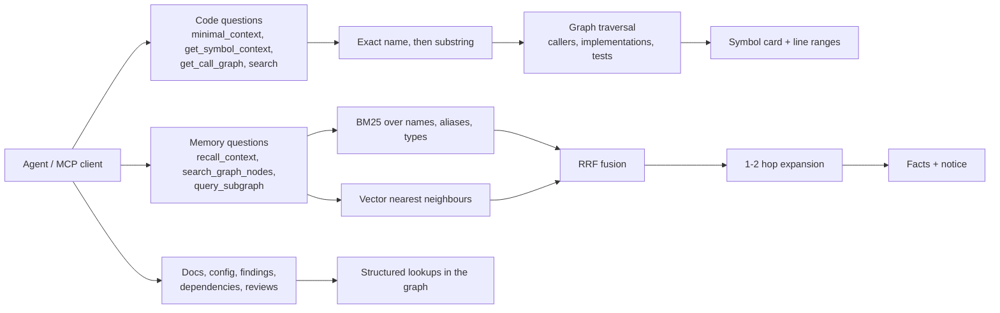
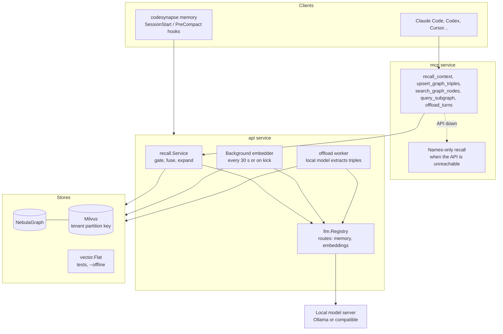
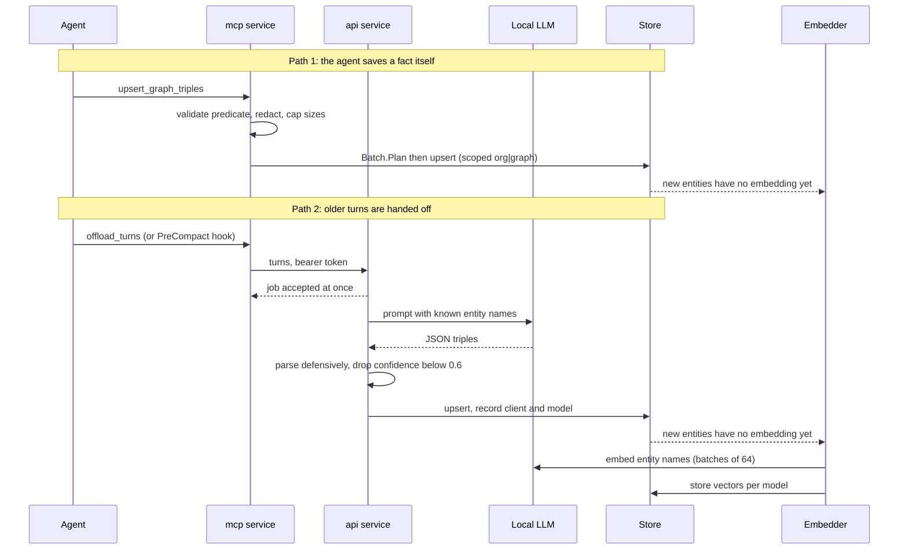
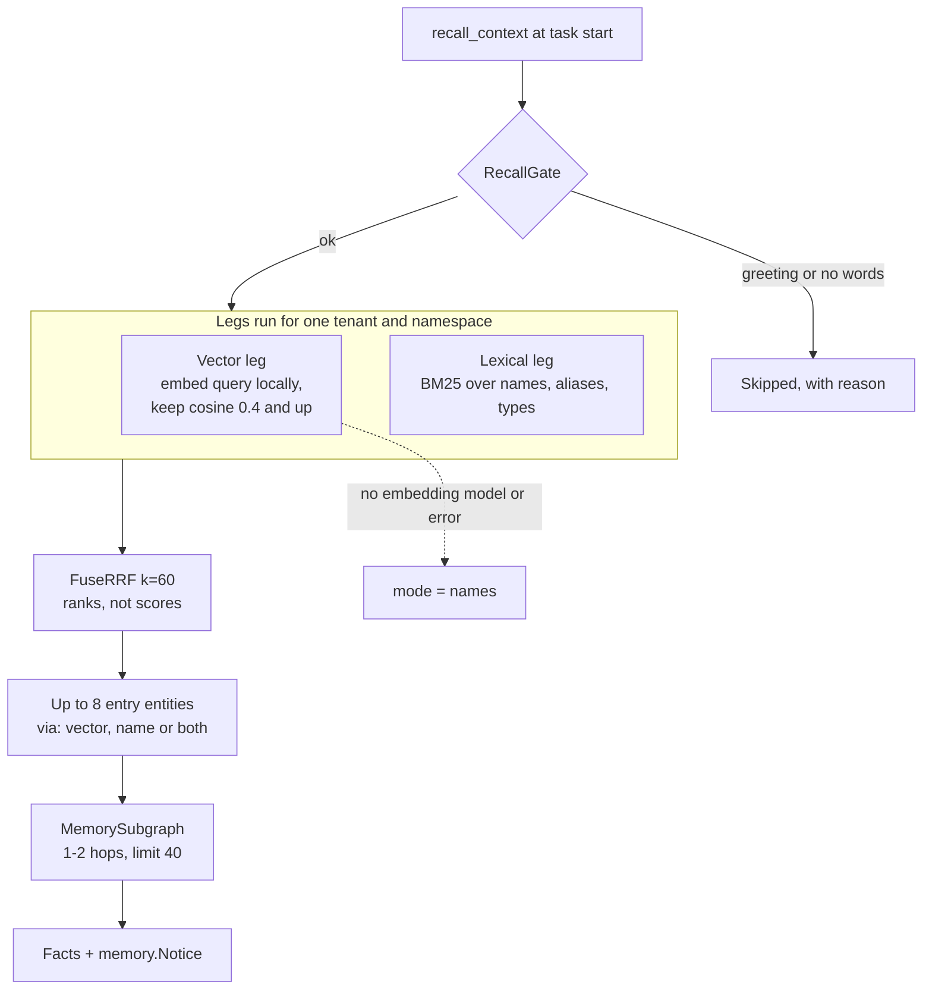
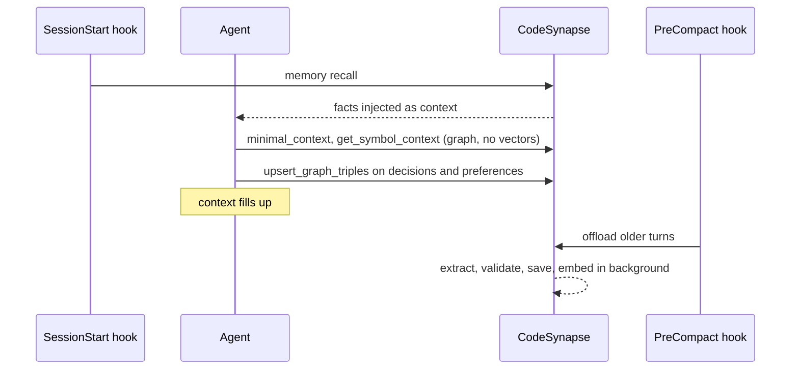

# Retrieval, vectors and agent memory

!!! tip "In plain words"
    How CodeSynapse finds the right answer for an assistant. Most answers come from the graph by exact lookups, with no guessing. Vectors (numbers that capture meaning, see [embedding](../GLOSSARY.md#ai-assistants)) are used in only a few places, mainly to recall agent memory. This page shows which is which.

CodeSynapse answers agents from a graph, not from embedded source. This page shows where retrieval is deterministic, where vectors are used, and how agent memory is written and recalled. Planned work (Milvus-side hybrid search) is marked as planned; see the [retrieval plan](../plans/RETRIEVAL_PLAN.md).

## The short version

| Question | Answer |
|---|---|
| Is code embedded? | No. Source bodies never enter the graph or a vector index. |
| What is embedded? | Only agent-memory **entity names**, by a **local** model. |
| Is this RAG? | Graph retrieval for code (exact lookup, then traversal) plus hybrid retrieval (BM25 + vectors) for memory. Both return small cards, not file text. |
| Where does the model run? | Embeddings and fact extraction use local providers only. Cloud providers are refused for these routes. |
| What if no embedding model is configured? | Recall degrades to names (BM25) and keeps working. |

## Three retrieval paths

| Data | Found by | Embedded |
|---|---|---|
| Code symbols, files | exact identifier, then substring, then traversal | no |
| Doc sections, config entries, commits, reviews | name and path lookup in the graph | no |
| Dependencies, findings | structured filters | no |
| Agent memory entities | BM25 and vector similarity, fused | names only |

The reason for this split is [ADR 0001](../adr/0001-search.md): search stays inside the stores that hold the data, so tenant filters travel with the query and revoking access takes effect on the next request.

## Components

- **Store interface.** `store.MemoryStore` exposes `MemoryLexical`, `MemoryNearest` and `MemorySubgraph`. NebulaGraph pairs with Milvus through `vector.Index` (vector length checked against `memory.MaxDimensions`). The in-memory store uses `vector.Flat`. All three pass the same contract tests.
- **Embedding model is part of the key.** Vectors are stored per model name, so changing `embedding_model` does not mix dimensions; entities without a current embedding are picked up again by the embedder.
- **Source of vectors.** Only the provider routed to `embeddings` that has an `embedding_model` and is local (`llm.Registry.EmbeddingProvider`). Inputs pass `redact.Free` in the registry.

## Writing memory

Two paths lead to the same validated write.

Rules that apply on both paths: predicates are `UPPER_SNAKE_CASE`, names are redacted and capped at 120 characters, each repository holds at most 10,000 facts and 5,000 entities, and turns are held in memory only until the job ran. Details are in [Agent memory](../features/memory.md).

## Recalling memory

- **Fusion on ranks.** BM25 values and cosine similarities have no common scale, so only ranks are fused. An entity found by both legs scores higher and is marked `both`.
- **Why the lexical leg is in Go.** Names are short and capped at 5,000 per repository, so BM25 takes about 5 ms; it works without any embedding model; and one ranking function makes all three stores answer alike. Moving fusion into Milvus is a measured, planned extension.
- **Degradation.** No embedding model, an embedding failure, or an unreachable API each leave the lexical leg standing. The MCP service falls back to names-only recall on its own.
- **Recalled facts are data.** Every answer carries `memory.Notice`: facts may come from agents that read untrusted code, so they are never instructions.

## Where the pieces run in a session

The agent keeps the last 5 to 10 exchanges verbatim. Anything older is either already a fact or is offloaded. Code understanding never waits on memory: the graph tools answer first, memory adds decisions and conventions.

## Isolation, layer by layer

| Layer | Control |
|---|---|
| Authentication | Accounts mode needs a personal API key on every MCP call; the installation token grants no content access. |
| Namespace | Memory lives under `org\|graph`; every statement filters on `tenant_id` and `ns` first (nGQL, values in parameters). |
| Vector request | Milvus filters use `exprParams` with `tenant_id` as the partition key; values never go in the expression. |
| Vector result | `vector.Isolate` drops any hit of another tenant or namespace, even if the backend filter was wrong. |
| Search without tenant | `vector.ErrNoTenant`. |
| Output | Redacted names, bounded hits (3 to 10), bounded hops, size caps, `memory.Notice`. |

## Telemetry

Recalls are counted by tenant and mode (`names` or `hybrid`). Queries, entity names and file paths never become labels; they belong in logs.

## Planned

- Milvus `hybrid_search` (BM25 sparse plus dense, RRF in the store) once entity counts or measured lexical latency pass the ADR trigger.
- Session-scoped chat memory filters ([phase 4g](../plans/SESSION_CONTEXT_PLAN.md)).
- A published token and latency benchmark. The only measured figure so far is the symbol-card result on Go standard-library sources in the retrieval plan, which does not cover memory.
