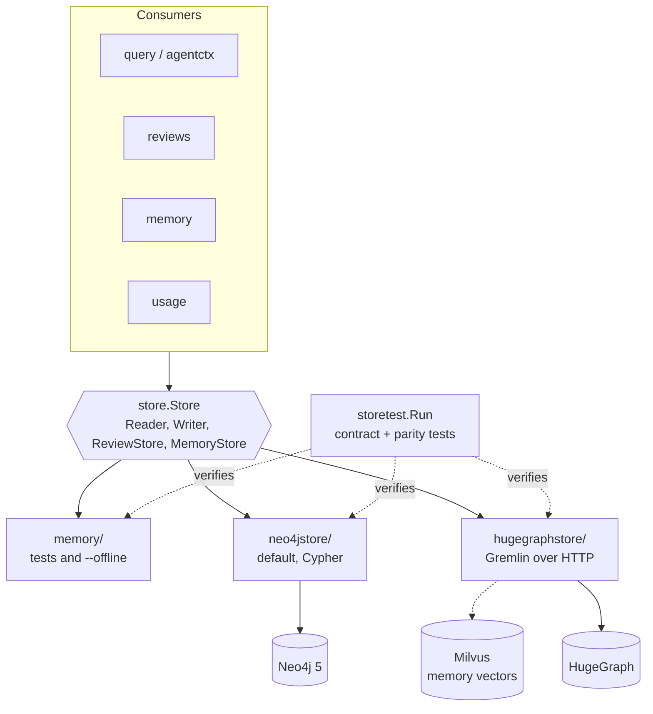

# Stores and backends

All persistence goes through the `store.Store` interface in `internal/store`. Three implementations must behave identically.



Select the backend with `CODESYNAPSE_GRAPH_BACKEND` (`neo4j` default, or `hugegraph`).

| | memory | neo4jstore | hugegraphstore |
|---|---|---|---|
| Query language | Go | Cypher (values as parameters) | Gremlin (constant scripts, values in `bindings`) |
| Use | Unit tests, `--offline` | Default deployment | Apache-2.0 alternative that scales out |
| Vectors | `vector.Flat` in process | Neo4j vector index | Milvus REST v2 |
| Licence | in repo | Community is GPL-3.0 | Apache-2.0 |

## Why contract tests matter

`storetest.Run` is the single definition of correct behaviour. `just test-integration` runs it against the compose Neo4j; `just test-hugegraph` runs it, and `TestParityWithReference`, against throwaway HugeGraph and Milvus containers. A new `store.Reader` method is not done until all three pass.

## Backend-specific rules

**Neo4j**

- Labels, relationship types, depth and ORDER BY are interpolated only from `model` allowlists, `store.ClampDepth` or the `metricCypher` table.
- The vector index length is the single interpolated value, an int checked against `memory.MaxDimensions`.

**HugeGraph**

- Vertex IDs are hashed (128-byte cap), write batches are size-bounded (Gremlin's 64 KB request default) and scripts read before they write.
- Gremlin-groovy executes code on the server, so HugeGraph always runs with a password, is never published to the host, and no raw-Gremlin tool exists.
- Statistics rules live once in `store.StatsBuilder`; HugeGraph aggregates groups server-side and feeds them through it.

**Milvus**

```mermaid
flowchart LR
    q[Query text] --> emb[Local embedding model]
    emb --> search[Search with tenant_id partition key<br/>+ exprParams template]
    search --> iso[vector.Isolate<br/>drop any hit of another tenant or namespace]
    iso --> out[Hits]
    notenant[No tenant] -. vector.ErrNoTenant .-> search
```

Only entity names are embedded, and only by a local model.

## Scoping

`store.ForRepository` wraps a store so node IDs, graph traversals and contextual answers are fenced to one repository. MCP and API both use it, so a crafted ID from another repository cannot be read.

## Limits

`store.MaxLimit`, `store.MaxDepth`, request body caps and query timeouts apply everywhere. New endpoints keep them.
