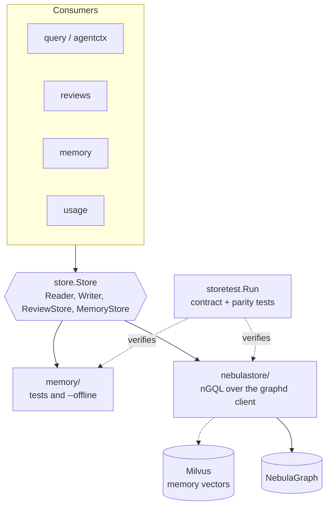
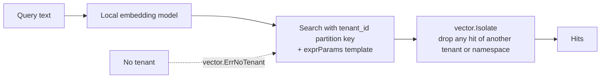

# Stores and backends

All persistence goes through the `store.Store` interface in `internal/store`. Two implementations must behave identically: NebulaGraph in production and an in-memory twin for tests and offline use.

| | memory | nebulastore |
|---|---|---|
| Query language | Go | nGQL (constant statements, values in parameters) |
| Use | Unit tests, `--offline` | Every deployment |
| Vectors | `vector.Flat` in process | Milvus REST v2 |
| Licence | in repo | Apache-2.0 |

Neo4j was supported until October 2026 and HugeGraph until the same month: both were removed so there is one production backend to keep correct. Graphs are not migrated, so an upgraded installation re-indexes. Reviews, curated records and agent memory live in the same graph, so they start empty too (see [Upgrading](../operations/upgrading.md)).

## Why contract tests matter

`storetest.Run` is the single definition of correct behaviour. `just test-nebula` runs it against throwaway NebulaGraph and Milvus containers; the memory store runs it in `just test`. A new `store.Reader` method is not done until both pass.

## Backend-specific rules

**NebulaGraph**

- Statements are constants; values travel as parameters and tags, edge types and columns are quoted from allowlists. nGQL has no parameters for vertex IDs, so an ID is written into the text as `literal(vid(prefix, id))`: one lowercase letter plus 32 hex characters of a hash, and a panic on anything else. This is the one documented exception to "values only in parameters".
- NebulaGraph has no transactions. Replacing a repository takes a lease (`UPSERT ... WHEN`), writes in place stamped with a run, then deletes the rows of other runs; readers filter on the live run, so they see the old or the new graph, never a mix. A crashed run is cleaned up by the next one.
- A composite index misses rows whose later columns are NULL, so indexed columns are `NOT NULL DEFAULT`.
- Schema changes reach graphd and storaged on their heartbeat (2 s in the shipped stack); `ensure schema` waits for them.
- Authentication is always on and the root password is set at first start (`NEBULA_PASSWORD`, at most 24 characters). graphd is never published to the host and no raw-nGQL tool exists.
- Statistics rules live once in `store.StatsBuilder`; the store feeds it grouped counts.
- Partitions and replicas of a new space come from `CODESYNAPSE_NEBULA_PARTITIONS` and `CODESYNAPSE_NEBULA_REPLICAS`, set by the chart's `nebula.space` (a space is created once; changing them later does not reshape it).

**Milvus**

Only entity names are embedded, and only by a local model.

## Scoping

`store.ForRepository` wraps a store so node IDs, graph traversals and contextual answers are fenced to one repository. MCP and API both use it, so a crafted ID from another repository cannot be read.

## Limits

`store.MaxLimit`, `store.MaxDepth`, request body caps and query timeouts apply everywhere. New endpoints keep them.
