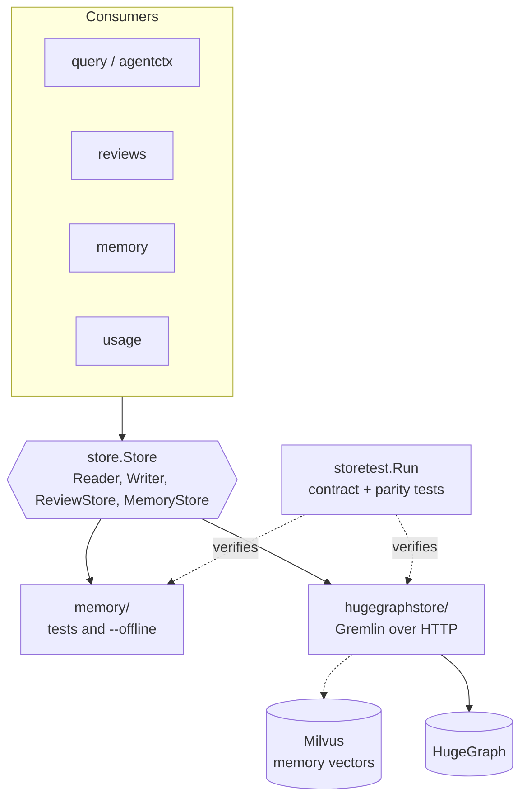
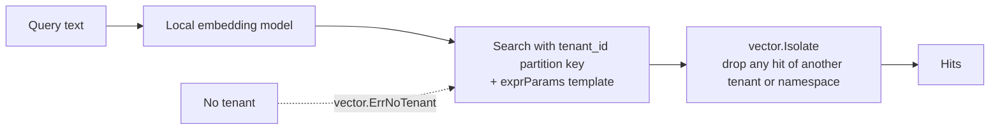

# Stores and backends

All persistence goes through the `store.Store` interface in `internal/store`. Two implementations must behave identically: HugeGraph in production and an in-memory twin for tests and offline use.

| | memory | hugegraphstore |
|---|---|---|
| Query language | Go | Gremlin (constant scripts, values in `bindings`) |
| Use | Unit tests, `--offline` | Every deployment |
| Vectors | `vector.Flat` in process | Milvus REST v2 |
| Licence | in repo | Apache-2.0 |

Neo4j was supported until October 2026. It was removed so the whole data path is Apache-2.0 and there is one production backend to keep correct; graphs are not migrated, so an upgraded installation re-indexes.

## Why contract tests matter

`storetest.Run` is the single definition of correct behaviour. `just test-hugegraph` runs it, and `TestParityWithReference`, against throwaway HugeGraph and Milvus containers; the memory store runs it in `just test`. A new `store.Reader` method is not done until both pass.

## Backend-specific rules

**HugeGraph**

- Vertex IDs are hashed (128-byte cap), write batches are size-bounded (Gremlin's 64 KB request default) and scripts read before they write.
- Gremlin-groovy executes code on the server, so HugeGraph always runs with a password, is never published to the host, and no raw-Gremlin tool exists.
- Statistics rules live once in `store.StatsBuilder`; HugeGraph aggregates groups server-side and feeds them through it.
- Indexing replaces a repository's graph in one transaction, so its old and new edges must fit the server's `edge.tx_capacity` and `vertex.tx_capacity`. HugeGraph's default of 10,000 is too small for most repositories; the compose service sets 1,000,000, the most HugeGraph accepts. If you run your own HugeGraph, set both options on the server and `CODESYNAPSE_HUGEGRAPH_TX_CAPACITY` to the same value for `api` and `mcp`. A replacement that does not fit is refused before anything is written, and the error names the setting. At 1,000,000 that is roughly a repository of 500,000 edges; larger ones cannot be indexed yet.

**Milvus**

Only entity names are embedded, and only by a local model.

## Scoping

`store.ForRepository` wraps a store so node IDs, graph traversals and contextual answers are fenced to one repository. MCP and API both use it, so a crafted ID from another repository cannot be read.

## Limits

`store.MaxLimit`, `store.MaxDepth`, request body caps and query timeouts apply everywhere. New endpoints keep them.
