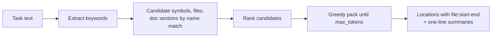
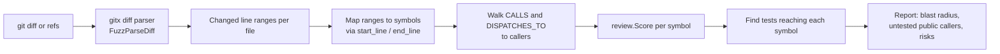

# Agent context (MCP)

The MCP server (`services/mcp`) gives assistants small composite answers. Few tools beat many: every tool definition costs every agent context on every turn.

## Recommended agent workflow


## Tool map

| Need | Tool | Implementation |
|---|---|---|
| Where to start for a task | `minimal_context` | `agentctx.MinimalContext`: keyword extraction, ranking, greedy packing to `max_tokens` |
| Symbol card, risk, callers, callees, tests | `get_symbol_context` | `agentctx.SymbolContext` |
| Call tree up or down, depth up to 4 | `get_call_graph` | `agentctx.CallGraph` |
| Concrete types behind an interface | `get_implementations` | `agentctx.Implementations` |
| Blast radius of a diff | `get_pr_context` | `agentctx.PRContext` on `review.Analyze` |
| File structure without opening it | `file_outline` | `query.Outline` |
| YAML and docs structure | `get_config_entries`, `get_doc_section` | config and docs nodes |
| Security | `security_report`, `security_symbols`, `rule_guide` | `internal/security` |
| Cleanup, licences, metrics | `unused_code`, `license_report`, `repo_metrics`, `hotspots` | `cleanup`, `license`, `metrics` |
| Repository discovery | `repo_list`, `search_all_repos`, `repo_overview`, `repo_status` | `query` |
| Memory | `recall_context`, `upsert_graph_triples`, `search_graph_nodes`, `query_subgraph`, `offload_turns` | `internal/memory` |
| Reviews | `submit_review`, `update_review_comment`, `list_reviews`, `get_review` | `internal/reviews` |

Prompts: `code-review`, `security-triage`, `briefing`, plus the refactor, PR-impact, onboarding, bug-investigation, reuse-first, dependency-review and context-offload prompts described in the [Agent guide](../AGENT_GUIDE.md).

## minimal_context



The agent reads only the returned ranges instead of whole files.

## Risk scoring

`review.Score` is a transparent additive 0 to 100 score. Every point comes with a reason string, so reviewers and agents can see why a symbol scored high.

| Factor | Points |
|---|---|
| Direct callers | x3, max 25 |
| Transitive impact | max 20 |
| Exported | +10 |
| Complexity | +5 / +10 / +15 |
| Security tags | +15 high-risk, +8 other, max 30 |
| No test reaches the symbol | +15 |

Levels: `low` < 20 <= `medium` < 40 <= `high` < 60 <= `critical`.

## Diff impact



Pass `diff` rather than refs whenever possible; refs only work for repositories CodeSynapse has cloned or mounted. User revisions are validated with `gitx.ValidateRev`.

## Usage counters

Unless `--record-usage=false`, the server adds daily aggregates per repository, tool and client (calls, errors, response size, latency) to `:McpUsage` nodes for the Statistics page. Only the `repo` argument is read. Other arguments and results are measured, never stored. Data older than 180 days is pruned.

## Connecting an agent

```sh
just mcp          # registers with Claude Code, Codex, Gemini, OpenCode, Cursor
just mcp-config   # prints a JSON client config for the running stack
```

Claude Code connects through a local per-chat bridge; see [Claude Code bridge](../operations/claude-code-bridge.md).

Without a database, the server can index one directory into memory at startup (`serve --offline .`), which is what this repository's `.mcp.json` does.
