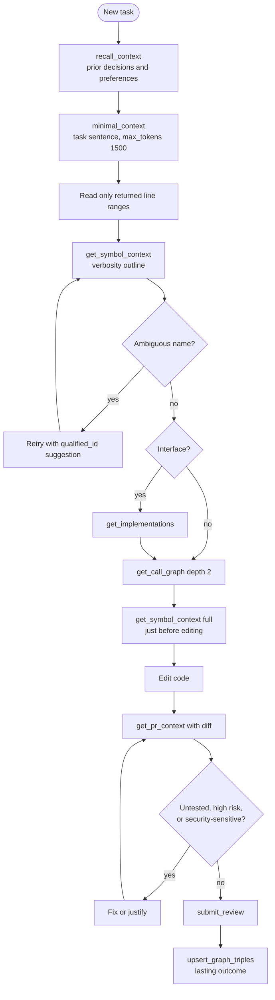
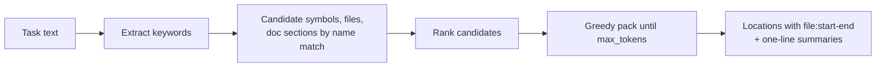
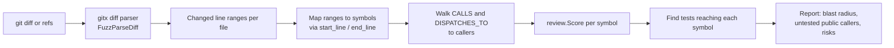

# Agent context (MCP)

!!! tip "In plain words"
    This page is about how a coding assistant (an "agent") asks CodeSynapse questions. Instead of reading whole files, the agent calls a few small tools (see [MCP](../GLOSSARY.md#ai-assistants) in the glossary) and gets a short answer. Fewer, bigger tools are better, because an agent has to carry every tool's description in its working memory on every turn.

The MCP server (`services/mcp`) gives assistants small composite answers. Few tools beat many: every tool definition costs every agent context on every turn.

## Recommended agent workflow

## Tool map

| Need | Tool | Implementation |
|---|---|---|
| Where to start for a task | `minimal_context` | `agentctx.MinimalContext`: keyword extraction, ranking, greedy packing to `max_tokens` |
| Symbol card, risk, callers, callees, tests | `get_symbol_context` | `agentctx.SymbolContext` |
| Call tree up or down, depth up to 4 | `get_call_graph` | `agentctx.CallGraph` |
| Concrete types behind an interface | `get_implementations` | `agentctx.Implementations` |
| Blast radius of a diff | `get_pr_context` | `agentctx.PRContext` on `review.Analyze` |
| File structure without opening it | `file_outline` | `query.Outline` |
| YAML and docs structure | `get_config_entries`, `get_doc_section` | config and docs nodes |
| Security | `security_report`, `security_symbols`, `rule_guide` | `internal/security` |
| Cleanup, licences, metrics | `unused_code`, `license_report`, `repo_metrics`, `hotspots` | `cleanup`, `license`, `metrics` |
| Repository discovery | `repo_list`, `search_all_repos`, `repo_overview`, `repo_status` | `query` |
| Memory | `recall_context`, `upsert_graph_triples`, `search_graph_nodes`, `query_subgraph`, `offload_turns` | `internal/memory` |
| Reviews | `submit_review`, `update_review_comment`, `list_reviews`, `get_review` | `internal/reviews` |

Prompts: `code-review`, `security-triage`, `briefing`, plus the refactor, PR-impact, onboarding, bug-investigation, reuse-first, dependency-review and context-offload prompts described in the [Agent guide](../AGENT_GUIDE.md).

## minimal_context

The agent reads only the returned ranges instead of whole files.

## Risk scoring

`review.Score` is a transparent additive 0 to 100 score. Every point comes with a reason string, so reviewers and agents can see why a symbol scored high.

| Factor | Points |
|---|---|
| Direct callers | x3, max 25 |
| Transitive impact | max 20 |
| Exported | +10 |
| Complexity | +5 / +10 / +15 |
| Security tags | +15 high-risk, +8 other, max 30 |
| No test reaches the symbol | +15 |

Levels: `low` < 20 <= `medium` < 40 <= `high` < 60 <= `critical`.

## Diff impact

Pass `diff` rather than refs whenever possible; refs only work for repositories CodeSynapse has cloned or mounted. User revisions are validated with `gitx.ValidateRev`.

## Usage counters

Unless `--record-usage=false` (or `CODESYNAPSE_MCP_USAGE=false`), the server adds daily aggregates per repository, tool and client (calls, errors, response size, latency) to `:McpUsage` nodes for the Statistics page. Only the `repo` argument is read. Other arguments and results are measured, never stored. Data older than 180 days is pruned.

## Connecting an agent

MCP tool execution requires PostgreSQL accounts, a personal organisation API key and an immutable chat ID supplied by the calling runtime. The installation token alone cannot execute tools. Offline CLI indexing still works without accounts; MCP tools fail closed without the execution-session registry.

**Codex and Cursor, CLI and desktop:** run `CODESYNAPSE_MCP_TOKEN='<personal key>' codesynapse mcp install --yes --only claude,codex,cursor` with a build containing the runtime adapters (after v0.0.4). The installer configures bridges and lifecycle hooks; restart clients and review/trust the hooks. Codex uses native per-call thread metadata. Cursor desktop matches native call IDs to its hooks; Cursor CLI chats start with `codesynapse cursor` to bind the runtime-created chat automatically. See [assistant setup and compatibility](../operations/assistant-hooks.md).

**Claude Code:** sign in to the dashboard, create a key under Settings → API keys, then run `CODESYNAPSE_MCP_TOKEN=<key> just mcp`. This installs the `codesynapse` binary (`go install`) and registers it as a stdio server that Claude Code starts once per chat (`codesynapse mcp bridge`). Claude Code gives that process the chat's ID; the bridge registers it and forwards every MCP request to `http://localhost:8090/mcp` with the key and both session headers. The key is stored in your user config folder (0600), not in Claude Code's settings. Claude Code keeps the process, and so the ID, across `/compact` and `/clear`; start a new chat for a new session. Installing without a checkout, remote servers and troubleshooting: [Claude Code bridge](../operations/claude-code-bridge.md).

**Other clients:** `just mcp` also writes connection settings for Codex, Gemini, OpenCode and Cursor, but supplies no chat identity and registers no session. Before the first tool call, a runtime-aware launcher or client integration must:

1. Read the existing thread ID from its runtime and register it with `POST /api/v1/execution/sessions`, using the personal key and body `{"session_id":"<runtime-provided thread ID>"}`.
2. Send that same value in both `X-CodeSynapse-Session` and `X-CodeSynapse-Parent-Session` on every MCP HTTP request, together with `Authorization: Bearer <personal key>`.
3. Keep the identity unchanged across reconnects, compaction and delegated work. Each new chat needs its own runtime-provided ID. Do not generate an ID inside a tool, substitute an MCP transport ID or share one static value across chats.

**Codex:** the CLI's `mcp add` supports the URL and bearer-token environment variable but has no HTTP header setter, so its installer does not complete runtime-header setup. Configure headers through a supported client configuration or runtime integration and verify that they reach the server. See the [runtime contract and client limitations](../AGENT_GUIDE.md#runtime-session-setup).

**Stdio:** launch one MCP server process per chat, with `CODESYNAPSE_DATABASE_URL`, the personal key in `CODESYNAPSE_API_TOKEN`, and the already-registered primary and parent IDs in `CODESYNAPSE_SESSION_ID` and `CODESYNAPSE_PARENT_SESSION_ID`. Both IDs must match. A process cannot switch to another chat; the server rechecks credentials and registration on each tool call.

The repository ships no `.mcp.json`: a project-scoped entry would override the user-scope bridge in Claude Code. `codesynapse mcp install --only project` writes one that starts `codesynapse mcp bridge` (the binary must be on `PATH`), for clients that pass their chat ID in `CODESYNAPSE_SESSION_ID` or `CLAUDE_CODE_SESSION_ID`.

Once connected, call `repo_list` or `search_all_repos`, then pass an authorised `repo` to other tools. Cloned repositories use names such as `owner/name`; mounted folders and older indexes can have plain names.

Write tools are limited to reviews, explicitly requested durable memory, session offloading and catalog proposals/annotations; none edits source code. `CODESYNAPSE_MCP_REVIEWS=false` disables the review tools and `CODESYNAPSE_ALLOW_MEMORY=false` the memory tools. Without a database, `just dev-mcp` serves an in-memory graph of a checkout on stdio for development.
