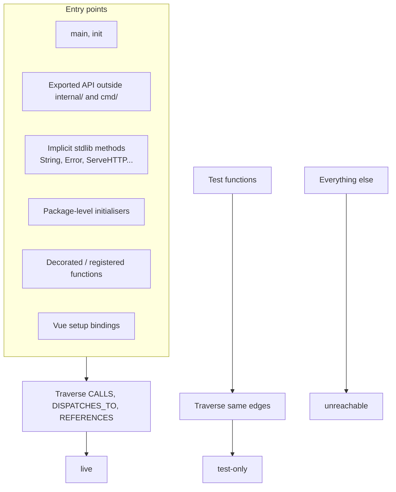
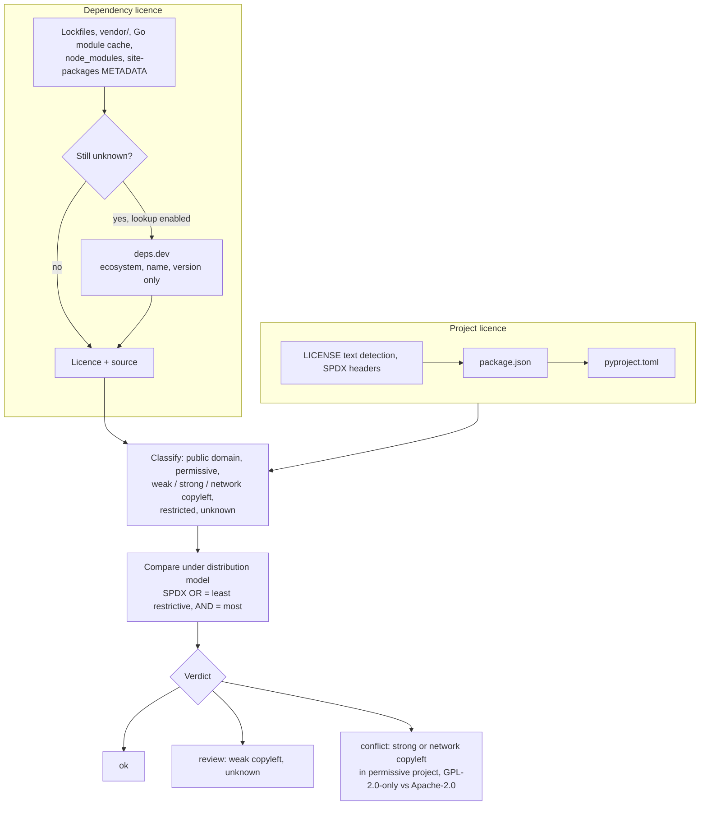

# Cleanup and licences

Both reports are computed at ingest on the complete graph and stored, so they cover everything and never hit `store.MaxLimit`.

## Unused code

`internal/cleanup` computes reachability from real entry points.



Each function and module node carries a `liveness`. Packages only tests use are test support and not counted.

The report lists:

- functions with confidence and security relevance (security-relevant dead code first);
- files where nothing is live;
- unused direct Go modules, with the CVEs removing them eliminates;
- unused Helm values and template defines;
- a safe-removal checklist.

```sh
codesynapse cleanup .
```

Also available as the **Cleanup** page and the `unused_code` MCP tool (`security_only`, then `min_confidence: "high"`).

## Licences

`internal/license` checks every dependency's licence against the repository's own.



Development-only dependencies turn conflicts into reviews. Every verdict carries its reason and the licence's source. This is guidance, not legal advice.

```sh
codesynapse licenses .                                      # Markdown
codesynapse licenses . --license-lookup --fail-on conflict  # CI gate
```

`--license-lookup` (or `CODESYNAPSE_LICENSE_LOOKUP=true`) is what sends package names and versions to deps.dev; without it, nothing leaves the machine.
