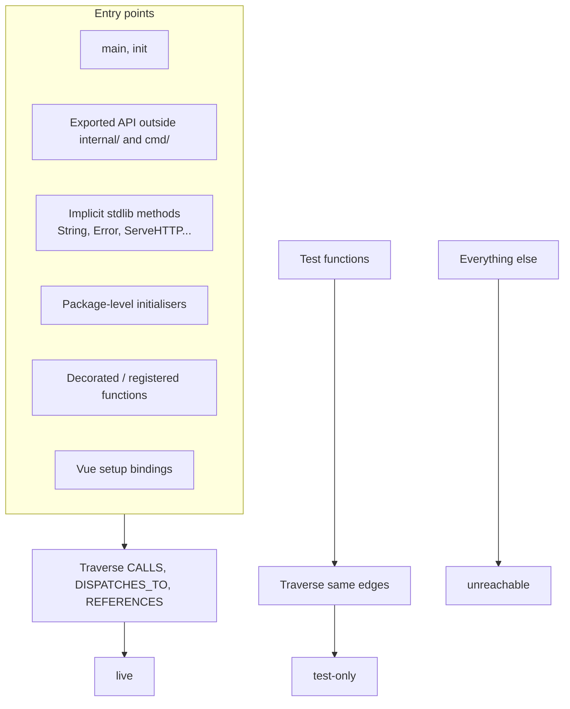
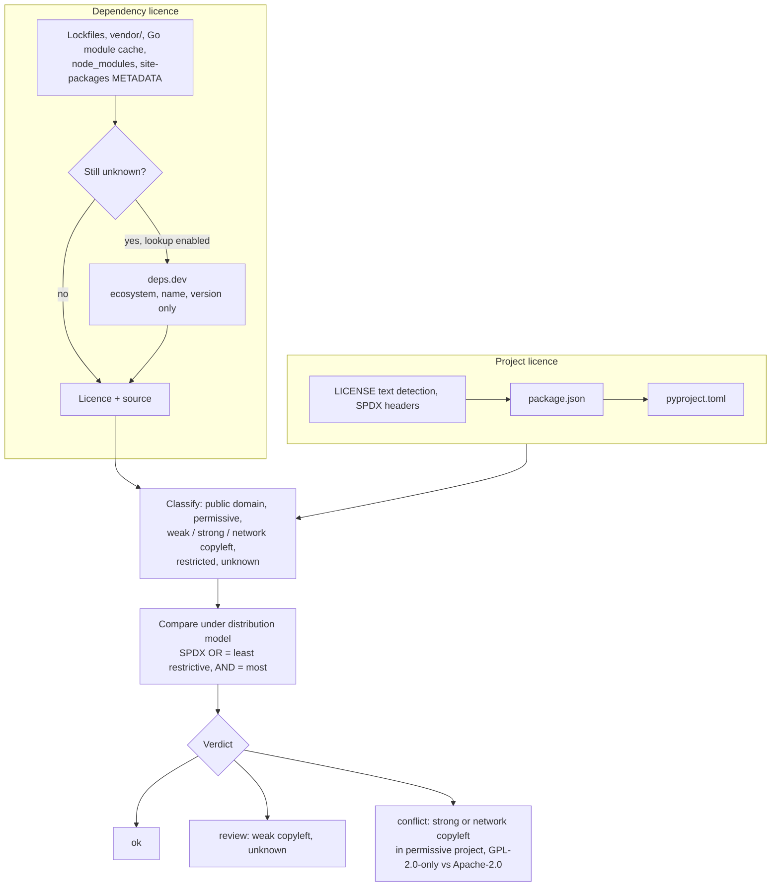

# Cleanup and licences

Both reports are computed at ingest on the complete graph and stored, so they cover everything and never hit `store.MaxLimit`.

## Unused code

`internal/cleanup` computes reachability from real entry points.



Each function and module node carries a `liveness`. Packages only tests use are test support and not counted.

The report lists:

- functions with confidence and security relevance (security-relevant dead code first);
- files where nothing is live;
- unused direct Go modules, with the CVEs removing them eliminates;
- unused Helm values and template defines;
- a safe-removal checklist.

```sh
codesynapse cleanup .
```

Also available as the **Cleanup** page and the `unused_code` MCP tool (`security_only`, then `min_confidence: "high"`).

## Licences

`internal/license` checks every dependency's licence against the repository's own.



Development-only dependencies turn conflicts into reviews. Every verdict carries its reason and the licence's source. This is guidance, not legal advice.

```sh
codesynapse licenses .                                      # Markdown
codesynapse licenses . --license-lookup --fail-on conflict  # CI gate
```

`--license-lookup` (or `CODESYNAPSE_LICENSE_LOOKUP=true`) is what sends package names and versions to deps.dev; without it, nothing leaves the machine.

## Dependency review page

**Dependency review** (per repository, under Dependencies and Licences) puts the packages that need a decision in one table: known advisories, licences to check and dependencies nothing imports. Each row shows the columns an agent-run review reports: dependency and version, how it was introduced, usage, licence, advisory, a proposed action and a verified-outcome column.

- **Introduced by** says "direct" for packages in your own manifest. For indirect packages it shows the shortest chain from a dependency you declared ("via a > b") and how many of your dependencies lead to it, so the fix is usually to upgrade the first link. Where no path is known the row says so and copies the command that finds it (`go mod why -m`, `npm explain`, `pipdeptree -r -p`).
- **Usage** comes from reachability for advisories (Go: your code calls a vulnerable symbol, imports the package, or only requires it; npm and PyPI: a source file imports the package or none does) and from the unused-modules report.
- **Proposed action** is a suggestion from the data: remove an unused dependency, upgrade to the fixed version (marked urgent when your code calls the vulnerable symbol), replace or mitigate when no fix exists, ask about a licence conflict. Licence findings are flags for review, not legal findings.
- **Verified outcome** always starts as "Not verified": run the tests, build and scans after a change and Sync again.
- Below the table the page lists the package-manager commands for the ecosystems the repository uses, and the text to give an agent to run the full `dependency-review` prompt (any language, with smaller-alternative checks).

CodeSynapse reads go.mod and npm and PyPI lockfiles only; a clean page is not proof that a project is free of vulnerabilities or compliant with a licence policy.

### Dependency paths

At ingest, every indirect module gets `via` (the shortest chain of modules from a declared dependency) and `roots` (how many declared dependencies reach it).

| Ecosystem | Where the edges come from |
|---|---|
| Go | `go list -deps -test` per go.mod: each import that crosses from one module into another is an edge. This is what the build uses, it works offline once dependencies are in the module cache, and it needs the local Go toolchain. A module that cannot be listed contributes what loaded. |
| npm | `dependencies` and `optionalDependencies` of each `package-lock.json` entry (lockfile v2 and v3) |
| Python | `dependencies` of `uv.lock` and `[package.dependencies]` of `poetry.lock` |

Not covered yet: yarn and pnpm lockfiles, `requirements.txt`, Pipfile.lock and lockfile v1 carry no edges, so their indirect packages show no path. Paths are by package name: when npm installs two versions of a package they share one path. `security_report` returns `via` and `roots` for each vulnerability.
