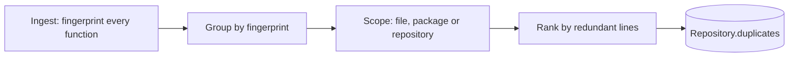
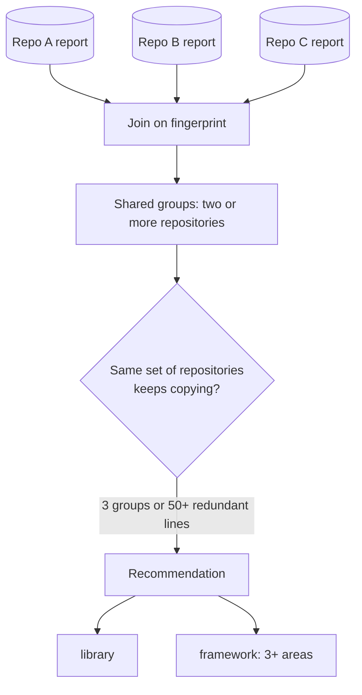

# Duplicate and shared code

Code that exists twice has to be read, tested, secured and fixed twice, and the copies drift apart. CodeSynapse finds it inside one repository and across the repositories you can see, and recommends where a shared library or framework would pay off.

## What counts as a duplicate

Each Go function or method of at least 6 lines and 5 statements gets a **structural fingerprint** at ingest (`Node.CloneHash`). It is computed from the type-checked syntax tree:

| Abstracted (copies still match) | Kept (copies must agree) |
|---|---|
| Names of parameters and local variables | Functions and methods called |
| Literal values (only their kind is kept) | Types, struct fields, imported packages |
| Comments and formatting | Operators and control flow |
| The receiver's type | Statement structure and order |

Tests and generated files are skipped. No source is stored: only the hash, the location and the size.

!!! note "What it does not find"
    Edited copies (a line added or changed) have a different structure and are not matched. Python, JavaScript, TypeScript and Vue are not fingerprinted yet. Small functions (getters, one-line wrappers) are ignored on purpose.

## Inside one repository

A group lists every copy with file and lines. **Redundant lines** are the lines left when one copy is kept. The scope says how to fix it:

- **file:** extract a helper in the same file;
- **package:** extract a shared function;
- **repository:** the copies are in different packages, so move one maintained copy into a package both import.

Where to look: the **Duplicates** tab under Code health on each repository, the `duplicate_code` MCP tool, or `codesynapse duplicates .`.

## Across repositories

Each repository's report keeps the fingerprints of its largest candidates (up to 3,000). When you open **Shared code**, the API compares the reports of the repositories **you may see**; nothing else is read, so one organisation never sees another's code.

Groups found in the same set of repositories are bundled into one recommendation:

- **library:** a shared module the repositories import, named after the most common package;
- **framework:** the same, when the copies span three or more areas (for example auth, logging, config and HTTP), which means the repositories rebuild the same foundation.

The recommendation lists candidate functions, the repositories involved and the lines saved. It is a heuristic starting point: check that the copies really mean the same thing before extracting them.

A repository whose report hit the cap is listed as partial, because copies of its smaller functions may be missing.

## Where it shows up

| Surface | Use |
|---|---|
| Dashboard, repository, Code health, Duplicates | Groups, scope and locations for one repository |
| Dashboard, Shared code | Cross-repository groups and recommendations |
| MCP `duplicate_code`, `shared_code` | Agents check before writing a helper or copying code |
| CLI `codesynapse duplicates [path...]` | One path for one repository; several paths also compare them |
| `GET /api/v1/repos/{repo}/duplicates`, `GET /api/v1/shared-code` | JSON for both |

Re-ingest (Sync) existing repositories once to create the first report.
