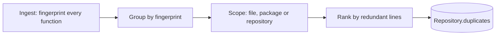
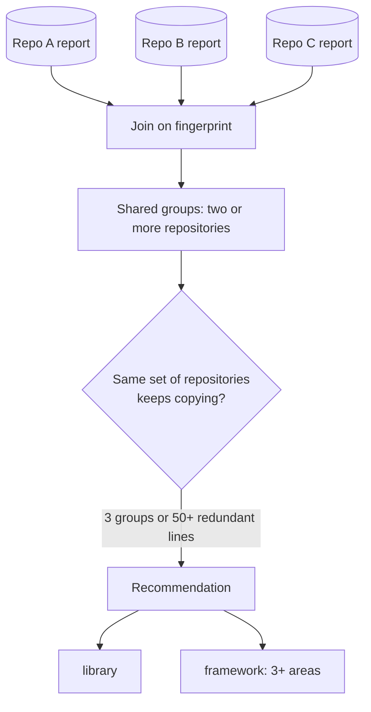

# Duplicate and shared code

Code that exists twice has to be read, tested, secured and fixed twice, and the copies drift apart. CodeSynapse finds it inside one repository and across the repositories you can see, and recommends where a shared library or framework would pay off.

## What counts as a duplicate

Each function or method of at least 6 lines and 5 statements gets a **structural fingerprint** at ingest (`Node.CloneHash`). For Go it is computed from the type-checked syntax tree. Python, JavaScript, TypeScript and Vue have no type information, so their fingerprint comes from tokens: comments, docstrings, strings and numbers are dropped, called functions and member names are kept, and every other identifier counts as a variable. They can therefore also match code that differs only in what it reads. The table describes Go:

| Abstracted (copies still match) | Kept (copies must agree) |
|---|---|
| Names of parameters and local variables | Functions and methods called |
| Literal values (only their kind is kept) | Types, struct fields, imported packages |
| Comments and formatting | Operators and control flow |
| The receiver's type | Statement structure and order |

Tests and generated files are skipped. No source is stored: only the hash, the location and the size.

!!! note "What it does not find"
    Heavily rewritten copies (below about 70% alike) are not matched, and a function written as `function f` never matches the same code written as an arrow function. Python never matches JavaScript or TypeScript; JavaScript, TypeScript and Vue can match each other. Small functions (getters, one-line wrappers) are ignored on purpose.

## Edited copies

Copies that were edited after copying (a line added, a condition changed) have a different structural fingerprint, so exact matching misses them. Each fingerprinted function also gets a **MinHash signature** of its normalised tokens (`Node.CloneSig`): 32 values of 16 bits over overlapping groups of three tokens. Two functions whose signatures agree on at least 70% of the values count as **edited copies**. Locality-sensitive hashing picks the pairs to compare, so large repositories stay fast.

- Only functions of at least 10 lines are compared, and a function less than half the size of another is never its edited copy.
- The largest variant leads a group and the others join only if they are close to it. Joining through a chain of neighbours would glue together functions that just share boilerplate.
- A near group lists every copy of every variant. Its **redundant lines** are the lines of the differing variants, each counted once, because copies inside one variant belong to an exact group. Exact and near lines are reported side by side and never added twice.
- The similarity is an estimate (about plus or minus 8 points), shown as "~88% alike".

In practice this surfaces code that was copied and drifted, for example three API handlers that read, check and write a report the same way, or two HTTP clients with the same request, retry and decode steps. Look at what differs before merging: sometimes the difference is the reason the copies exist.

## Inside one repository

A group lists every copy with file and lines. **Redundant lines** are the lines left when one copy is kept. The scope says how to fix it:

- **file:** extract a helper in the same file;
- **package:** extract a shared function;
- **repository:** the copies are in different packages, so move one maintained copy into a package both import.

Where to look: the **Duplicates** tab under Code health on each repository, the `duplicate_code` MCP tool, or `codesynapse duplicates .`.

## Across repositories

Each repository's report keeps the fingerprints of its largest candidates (up to 2,000). When you open **Shared code**, the API compares the reports of the repositories **you may see**; nothing else is read, so one organisation never sees another's code.

Exact and edited groups found in the same set of repositories are bundled into one recommendation:

- **library:** a shared module the repositories import, named after the most common package;
- **framework:** the same, when the copies span three or more areas (for example auth, logging, config and HTTP), which means the repositories rebuild the same foundation.

The recommendation lists candidate functions, the repositories involved and the lines saved. It is a heuristic starting point: check that the copies really mean the same thing before extracting them.

A repository whose report hit the cap is listed as partial, because copies of its smaller functions may be missing.

## Where it shows up

| Surface | Use |
|---|---|
| Dashboard, repository, Code health, Duplicates | Groups, scope and locations for one repository |
| Dashboard, Shared code | Cross-repository groups and recommendations |
| MCP `duplicate_code`, `shared_code` | Agents check before writing a helper or copying code |
| CLI `codesynapse duplicates [path...]` | One path for one repository; several paths also compare them |
| `GET /api/v1/repos/{repo}/duplicates`, `GET /api/v1/shared-code` | JSON for both |

Re-ingest (Sync) existing repositories once to create the first report.
