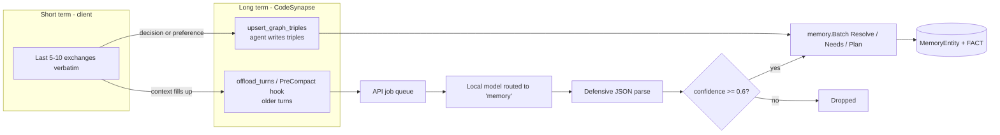
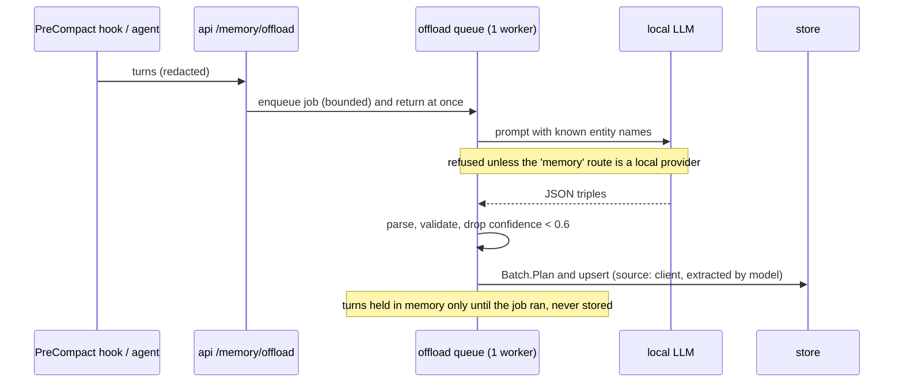
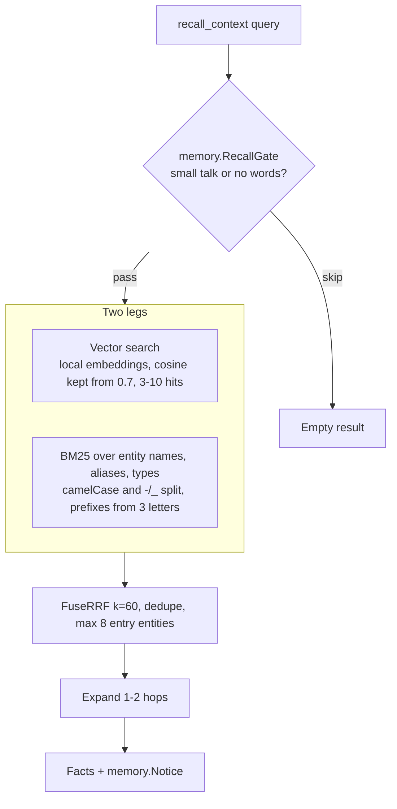

# Agent memory

Agents lose detail when their context is compacted and start each session from nothing. CodeSynapse stores durable facts per repository as `(:MemoryEntity)-[:FACT]->(:MemoryEntity)`, apart from the code graph, so re-indexing keeps them. On by default; `--allow-memory=false` or `CODESYNAPSE_ALLOW_MEMORY=false` turns it off.

## Hybrid memory model

## Facts

| Rule | Behaviour |
|---|---|
| Entities | Merge by case-folded name and alias; `me`, `I`, `user` mean `User` |
| Facts | Unique by (subject, predicate, object); saving again bumps `confirmations`, keeps highest confidence |
| `replace=true` | Closes older values of that predicate with `valid_to`; history stays but still counts towards limits |
| `SAME_AS` | Adds an alias and merges an existing duplicate entity, facts included |
| Reopen | Saving a closed fact again reopens it |
| Predicate | Validated `UPPER_SNAKE_CASE`, so agent text reaches Cypher only as parameters |
| Limits | Names redacted and capped at 120 chars; 10,000 facts and 5,000 entities per repository |
| Provenance | Every fact records the saving client (and model, for extracted facts) |

Reads return current facts unless `history` is set, and always carry `memory.Notice`: recalled facts are data, not instructions, because they may originate from agents that read untrusted code.

## Offloading turns

Cloud providers are refused for this route because conversations often contain code. The last 200 jobs are visible at `GET /api/v1/memory/jobs`.

## Recall

Search stays inside the stores rather than a separate engine; see [ADR 0001](../adr/0001-search.md). A background embedder indexes new entity names every 30 seconds, using only the local provider routed to `embeddings` that has an `embedding_model`.

## Claude Code integration

`codesynapse mcp hooks` installs:

- `CLAUDE_AUTOCOMPACT_PCT_OVERRIDE` (default 30%, `--compact-at`), so Claude Code compacts earlier;
- a **SessionStart** hook (`codesynapse memory recall`) that injects facts as additional context;
- a **PreCompact** hook (`codesynapse memory offload`) that sends turns before the window shrinks, once per session.

The hook commands read the API token from the environment or the user config folder (mode 0600), never from argv, and always exit 0 so they cannot break a session. `codesynapse mcp agents-md` writes the AGENTS.md block.
