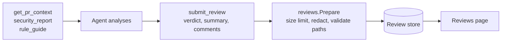
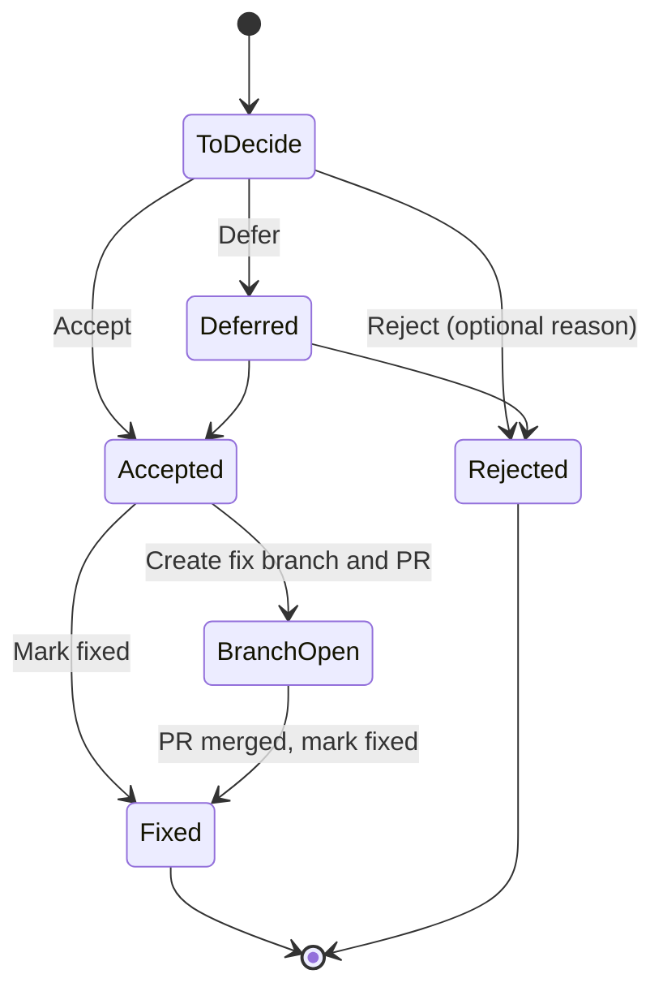

# Reviews and fix branches

## Review lifecycle

Ask your agent to review a change ("review my changes with CodeSynapse and submit the review", or the `code-review` MCP prompt). It (or the API's AI tasks) analyses the change with the graph, then records the result with `submit_review`, and the review appears on the **Reviews** page. Reviews live in the review store (`:Review` nodes), never in the code graph. Disable the review tools with `CODESYNAPSE_MCP_REVIEWS=false`.



Each comment is anchored to `file:line`, and carries severity, category, the symbol it targets and a suggested fix. File paths are repo-relative with no `..`.

## Comment decisions



The Reviews page shows progress with tabs **To decide**, **To fix**, **Later** and **Done**. Agents record the same decisions with `update_review_comment` and read the to-do list with `get_review` `status: "accepted"`.

## Fix branches

For an accepted comment on a Go function or method, **Create fix branch & PR** asks the local model routed to "Fixes" to rewrite the affected file, commits it to a new `codesynapse/fix-…` branch, pushes it and opens a draft pull request, so your CI runs on it. You review and merge the PR, then mark the comment fixed. **Fix all on one branch** does the same for every accepted item.

Off by default. Turn on with `CODESYNAPSE_ALLOW_PUSH=true` in `.env` and a token (`just git-token`) with **Contents** and **Pull requests** read and write.

```mermaid
sequenceDiagram
    participant U as User
    participant A as api (internal/fixes)
    participant W as Separate git worktree
    participant M as Model routed to 'Fixes'
    participant R as Remote

    U->>A: Create fix branch and PR for accepted comment
    A->>A: Check CODESYNAPSE_ALLOW_PUSH and fixes.protected
    A->>W: gitx worktree at the indexed commit
    A->>M: file + comment (source only if model is local or send_source)
    M-->>A: rewritten file
    A->>A: Refuse empty, unchanged, wildly different size,<br/>or files not named in comments
    A->>W: Commit to new codesynapse/fix-... branch
    A->>R: gitx.PushBranch (new branch, never forced)
    A->>R: Open draft pull request (github.com only)
    A-->>U: PR link; CI runs on it
```

### Rails

- Work happens in a separate worktree. The indexed checkout never changes.
- Only files named in accepted comments may change.
- CI definitions (`.github/`, `.gitlab-ci.yml`, Jenkinsfile, ...) and git config are never touched.
- Pushes go only to new `codesynapse/*` branches and are never forced.
- Organisation members push with the organisation's own token (`pushAuth`).
- The review must pin the current commit, and the model's answer must contain exactly one bounded Go code block. Go syntax is checked, and only the accepted comments' function bodies may change; signatures, imports, headers and other bytes are preserved. Other edits need manual handling.
- Revision, comment, permission, file-hash and commit checks run before publication.
- Route "Fixes" to a local model; `send_source: true` does not permit cloud fixes.

Workflows that run on every push run before anyone reviews the change; if that matters, limit them to pull requests. See [fix validation and retry rules](../FIX_VALIDATION.md).

## Prompt budgets

Every model call checks its final redacted request before sending. Input counts are conservative estimates, separate from billed usage; oversized requests are refused. `input_budget_policy: require_exact` refuses calls until a verified model/template counter is available. See [configuration and limits](../PROMPT_BUDGETS.md).

## Background AI reviews

In a repository's auto-sync settings, "AI-review new commits" and "AI-triage new findings" make every successful sync review the commits that arrived and triage new findings of medium severity or above. Results appear as reviews waiting for decisions. Model output is untrusted: it is parsed defensively, enums and paths validated, and text redacted before storing.
