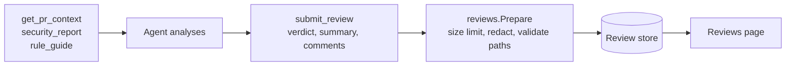
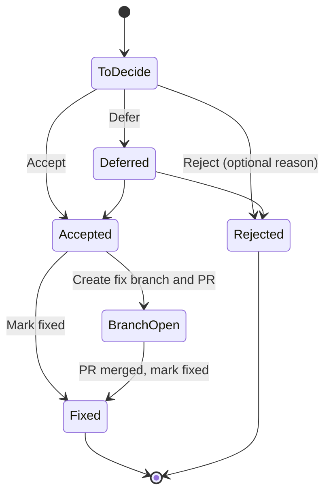

# Reviews and fix branches

## Review lifecycle

An agent (or the API's AI tasks) analyses a change with the graph, then records the result with `submit_review`. Reviews live in the review store (`:Review` nodes), never in the code graph.



Each comment is anchored to `file:line`, and carries severity, category, the symbol it targets and a suggested fix. File paths are repo-relative with no `..`.

## Comment decisions



The Reviews page shows progress with tabs **To decide**, **To fix**, **Later** and **Done**. Agents record the same decisions with `update_review_comment` and read the to-do list with `get_review` `status: "accepted"`.

## Fix branches

Off by default. Turn on with `CODESYNAPSE_ALLOW_PUSH=true` and a token with **Contents** and **Pull requests** read and write.

```mermaid
sequenceDiagram
    participant U as User
    participant A as api (internal/fixes)
    participant W as Separate git worktree
    participant M as Model routed to 'Fixes'
    participant R as Remote

    U->>A: Create fix branch and PR for accepted comment
    A->>A: Check CODESYNAPSE_ALLOW_PUSH and fixes.protected
    A->>W: gitx worktree at the indexed commit
    A->>M: file + comment (source only if model is local or send_source)
    M-->>A: rewritten file
    A->>A: Refuse empty, unchanged, wildly different size,<br/>or files not named in comments
    A->>W: Commit to new codesynapse/fix-... branch
    A->>R: gitx.PushBranch (new branch, never forced)
    A->>R: Open draft pull request (github.com only)
    A-->>U: PR link; CI runs on it
```

### Rails

- Work happens in a separate worktree. The indexed checkout never changes.
- Only files named in accepted comments may change.
- CI definitions (`.github/`, `.gitlab-ci.yml`, Jenkinsfile, ...) and git config are never touched.
- Pushes go only to new `codesynapse/*` branches and are never forced.
- Organisation members push with the organisation's own token (`pushAuth`).
- Route "Fixes" to a local model; remote providers need `send_source: true`.

## Background AI reviews

In a repository's auto-sync settings, "AI-review new commits" and "AI-triage new findings" make every successful sync review the commits that arrived and triage new findings of medium severity or above. Results appear as reviews waiting for decisions. Model output is untrusted: it is parsed defensively, enums and paths validated, and text redacted before storing.
