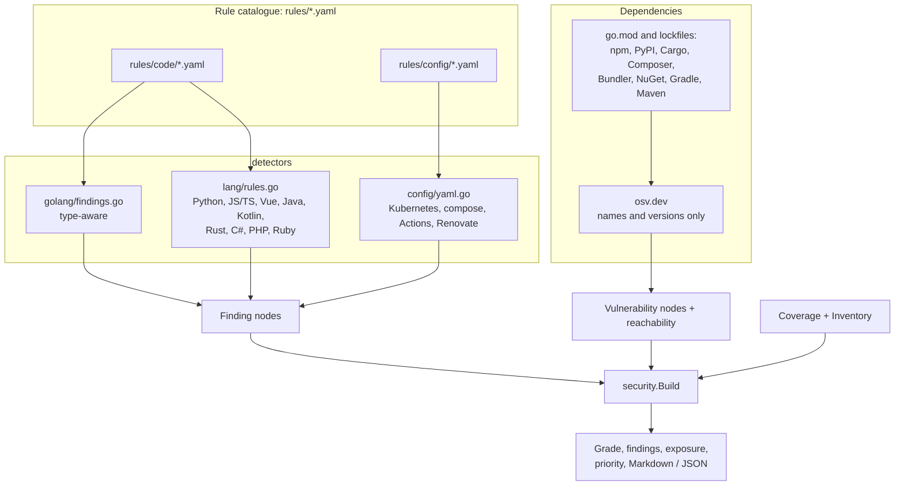
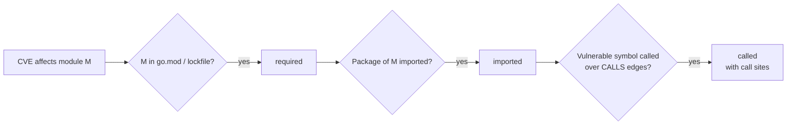

# Security review

!!! tip "In plain words"
    A security review gives a repository a grade from A to F and a list of problems ("findings"). Each finding says what is wrong, why it matters and how to fix it. The grade is only meaningful next to what was checked, so every report also says how much it covered.

`codesynapse audit`, the **Security** page and the `security_report` MCP tool grade a repository A to F and list findings. The grade only means something next to what was checked, so every report also states its coverage.

## Where findings come from



Each rule is a readable YAML file (title, severity, CWE, why, fix, vulnerable to fixed examples per language). It surfaces as **How to fix** on a finding, through `rule_guide`, and at `GET /api/v1/rules`.

## Finding categories

Findings fall into five groups. Technical terms are explained in the [glossary](../GLOSSARY.md). *CWE* is the public catalogue number for a kind of weakness. A *CVE* is a known vulnerability in a published package. *Injection* means untrusted input gets run as a command or query. Each group below starts with a short summary; the long lists that follow name exactly what is checked.

- **Code:** shell and command injection, SQL/Cypher from strings, request input reaching SQL text, process arguments, file paths and outbound URLs (Go: followed inside a function through variables, string building, `url.Parse`, body reads and JSON decoding or framework binding, and stopped by number parsing, `filepath.Base` and escaping; and across the repository's own functions: input passed to a helper that reaches a sink is reported at that sink, naming the handler and the call, and a helper's string, byte or URL result carries what it was given unless it parses it (a record looked up by the input does not); calls through the repository's interfaces apply every implementation. Calls through function values (closures, func-typed parameters and fields, method values) are followed only with `--dataflow`, to the repository functions and closures its VTA call graph resolves), disabled TLS verification, old TLS, weak hashes and ciphers, hardcoded credentials, `template.HTML` from variables, HTTP servers/clients without timeouts, request-derived paths and URLs, unbounded bodies, world-writable files, unverified JWTs, `unsafe`.
- **Configuration:** privileged pods, privilege escalation, host namespaces, `hostPath`, root users, dangerous capabilities, unpinned images, literal secrets, GitHub Actions script injection, `pull_request_target` checkouts, unpinned third-party actions, privileged compose services; in Dockerfiles and Containerfiles, a final stage that runs as root (following the stages it builds on, nonroot base images excepted), `ADD` from a URL without `--checksum`, a download piped into a shell, an unpinned base image and a literal secret in `ENV` or `ARG` (the variable is named, its value never stored); in Terraform (AWS, Google Cloud, Azure), ingress open to the internet on ports other than 80 and 443, public buckets and containers (public ACLs, public access blocks turned off, `allUsers`, anonymous container access), databases reachable from anywhere, RDS and EBS storage left unencrypted, and literal secrets in resources, providers and variable defaults. Terraform values are read as written: anything from a variable or module is not guessed.
- **Update automation:** manifests but no Renovate or Dependabot; Renovate configs that are broken, disabled, automerge without `minimumReleaseAge`, or leave actions and images unpinned.
- **Git history:** provider-shaped credentials (AWS, GitHub, Slack, OpenAI/Anthropic, Google API keys, PEM private keys) added in the last 500 commits and no longer in the checkout. Removing a credential from the code does not revoke it: it is in every clone, so the finding asks for rotation. `git log -G` selects the candidate commits with a pattern, the added lines are checked in memory, and a credential still in the checkout is left to the rules that read the checkout. Nothing of the value is stored: the finding names the kind of credential, the commit that first added it and the file and line, and tells credentials apart by a truncated hash. Documentation examples (`…EXAMPLE`) and filler are skipped; a PEM header counts only on a line of its own followed by key material.
- **Dependencies:** known CVEs with fixed version and reachability.

## Vulnerability reachability



Symbol-level reachability exists for Go. For the other ecosystems, advisories rarely list symbols, so the levels are imported (npm, PyPI, Cargo, NuGet and RubyGems, when a source file imports the package; for NuGet, a using directive whose namespace the package ID prefixes; for RubyGems, a require of the gem) or required (everything else: PHP and Java imports are not matched to Composer or Maven names). `--fail-on` gates CI on reachable vulnerabilities only.

For npm and PyPI the code graph also records which members of a package your non-test code calls through an import (`lodash.template`, `yaml.safe_load`). OSV lists no affected functions for these ecosystems, so a vulnerability stays `imported`; but when its advisory text names a member you call (the full name, or the name in backticks or with parentheses), the vulnerability gets an inferred `AFFECTS` edge to that member and the call sites show with it. It is evidence for a person or an agent to check, never a `called` verdict, and `--fail-on` ignores it. A method on a value a package returned (`yaml.load(x).items()`) is not seen.

## Priority

A finding's priority combines:

1. Severity and CWE.
2. **Exposure:** reachable from `main`, an exported API or a handler.
3. **Test context:** whether a test reaches the owning function.
4. For vulnerabilities, reachability level.

## Coverage

At ingest `security.CoverageOf` counts what rules read, and `security.Inventory` counts file kinds with no rules yet (Dockerfile, Terraform, shell, Java, ...). Both are stored on the Repository node.

| Reported as checked | Reported as not checked |
|---|---|
| Code files per language | YAML that does not parse |
| YAML files, Kubernetes resources | Helm templates whose output is not YAML |
| Workflows, Compose files | File kinds without rules |
| Helm templates (literal values) | Values set through `{{ .Values }}` |
| Dependencies | |

A repository where nothing is scannable gets **N/A**, not a grade. The report also names the commit it describes.

## Owners (CODEOWNERS)

When the repository has a CODEOWNERS file (`.github/CODEOWNERS`, `CODEOWNERS`, `docs/CODEOWNERS` or `.gitlab/CODEOWNERS`, the first found, as GitHub looks), every finding names the owners of its file, and the report counts the listed findings per owner, most severe work first, with a "no owner" row for files no rule covers. The Security page shows that as **Findings by owner** (a row filters the findings to that owner), `codesynapse audit` as a table, SARIF as a `code_owners` property, and `get_pr_context` lists the owners of the changed files as `code_owners`, the people to ask for review.

Patterns follow GitHub: gitignore style, the last matching line wins, a line without owners leaves its paths unowned, and `docs/*` covers only the files directly in `docs/`. GitLab sections are read as plain lines, without their default owners. Only `@user` and `@org/team` handles are kept; an e-mail owner is personal data and is dropped. The file is read at ingest (up to 3 MB and 1,000 rules, never through a symlink) and stored with the repository's metadata, so a change to it shows after the next sync.

## CI usage

```sh
codesynapse audit .                  # Markdown
codesynapse audit . --fail-on high   # exit 1 on high/critical (reachable vulns only)
codesynapse audit . -o json
codesynapse audit . -o sarif > codesynapse.sarif   # GitHub code scanning, IDEs
```

`--vulns=false` (or `CODESYNAPSE_VULN_SCAN=false`) keeps the scan offline. `--history N` sets how many commits are checked for removed credentials (500 by default, `0` skips it; about 1.5 s for 500 commits of this repository).

### Pre-commit gate

```sh
codesynapse audit . --changed --fail-on high             # findings in staged files only
codesynapse git-hook install . --pre-commit --fail-on high
codesynapse git-hook uninstall . --pre-commit
```

`--changed` indexes the checkout as `audit` always does, then keeps only the findings in files staged for commit (added, modified, copied or renamed) and fails on `--fail-on` as usual. The grade is left out, since it describes the whole repository. It reads the working tree, not the index: a staged file that also has unstaged changes is named on standard error. The osv.dev lookup is skipped unless `--vulns` is given explicitly, so the hook works offline. Expect a few seconds (about 5 s on this repository, most of it type-checking Go).

`git-hook install --pre-commit` writes `.git/hooks/pre-commit` (or into `core.hooksPath`) to run that check on every commit; `git commit --no-verify` skips it once. Without the `codesynapse` binary the commit goes ahead. A pre-commit hook that is not CodeSynapse's is left alone, and the error shows the line to add to it. To refuse only findings a branch introduces, rather than any finding in a touched file, use `codesynapse review --offline --fail-on-new` in CI.

### SARIF and GitHub code scanning

`-o sarif` writes SARIF 2.1.0, which GitHub code scanning, the VS Code SARIF viewer and most IDEs read. Each result says where it comes from: the rule's `source` property is "CodeSynapse built-in rule" (with the rule's title, why, fix and a link to its rule file at the release that ran) or "osv.dev advisory" (with the advisory's link). Severities map to SARIF levels (critical and high are errors, medium warnings, low and info notes) and to GitHub's `security-severity`, CWE IDs to `external/cwe/…` tags. Findings suppressed by repository policy are included with their reason as a suppression, so code scanning shows them as dismissed instead of dropping them. A `// codesynapse:ignore <rule> <reason>` comment next to a finding is a request only: it suppresses the finding when the organisation approved a configuration with `scanners.security.inline_ignores: true`, and until then the finding stays active with the request shown beside it (`ignore_request`). See [REPO_CONFIG_PLAN.md](../REPO_CONFIG_PLAN.md#inline-ignores).

Code scanning needs a place for every result: a vulnerability goes to the first call of the vulnerable symbol, otherwise to its ecosystem's manifest at the repository root (`go.mod`, `package-lock.json`, `Cargo.lock`, …). One with neither is left out and counted in the run's `vulnerabilities_without_location` property. Results carry a `partialFingerprints` value from rule, owning function and file, like the new-versus-fixed comparison of `review`, so an alert keeps its identity when code above it moves.

```yaml
permissions:
  security-events: write
steps:
  - uses: actions/checkout@v7
  - uses: actions/setup-go@v7
    with:
      go-version: stable
  - run: go install github.com/astrona-io/codesynapse/cmd/codesynapse@latest
  - run: codesynapse audit . -o sarif > codesynapse.sarif
  - uses: github/codeql-action/upload-sarif@9b3254085494b55a0f7c4c2b3d2d52cc712ce370 # v4.39.1
    with:
      sarif_file: codesynapse.sarif
      category: codesynapse
```

## Languages

| | Symbols & calls | Tests | Security rules | Dependency CVEs |
|---|---|---|---|---|
| Go | type-checked (go/types), interface dispatch | `_test.go` | ~20 rules | go.mod + stdlib, symbol-level reachability |
| Python | structural parser, imports, `self.` calls | pytest files/functions | shell, eval, pickle/yaml, SQL, TLS, JWT, secrets, debug | requirements*.txt, poetry.lock, uv.lock, Pipfile.lock |
| JavaScript / TypeScript / Vue | structural parser, ES imports/require, `this.` calls | `*.test.*`, `*.spec.*`, `__tests__` | child_process, eval, DOM XSS, `v-html`, SQL, TLS, JWT, secrets, redirects | package-lock.json, yarn.lock, pnpm-lock.yaml |
| YAML, Helm, Go templates | resources, key paths, `include`/`.Values` links | – | Kubernetes, compose, GitHub Actions, Renovate/Dependabot | – |
| Terraform (`.tf`) | blocks, labels and attributes (comments, heredocs, templates) | – | open ingress, public storage, public databases, unencrypted storage, literal secrets | – |
| Ansible | plays, roles, tasks, handlers, packages, services, vars, inventory groups and hosts (names only, never values) | – | literal secrets, unquoted variables in `shell`, `curl \| sh`, `validate_certs: false`, world-writable modes, `state: latest` | – |
| Dockerfile, Containerfile | stages and base images (continuations, `# escape=`, heredocs) | – | root user, `ADD` from URLs, `curl \| sh`, unpinned base, secrets in `ENV`/`ARG` | – |

Non-Go call edges are name-based (imports, enclosing class, names unique in the repo), so they can miss dynamic dispatch; Go keeps exact type-checked edges. Parsers are pure Go: no cgo, static binaries.

Go calls through function values (handler tables, injected functions) have no typed edge. `--dataflow` (or `CODESYNAPSE_INGEST_DATAFLOW=true`) runs an optional SSA/VTA analysis that links them, marked as `dataflow` evidence; it makes Go extraction about 40% slower and finds only targets declared in the repository. See [edge evidence](../EDGE_EVIDENCE.md).

## Adding a rule

Every rule is a readable YAML file in `rules/` with why it matters, how to fix it and vulnerable → fixed examples per language. They show up as **How to fix** on each finding, through the `rule_guide` MCP tool and at `GET /api/v1/rules`. `just rules` lists them.


