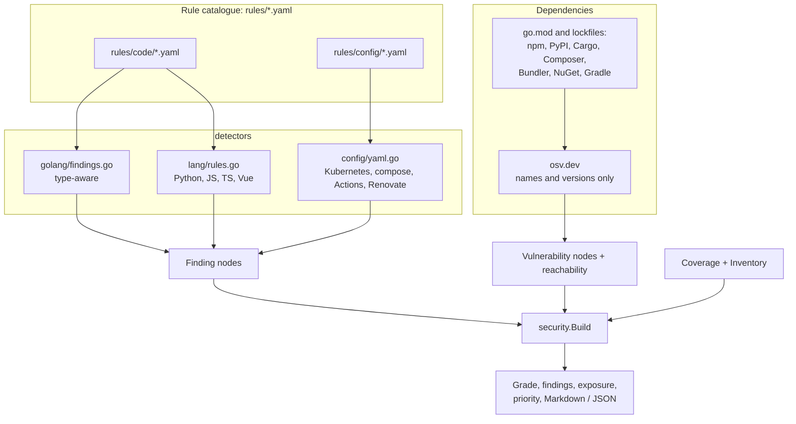
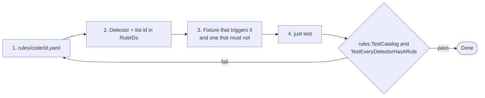

# Security review

`codesynapse audit`, the **Security** page and the `security_report` MCP tool grade a repository A to F and list findings. The grade only means something next to what was checked, so every report also states its coverage.

## Where findings come from



Each rule is a readable YAML file (title, severity, CWE, why, fix, vulnerable to fixed examples per language). It surfaces as **How to fix** on a finding, through `rule_guide`, and at `GET /api/v1/rules`.

## Finding categories

- **Code:** shell and command injection, SQL/Cypher from strings, disabled TLS verification, old TLS, weak hashes and ciphers, hardcoded credentials, `template.HTML` from variables, HTTP servers/clients without timeouts, request-derived paths and URLs, unbounded bodies, world-writable files, unverified JWTs, `unsafe`.
- **Configuration:** privileged pods, privilege escalation, host namespaces, `hostPath`, root users, dangerous capabilities, unpinned images, literal secrets, GitHub Actions script injection, `pull_request_target` checkouts, unpinned third-party actions, privileged compose services.
- **Update automation:** manifests but no Renovate or Dependabot; Renovate configs that are broken, disabled, automerge without `minimumReleaseAge`, or leave actions and images unpinned.
- **Dependencies:** known CVEs with fixed version and reachability.

## Vulnerability reachability

```mermaid
flowchart LR
    v[CVE affects module M] --> req{M in go.mod / lockfile?}
    req -- yes --> required[required]
    required --> imp{Package of M imported?}
    imp -- yes --> imported[imported]
    imported --> call{Vulnerable symbol called<br/>over CALLS edges?}
    call -- yes --> called[called<br/>with call sites]
```

Symbol-level reachability exists for Go. For the other ecosystems, advisories rarely list symbols, so the levels are imported (npm, PyPI, Cargo, NuGet and RubyGems, when a source file imports the package; for NuGet, a using directive whose namespace the package ID prefixes; for RubyGems, a require of the gem) or required (everything else: PHP and Java imports are not matched to Composer or Maven names). `--fail-on` gates CI on reachable vulnerabilities only.

## Priority

A finding's priority combines:

1. Severity and CWE.
2. **Exposure:** reachable from `main`, an exported API or a handler.
3. **Test context:** whether a test reaches the owning function.
4. For vulnerabilities, reachability level.

## Coverage

At ingest `security.CoverageOf` counts what rules read, and `security.Inventory` counts file kinds with no rules yet (Dockerfile, Terraform, shell, Java, ...). Both are stored on the Repository node.

| Reported as checked | Reported as not checked |
|---|---|
| Code files per language | YAML that does not parse |
| YAML files, Kubernetes resources | Helm templates whose output is not YAML |
| Workflows, Compose files | File kinds without rules |
| Helm templates (literal values) | Values set through `{{ .Values }}` |
| Dependencies | |

A repository where nothing is scannable gets **N/A**, not a grade. The report also names the commit it describes.

## CI usage

```sh
codesynapse audit .                  # Markdown
codesynapse audit . --fail-on high   # exit 1 on high/critical (reachable vulns only)
codesynapse audit . -o json
```

`--vulns=false` (or `CODESYNAPSE_VULN_SCAN=false`) keeps the scan offline.

## Languages

| | Symbols & calls | Tests | Security rules | Dependency CVEs |
|---|---|---|---|---|
| Go | type-checked (go/types), interface dispatch | `_test.go` | ~20 rules | go.mod + stdlib, symbol-level reachability |
| Python | structural parser, imports, `self.` calls | pytest files/functions | shell, eval, pickle/yaml, SQL, TLS, JWT, secrets, debug | requirements*.txt, poetry.lock, uv.lock, Pipfile.lock |
| JavaScript / TypeScript / Vue | structural parser, ES imports/require, `this.` calls | `*.test.*`, `*.spec.*`, `__tests__` | child_process, eval, DOM XSS, `v-html`, SQL, TLS, JWT, secrets, redirects | package-lock.json, yarn.lock, pnpm-lock.yaml |
| YAML, Helm, Go templates | resources, key paths, `include`/`.Values` links | – | Kubernetes, compose, GitHub Actions, Renovate/Dependabot | – |

Non-Go call edges are name-based (imports, enclosing class, names unique in the repo), so they can miss dynamic dispatch; Go keeps exact type-checked edges. Parsers are pure Go: no cgo, static binaries.

Go calls through function values (handler tables, injected functions) have no typed edge. `--dataflow` (or `CODESYNAPSE_INGEST_DATAFLOW=true`) runs an optional SSA/VTA analysis that links them, marked as `dataflow` evidence; it makes Go extraction about 40% slower and finds only targets declared in the repository. See [edge evidence](../EDGE_EVIDENCE.md).

## Adding a rule

Every rule is a readable YAML file in `rules/` with why it matters, how to fix it and vulnerable → fixed examples per language. They show up as **How to fix** on each finding, through the `rule_guide` MCP tool and at `GET /api/v1/rules`. `just rules` lists them.


