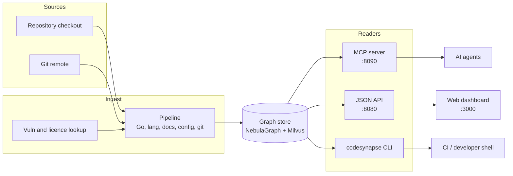

# CodeSynapse

CodeSynapse reads your code and keeps what it learned in one searchable map, called a graph. Your AI coding assistant asks the map small, exact questions ("who calls `ReplaceRepo`?", "what does this change affect?") instead of opening whole files. That saves tokens (the unit AI models read and charge for) and gives better context for code review.

On this repository the context an assistant needs per question is a median 92% smaller, measured by `codesynapse stats`.

New to the terms? The [glossary](GLOSSARY.md) explains each one in plain English.

## What goes into the graph

The table shows what CodeSynapse reads from a project. It keeps names, positions and short summaries, not your source code.

| Source | What is extracted |
|---|---|
| Go | Packages, files, functions, methods, types, exact calls and interface dispatch (`go/types`) |
| Python, JS/TS, Vue, Java, Kotlin, Rust, C#, PHP, Ruby | Structural symbols, imports, name-based call edges, tests |
| Markdown | Sections with line ranges; `MENTIONS` edges to exported symbols |
| YAML, Helm, Go templates | Kubernetes resources, key paths, `{{define}}` blocks, `.Values` links |
| Git history | Commits, authors (e-mail hashed), per-file churn |
| Dependencies | Go, npm, PyPI, Rust, PHP, Ruby, .NET and Gradle modules with licences and CVEs (via osv.dev) |
| Security rules | Findings per rule, linked to the owning function |

## Big picture

## Where to start

- **I want to understand the system:** [Architecture overview](architecture/overview.md).
- **I want to know what is stored:** [Graph schema](architecture/graph-schema.md).
- **I am connecting an AI assistant:** [Agent context (MCP)](features/agent-context.md), then the [Agent guide](AGENT_GUIDE.md). For Claude Code, start with the [Claude Code bridge](operations/claude-code-bridge.md).
- **I am reviewing security posture:** [Security review](features/security.md) and [Security model](operations/security-model.md).
- **I am deploying it:** [Running the stack](operations/running.md).

## Design principles

1. **Same question, same answer.** The graph tools never call an AI model. The assistant that uses them is the only AI in the loop.
2. **Read-only by default.** Only review tools and opt-in agent memory write, and only to their own stores.
3. **No source bodies in the graph.** Hashes, signatures, key paths, line ranges and redacted summaries only.
4. **Untrusted input everywhere.** Repositories, model output and agent text are treated as hostile.
5. **Tenant isolation in the data.** Every API route and MCP tool is scoped to the caller's organisation.
