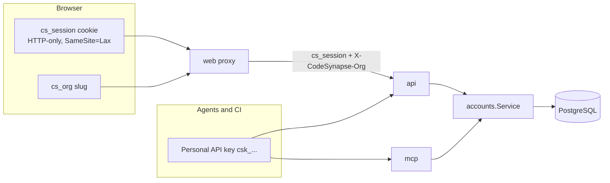
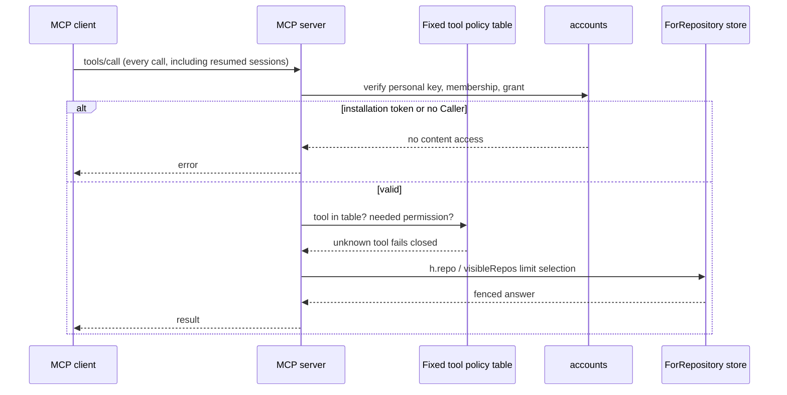
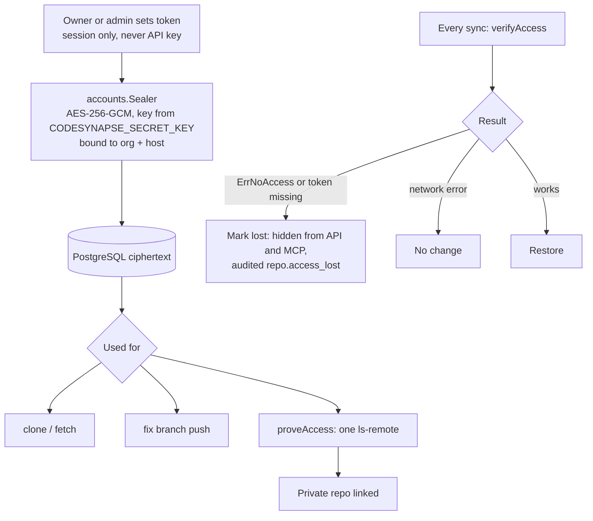

# Accounts and access

!!! info "In plain words"
    This page explains who can sign in and what each person can see. People belong to an **organisation** (a team or company). Inside it they have a **role** and can be given access to single repositories. Programs, such as a coding assistant or a CI job, sign in with an **API key** instead of a password. Every change is written to an **audit log** that cannot be edited afterwards. Terms are in the [glossary](../GLOSSARY.md#people-and-access).

Accounts are optional. Without `CODESYNAPSE_DATABASE_URL` the installation is single-tenant and uses bearer tokens. With it, PostgreSQL holds users, organisations, roles, sessions, API keys, teams, grants and the audit log (`internal/accounts`).

## Identity

- People sign in with an email or an optional username (3 to 32 characters, no `@`, case-insensitive, unique) and a password.
- Passwords are argon2id. Logins are rate limited and unknown emails take as long as wrong passwords.
- Session tokens and API keys are stored only as SHA-256 hashes.
- An API key acts in exactly one organisation and stops working when its owner is removed or suspended. It can never mutate access.
- Cookie-authenticated changes must be same-origin.

The web app has sign-in, a first-run setup, Settings for your profile, API keys, members and Git tokens, an Agents page with client connection settings (runtime session integration is still required), and Help that explains every figure. Organisations have the roles owner, admin, member and viewer. An agent connected with a personal key and a registered runtime session sees only its organisation's repositories and keeps its memory, reviews and statistics apart from other organisations.

## Root account and sign-up

The first account is the installation's root account. A fresh installation creates it at first start as the user `admin` with a random, per-installation password (in `.env` or the `<release>-admin` Secret); you sign in and replace it with your own root account. `codesynapse-api reset-admin` resets it if you are locked out. See [First run and sign-in](first-run.md). Until an organisation connects single sign-on, everyone signs in with the local user database, using their email or an optional username. It administers the platform (settings, health, people, the audit log) and never does organisation work. Its one organisation task is setup, which creates the first organisation and a separate owner account in one step, then signs root out; the owner signs in for everything else. Set `CODESYNAPSE_SIGNUP_OPEN=true` to let others sign up after setup.

On an installation that predates this, the API identifies the root at start-up from its setup history. If that history is missing (for example, pruned by audit retention), platform administrators stay limited to administration until an operator runs `codesynapse-api designate-root --email <root>`. See [root bootstrap](../ROOT_BOOTSTRAP_PLAN.md).

## Single sign-on

An organisation can connect its own OpenID Connect provider (Entra ID, Okta, Keycloak, …). People then sign in through it, get an account on first use, and the provider's groups decide their role and teams. Register `CODESYNAPSE_PUBLIC_URL` + `/sso/callback` as the redirect URI; `SECRET_KEY` must be set. Owners and admins set it up under Settings → Single sign-on and share the sign-in link it shows. See [single sign-on](../SSO_PLAN.md).

## Repository permission resolution

Memberships and relation tuples in PostgreSQL are authoritative. Every subject must be an active, explicit member of the owning organisation; platform administration gives no code access.

| Permission | Allows |
|---|---|
| READ (viewer) | Navigation, review reading, memory recall |
| WRITE (editor) | Also `upsert_graph_triples`, `offload_turns`, `submit_review`, `update_review_comment` |
| ADMIN | Sync, schedules, settings, grants, repository configuration |

Organisation owner and admin roles manage membership and policy; they do not grant repository permissions. An explicit owner can recover administration through an audited action. `AccessOf` uses bounded bulk reads; overflow or invalid grants fail closed.

Settings → Organisation controls the default and owner recovery; Settings → Teams and each repository's Access page manage grants. Changes are audited. See the [upgrade notes](../ACCESS_CONTROL_PLAN.md#implementation-and-upgrade) before upgrading an existing accounts database.

## API route scoping

Every API route is registered with `s.route(pattern, policy, handler)` in `services/api/internal/api/scope.go`.

| Policy | Meaning |
|---|---|
| `repoRole` / `reviewRole` | A role on the repository's organisation; others' repositories answer 404 |
| `visibleOnly` | Handler filters with `visibleRepos` / `scopeFrom(ctx).sees` |
| `orgRole` | A role in the selected organisation (`X-CodeSynapse-Org` or the API key's) |
| `anyone` | No restriction |
| `platformOnly` | Platform admins |

Pick the narrowest. A new list endpoint must filter.

## MCP scoping

Memory uses the `org|graph` namespace; reviews require the exact organisation. Calls to the API forward the caller's own key. Background work carries actor and organisation identity and rechecks credentials and permission before execution and writes.

## Access projections in the graph

PostgreSQL mutations commit audit and outbox records together. A bounded worker rebuilds the `Organization`, `User`, `Team` and `AccessRepository` projections in the graph store. Missing, conflicting or stale projections can never authorize a request; they only support graph-side queries. Details: [Access control plan](../ACCESS_CONTROL_PLAN.md).

## Organisation Git tokens

An organisation admin stores a token per host (`PUT /api/v1/accounts/orgs/{org}/git-tokens/github.com`, or Settings). Keep `SECRET_KEY` from `.env`: tokens sealed with a lost key have to be set again.

To add many repositories at once, **Import** lists the public repositories of an organisation or user on GitHub, Forgejo/Gitea or GitLab and adds the ones you pick. Private repositories are added by URL, if the organisation can read them with its own token.

Organisations never use the installation's tokens. A public repository is cloned anonymously. An existing graph is linked only for the same remote (`sameRemote`), so a name cannot open someone else's graph. Tokens are shown only as previews and never logged or audited in clear.

## Audit log

Every changing request and security event is appended to a hash-chained table with actor, authentication method, client address, user agent, request ID, target, status and outcome. `GET /api/v1/admin/audit/verify` checks the chain; export is JSON, JSON Lines or CSV (formula-neutralised). Retention is `CODESYNAPSE_AUDIT_RETENTION_DAYS` (default 400, minimum 30). New endpoints are covered by middleware; new security-relevant service actions also call `Service.Record`.

### Archive

PostgreSQL does not have to hold the whole retention period. With an archive set, entries older than `CODESYNAPSE_AUDIT_HOT_DAYS` (default 90, at least 7, at most the retention) are sealed once a day into gzip JSON Lines files of at most 20,000 entries and removed from PostgreSQL. PostgreSQL keeps one row per file: the first and last entry, the hash before and after it, and the file's SHA-256. A file is deleted when its newest entry is past `CODESYNAPSE_AUDIT_RETENTION_DAYS`, so the total retention stays 400 days.

| Archive | Settings | Notes |
|---|---|---|
| Directory | `CODESYNAPSE_AUDIT_ARCHIVE_DIR` | Files are written read-only. Compose mounts the `audit-archive` volume at `/audit-archive`. Back the directory up. |
| S3-compatible bucket | `CODESYNAPSE_AUDIT_S3_ENDPOINT` (https), `_BUCKET`, `_REGION` (default `us-east-1`), `_PREFIX` (default `audit/`), `_ACCESS_KEY_ID`, `_SECRET_ACCESS_KEY`, optional `_SESSION_TOKEN` | Path-style requests signed with SigV4, so AWS S3, MinIO, Ceph and most providers work. `_LOCK_MODE=COMPLIANCE` or `GOVERNANCE` sets object lock retention on each file until it expires; the bucket needs object lock turned on. In a versioned bucket, add a lifecycle rule that removes noncurrent versions. In the chart: `auditArchive.s3` with the two keys in `global.existingSecret`. |

Set one of the two, never both. Only the API process that holds the `api-loops` lease seals and deletes; workers never see the archive or its keys. `audit.seal` and `audit.expire` entries record each run.

Keep the archive on once it is set. PostgreSQL then no longer holds the oldest entries, so the daily pruning without an archive stops and logs a warning instead of deleting anything.

`GET /api/v1/admin/audit/verify` checks the rows in PostgreSQL and the links between the files through the stored hashes; it reports `segments` and `sealed` (entries in files). Add `?deep=true` to read every file back as well: its checksum, every entry's hash and every link. `archives` then counts the files read. A missing or changed file fails the check and names its segment. When older entries were pruned without an archive, `first_id` says where the check started.

## Platform administration

`/api/v1/admin/*` is for platform admins only. Suspending an account ends its sessions and refuses its logins and keys on the next request. The service keeps at least one active platform admin (`ErrLastAdmin`) and refuses suspending yourself. Suspension and the admin flag need a signed-in session, never an API key.
