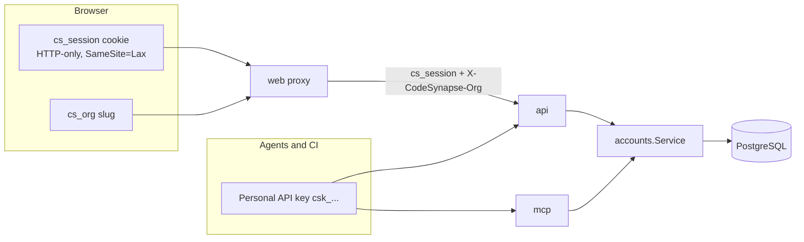
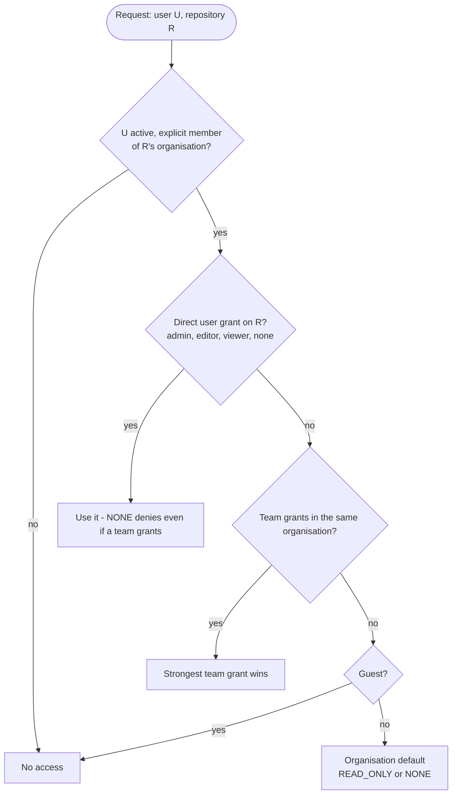
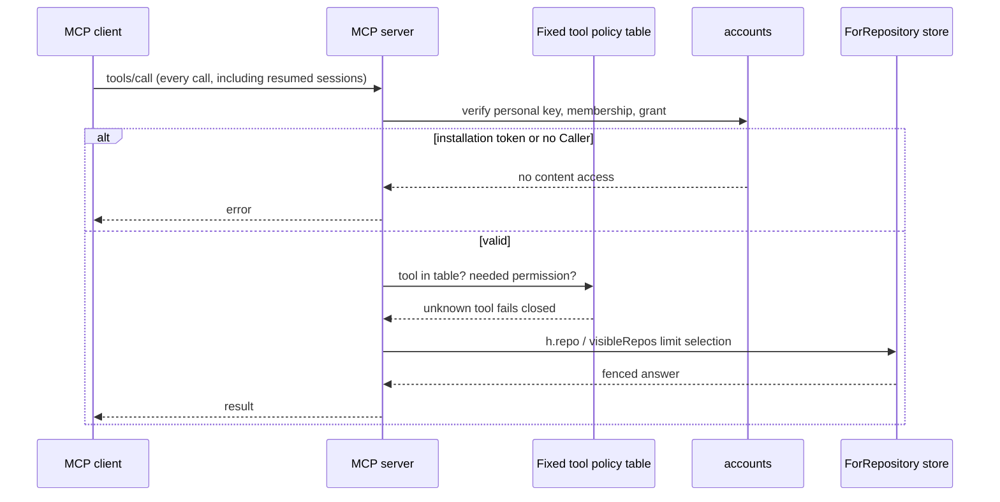
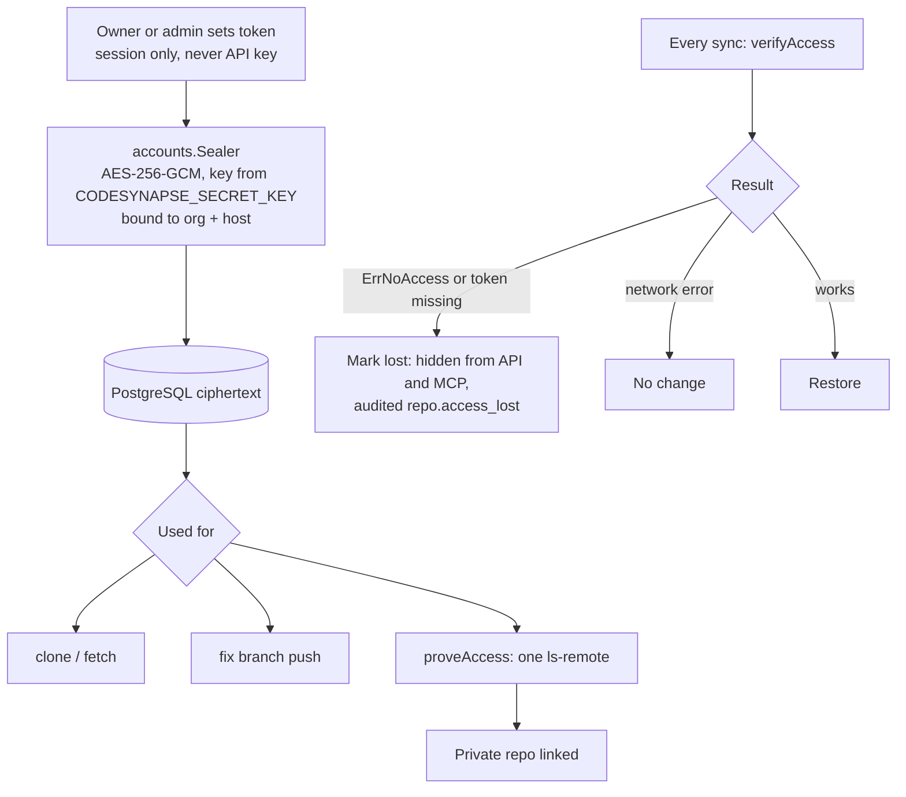

# Accounts and access

!!! info "In plain words"
    This page explains who can sign in and what each person can see. People belong to an **organisation** (a team or company). Inside it they have a **role** and can be given access to single repositories. Programs, such as a coding assistant or a CI job, sign in with an **API key** instead of a password. Every change is written to an **audit log** that cannot be edited afterwards. Terms are in the [glossary](../GLOSSARY.md#people-and-access).

Accounts are optional.

- **Without** `CODESYNAPSE_DATABASE_URL`, the installation is *single-tenant*: one shared space, protected by bearer tokens (a secret string sent with each request).
- **With** it, PostgreSQL holds users, organisations, roles, sessions, API keys, teams, grants and the audit log (`internal/accounts`).

The diagram shows how a browser and an agent each prove who they are:

## Identity

- People sign in with an email or an optional username (3 to 32 characters, no `@`, case-insensitive, unique) and a password.
- Passwords are argon2id. Logins are rate limited and unknown emails take as long as wrong passwords.
- Session tokens and API keys are stored only as SHA-256 hashes.
- An API key acts in exactly one organisation and stops working when its owner is removed or suspended. It can never mutate access.
- Cookie-authenticated changes must be same-origin.

The web app has sign-in, a first-run setup, Settings for your profile, API keys, members and Git tokens, an Agents page with client connection settings (runtime session integration is still required), and Help that explains every figure. Organisations have the roles owner, admin, member and viewer. An agent connected with a personal key and a registered runtime session sees only its organisation's repositories and keeps its memory, reviews and statistics apart from other organisations.

## Root account and sign-up

The first account is the installation's root account. A fresh installation creates it at first start as the user `admin` with a random, per-installation password (in `.env` or the `<release>-admin` Secret); you sign in and replace it with your own root account. `codesynapse-api reset-admin` resets it if you are locked out. See [First run and sign-in](first-run.md). Until an organisation connects single sign-on, everyone signs in with the local user database, using their email or an optional username. It administers the platform (settings, health, people, the audit log) and never does organisation work. Its one organisation task is setup, which creates the first organisation and a separate owner account in one step, then signs root out; the owner signs in for everything else. Set `CODESYNAPSE_SIGNUP_OPEN=true` to let others sign up after setup.

On an installation that predates this, the API identifies the root at start-up from its setup history. If that history is missing (for example, pruned by audit retention), platform administrators stay limited to administration until an operator runs `codesynapse-api designate-root --email <root>`. See [root bootstrap](../ROOT_BOOTSTRAP_PLAN.md).

## Single sign-on

An organisation can connect its own OpenID Connect provider (Entra ID, Okta, Keycloak, …). People then sign in through it, get an account on first use, and the provider's groups decide their role and teams. Register `CODESYNAPSE_PUBLIC_URL` + `/sso/callback` as the redirect URI; `SECRET_KEY` must be set. Owners and admins set it up under Settings → Single sign-on and share the sign-in link it shows. See [single sign-on](../SSO_PLAN.md).

## Repository permission resolution

When someone asks to open a repository, CodeSynapse works out the answer from the memberships and grants stored in PostgreSQL, and nothing else decides. Every person must be an active, named member of the organisation that owns the repository. Being a platform administrator gives no access to code.

Follow the diagram from the top. For example, if Sam is a member and has a direct grant of `viewer` on the repository, the answer is "viewer", even if a team Sam belongs to has a stronger grant.

| Permission | Allows |
|---|---|
| READ (viewer) | Navigation, review reading, memory recall |
| WRITE (editor) | Also `upsert_graph_triples`, `offload_turns`, `submit_review`, `update_review_comment` |
| ADMIN | Sync, schedules, settings, grants, repository configuration |

Organisation owner and admin roles manage membership and policy; they do not grant repository permissions. An explicit owner can recover administration through an audited action. `AccessOf` uses bounded bulk reads; overflow or invalid grants fail closed.

Settings → Organisation controls the default and owner recovery; Settings → Teams and each repository's Access page manage grants. Changes are audited. See the [upgrade notes](../ACCESS_CONTROL_PLAN.md#implementation-and-upgrade) before upgrading an existing accounts database.

### Organisation and personal repositories

Each organisation has at most one entry per repository, and that entry lives in one of two spaces:

- **The organisation:** grants, team grants and the organisation default (`READ_ONLY` or `NONE`) apply as above. Adding a repository here needs the Admin role.
- **Only me:** a member's personal repository. The organisation default does not apply, so other members see it only if the owner grants them (or a team) access. Adding one needs the Member role and the setting below.

Whoever adds a repository gets an explicit admin grant on it, in either space. The dashboard marks personal entries with a "personal" badge, and the Add dialog and the import page ask where to add it. Without a choice, owners and admins add to the organisation and other members to their own space.

Settings → Organisation → "Members may add their own repositories" turns personal additions on or off. It is on until an admin changes it (`GET`/`PUT /api/v1/accounts/orgs/{org}/member-repos`; changing it needs Admin in a signed-in session and is audited as `org.member_repos.set`). Turning it off stops new personal additions with 403; entries that already exist stay.

When the organisation adds a repository a member already has in their own space (an owner or admin adding it, or their watch finding it), the member's entry becomes the organisation's. The move is audited as `repo.space_moved` before it happens. The member keeps an explicit admin grant and whoever added it gets one; other members get the organisation default and whatever grants already exist, nothing more. A member's private entry moves only when the organisation can read the repository with its own Git token; until then the add answers 409 with a message saying a member of the organisation has it privately, without saying who. A member adding a repository that the organisation or another member already has answers 409. Adding it again in the same space does nothing. Owner recovery works on organisation repositories only: an owner cannot recover administration of a member's personal repository.

Each space uses only its own Git tokens. Organisation repositories use the organisation's tokens; a private repository in a member's own space uses only that member's own token (see [personal Git tokens](#personal-git-tokens)), never the organisation's, even when the organisation's token could read it. A private personal repository can be added only after the owner's own token read it; without one the API answers 403 and names Profile → Git tokens.

A watch created by a member adds to that member's own space, and skips new repositories while members' own repositories are turned off. A watch skips what it cannot add without an audit entry and without counting it as added.

## API route scoping

Every API route is registered with `s.route(pattern, policy, handler)` in `services/api/internal/api/scope.go`.

| Policy | Meaning |
|---|---|
| `repoRole` / `reviewRole` | A role on the repository's organisation; others' repositories answer 404 |
| `visibleOnly` | Handler filters with `visibleRepos` / `scopeFrom(ctx).sees` |
| `orgRole` | A role in the selected organisation (`X-CodeSynapse-Org` or the API key's) |
| `anyone` | No restriction |
| `platformOnly` | Platform admins |

Pick the narrowest. A new list endpoint must filter.

## MCP scoping

Memory uses the `org|graph` namespace; reviews require the exact organisation. Calls to the API forward the caller's own key. Background work carries actor and organisation identity and rechecks credentials and permission before execution and writes.

## Access projections in the graph

PostgreSQL mutations commit audit and outbox records together. A bounded worker rebuilds the `Organization`, `User`, `Team` and `AccessRepository` projections in the graph store. Missing, conflicting or stale projections can never authorize a request; they only support graph-side queries. Details: [Access control plan](../ACCESS_CONTROL_PLAN.md).

## Organisation Git tokens

An organisation admin stores a token per host (`PUT /api/v1/accounts/orgs/{org}/git-tokens/github.com`, or Settings). Keep `SECRET_KEY` from `.env`: tokens sealed with a lost key have to be set again.

To add many repositories at once, **Import** lists the repositories of an organisation or user on GitHub, Forgejo/Gitea or GitLab and adds the ones you pick. For the organisation space an owner or admin lists with the organisation's token for the host when it has one (audited `git_token.list`), so private repositories that token reads are shown too; without a token the listing is anonymous and shows public repositories only. For your own space (`"space": "me"`) the listing uses your own token for that host when you saved one, so it also shows private repositories that token can see (marked `private`). On GitHub, `/users/{login}/repos` returns public repositories only even with a token, so add your own private GitHub repositories by URL.

Organisations never use the installation's tokens. A public repository is cloned anonymously. An existing graph is linked only for the same remote (`sameRemote`), so a name cannot open someone else's graph. Tokens are shown only as previews and never logged or audited in clear.

## Personal Git tokens

Each member can store their own token per host under Profile → Git tokens (`GET /api/v1/me/git-tokens`, `PUT`/`DELETE /api/v1/me/git-tokens/{host}`). Only a signed-in session can list or change them, for its own account only; API keys get 403. Changes are audited as `user.git_token.set` and `user.git_token.remove`, without the token. Tokens are sealed with `accounts.Sealer` bound to the user and host, kept per user (not per organisation), and opened only for repositories in that user's own space, and only while the user is still an active member of the entry's organisation.

They are used, with no fallback to the organisation's token, to:

- prove access once before a private personal repository is added (one `ls-remote`);
- clone, fetch and sync it, and recheck access at every sync: without a working token the entry is marked lost (`repo.access_lost`); saving a working token restores it (`repo.access_restored`) and the answer lists the restored repositories;
- push fix branches for it;
- list repositories for Import into your own space.

Organisation watches still add public repositories only, to the organisation space.

## Audit log

Every changing request and security event is appended to a hash-chained table with actor, authentication method, client address, user agent, request ID, target, status and outcome. `GET /api/v1/admin/audit/verify` checks the chain; export is JSON, JSON Lines or CSV (formula-neutralised). Retention is `CODESYNAPSE_AUDIT_RETENTION_DAYS` (default 400, minimum 30). New endpoints are covered by middleware; new security-relevant service actions also call `Service.Record`.

### Archive

PostgreSQL does not have to hold the whole retention period. With an archive set, entries older than `CODESYNAPSE_AUDIT_HOT_DAYS` (default 90, at least 7, at most the retention) are sealed once a day into gzip JSON Lines files of at most 20,000 entries and removed from PostgreSQL. PostgreSQL keeps one row per file: the first and last entry, the hash before and after it, and the file's SHA-256. A file is deleted when its newest entry is past `CODESYNAPSE_AUDIT_RETENTION_DAYS`, so the total retention stays 400 days.

| Archive | Settings | Notes |
|---|---|---|
| Directory | `CODESYNAPSE_AUDIT_ARCHIVE_DIR` | Files are written read-only. Compose mounts the `audit-archive` volume at `/audit-archive`. Back the directory up. |
| S3-compatible bucket | `CODESYNAPSE_AUDIT_S3_ENDPOINT` (https), `_BUCKET`, `_REGION` (default `us-east-1`), `_PREFIX` (default `audit/`), `_ACCESS_KEY_ID`, `_SECRET_ACCESS_KEY`, optional `_SESSION_TOKEN` | Path-style requests signed with SigV4, so AWS S3, MinIO, Ceph and most providers work. `_LOCK_MODE=COMPLIANCE` or `GOVERNANCE` sets object lock retention on each file until it expires; the bucket needs object lock turned on. In a versioned bucket, add a lifecycle rule that removes noncurrent versions. In the chart: `auditArchive.s3` with the two keys in `global.existingSecret`. |

Set one of the two, never both. Only the API process that holds the `api-loops` lease seals and deletes; workers never see the archive or its keys. `audit.seal` and `audit.expire` entries record each run.

Keep the archive on once it is set. PostgreSQL then no longer holds the oldest entries, so the daily pruning without an archive stops and logs a warning instead of deleting anything.

`GET /api/v1/admin/audit/verify` checks the rows in PostgreSQL and the links between the files through the stored hashes; it reports `segments` and `sealed` (entries in files). Add `?deep=true` to read every file back as well: its checksum, every entry's hash and every link. `archives` then counts the files read. A missing or changed file fails the check and names its segment. When older entries were pruned without an archive, `first_id` says where the check started.

## Platform administration

`/api/v1/admin/*` is for platform admins only. Suspending an account ends its sessions and refuses its logins and keys on the next request. The service keeps at least one active platform admin (`ErrLastAdmin`) and refuses suspending yourself. Suspension and the admin flag need a signed-in session, never an API key.

### Reading platform figures

The platform reads need a platform administrator's signed-in browser session: `GET /api/v1/admin/users`, `/admin/orgs`, `/admin/health`, the `/admin/stats/*` routes and the cross-tenant `platform_*` health panels of `/api/v1/stats/series`. An API key or the installation token gets 403, even when it belongs to a platform administrator. Root may read them; a suspended administrator is refused.

!!! warning "Scripts that read the admin lists with an API key stop working"
    Before this change `GET /api/v1/admin/users`, `/admin/orgs` and `/admin/health` answered an API key of a platform administrator. They now answer 403. Sign in through the dashboard instead, or use the audit export, which is unchanged.

Every view is written to the audit log before any figure is read: `admin.users.view`, `admin.orgs.view`, `admin.health.view`, `admin.stats.view` (with the section, range, organisation and panel), and `admin.stats.export` (with the format as well). A batch of series panels is one view. When the audit entry cannot be written, the request answers 503 and shows no figures.

Administration → Statistics shows the figures (`docs/PLATFORM_STATS_PLAN.md`, phases 1 and 3):

| Route | Answers |
|---|---|
| `GET /api/v1/admin/stats/summary?range=` | Tiles: organisations, people, active people, memberships, seats, runtime sessions, API keys, browser sessions. Graphs, jobs, cost and alerts are `null` until later phases. |
| `GET /api/v1/admin/stats/tenants?range=&org=&sort=&page=` | Platform totals and one row per organisation: members by role, seats, active members, teams, repository entries, single sign-on, watches. |
| `GET /api/v1/admin/stats/sessions?range=&org=&sort=&page=` | Browser sessions, runtime sessions (agent, dashboard, gateway) and API keys (active, used, expiring within 14 days), per organisation. |
| `GET /api/v1/admin/stats/usage?range=&org=&sort=&page=` | Agent sessions, tool calls and errors, tokens served and avoided, the token share, workflow counts and unindexed checkouts per organisation, with the tools and clients used. A tool or client fewer than three organisations use is counted as "other" unless `org` is set. |
| `GET /api/v1/admin/stats/series?panel=&range=&org=` | One usage chart from VictoriaMetrics (`range` up to `30d`). Series per organisation carry its name; a deleted one reads "deleted organisation". |
| `GET /api/v1/admin/stats/series/batch?panels=&range=&org=` | Up to 20 of those charts in one request and one audit event. |
| `GET /api/v1/admin/stats/export?section=summary\|tenants\|sessions\|usage&range=&org=&format=csv\|json` | The whole section, at most 10,000 rows. CSV cells are formula-neutralised. |

`range` is `1h`, `6h`, `24h`, `7d`, `30d`, `90d` or `365d`; anything else answers 400. `org` is an organisation ID and must exist; it filters the rows, never the totals. Tables have 50 rows per page. The former panels `tenants`, `platform_llm_cost`, `platform_tool_latency` and `platform_db_latency` of `/api/v1/stats/series` were removed and answer 404; their figures are the admin panels `org_sessions`, `llm_cost`, `tool_latency` and `db_latency`. The figures are counts only: organisation names and slugs appear, repository names, graph IDs, paths, e-mail addresses and user, key or session IDs never do. Root is never counted. A person counts once in the platform totals and once in each organisation they belong to. Seats are active members other than guests. Active people signed in, opened a browser or runtime session, or used an API key in the window.

The process holding the `api-loops` lease writes daily platform statistics to `platform_stats_daily` shortly after midnight UTC: counts of organisations, users other than root, active users, memberships, seats, repository entries, graphs, finished jobs, sessions and API keys, per day and, for some, per organisation ID. Rows hold counts and opaque organisation IDs only, never names, e-mail addresses, repository names or the IDs of users, keys or sessions. A deleted organisation's rows stay. Rows are kept 400 days, independently of the audit retention, and older ones are pruned by the same loop. They feed the 90-day and 365-day ranges of the platform statistics. See [platform statistics](../PLATFORM_STATS_PLAN.md).

| Range | Window figures (created, started, ended) | State figures (totals, open now) |
|---|---|---|
| `1h` to `30d` | Counted live from PostgreSQL over the window | Live |
| `90d`, `365d` | Summed from `platform_stats_daily` over the last 90 or 365 complete UTC days, up to yesterday | Live |

A long range adds `rollup` to the answer: `days` in the range, `written` days the rollup holds (days before it ran or while no API process held `api-loops` are missing, not estimated), `latest` and `unavailable`. Active people are the 30-day count on the latest written day (`active_window`). Figures that count distinct people or keys over the whole window cannot be summed from days: per-organisation active members, keys used and watch additions are listed in `unavailable`, read 0 in JSON and are empty in CSV. The series panels stay at `1h` to `30d`.
