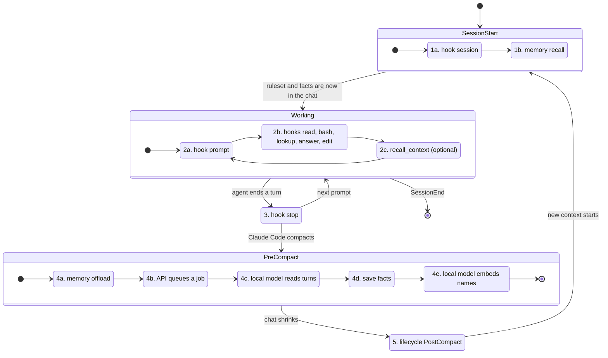

# Chat memory flow: every step, with its tokens

This page follows one chat from start to compaction and shows each step the Claude Code plugin takes, what it asks of CodeSynapse, which steps call a **local model**, and how many tokens each one moves. Use it to find where tokens go and which step to shorten. Setup is in [Keep chats small](chat-memory-setup.md).

Token figures come in two kinds:

- **Limit** is a constant in the code. The step can never move more.
- **Estimate** is the size of the text divided by four, or the count the provider reported.

## The whole flow

## Step by step

"Model" says whether a step calls your local Ollama. "Chat" is the tokens a step adds to (+) or removes from (−) the chat the paid model reads. "Local" is what the local model reads and writes; it costs electricity and time, not API tokens.

| Step | Runs where | What it does | Model | Chat tokens | Local tokens |
|---|---|---|---|---|---|
| 1a `hook session` | plugin CLI → `GET /api/v1/agent-rules` | Adds the agent ruleset to the new chat | no | **+640** built-in text; limit +1000 (4 KiB) | none |
| 1b `memory recall --hook` | plugin CLI → `GET …/session-memory` | Adds the facts saved for this chat, newest first | no | **+** up to **1500** (limit: 6000 characters) | none |
| 2a `hook prompt` | plugin CLI | Notes how the chat began (graph tool or native search first) for the workflow report | no | measure | none |
| 2b `hook read`, `bash`, `lookup`, `answer`, `read-done`, `edit` | plugin CLI, local only | Turns back a whole-file read with an outline (limit 60 lines), hints at a graph tool once per class, counts what was read | no | **+** a short hint when it fires; **−** the whole file when a read is turned back | none |
| 2c `recall_context` | model → bridge → MCP → API | Finds facts about a question | embeddings only | **+** about 600 for the answer | question ÷ 4 through `nomic-embed-text` |
| 3 `hook stop` | plugin CLI | Asks once for `verify_plan` and `get_pr_context` after edits | no | **+** one message; the tools add their answers | none |
| 4a `memory offload --hook` | plugin CLI | Cuts the transcript into chunks (limit 60 turns and 144 000 characters each); tool output is cut to 300 characters | no | none yet | none |
| 4b queue | API | Accepts a job, redacts the turns, holds them in memory | no | none | none |
| 4c extract | API worker → Ollama | One call per batch of turns | **yes** `llama3.1:8b` | none | input: limit 13 312 *estimated* tokens a call; output: limit 4000 |
| 4d save | API worker | Writes validated facts to the session | no | none | none |
| 4e embed | API worker → Ollama | Embeds the new entity names, 64 a call | **yes** `nomic-embed-text` | none | names ÷ 4 |
| 5 `PostCompact` | plugin CLI | Reports the compaction | no | **−** the offloaded turns (estimate: characters ÷ 4) | none |

The chat only shrinks at step 5, because Claude Code does the compacting. Steps 4a to 4e prepare what 1b brings back.

## Where the tokens go

- **Every chat pays 1a and 1b once**, about 640 + 1500 tokens at most, before the first question. A chat with no saved facts pays only 1a.
- **The local model runs only at compaction**, in steps 4c and 4e, and for each `recall_context` call (2c). Nothing else in the plugin calls a model.
- **4c is the expensive step.** A chat of 350 turns became 6 chunks; each chunk is split again into batches, one model call each, about 20 to 30 seconds on a laptop.
- **Output is short.** A batch answers with a JSON list of triples. The limit is 4000 tokens, a normal answer is a few hundred.

## What we found

These came out of real compactions and are the first things to improve.

| Finding | Effect | Idea |
|---|---|---|
| The input budget counts request bytes as tokens, so 13 312 "tokens" is about 13 KB, or roughly 3 300 real tokens | A batch holds about a quarter of what the model could read, so there are about four times too many calls | Count bytes ÷ 4, or use the provider's tokenizer, for the local route only |
| The entity list in every prompt grows after each batch (limit 200 names) | A later batch could overflow the budget (fixed: batches are now sized against the current list) | Send only names that occur in the batch |
| One session and repository keep one 24 KB document | Long chats filled it and every later job failed with `session memory capacity exceeded` (fixed: a full document now drops replaced and then the oldest facts to make room) | Merge facts about the same entity before saving |
| `model answer has an unterminated JSON object` | The model's answer was cut off. Fixed: the triples finished before the cut are kept; the job fails only when none were finished | Retry once with a smaller batch when nothing could be kept |
| The older v0.0.7 hook sends all turns every time | Duplicate jobs for the same turns | Upgrade the CLI (the new client remembers what succeeded) |

## What is measured

Each step is recorded as a metric with a fixed set of labels, so it can be exported over OTLP like the rest. Labels are `tenant_id` and `step`; never a repository, path, prompt or session.

| Metric | Labels | Meaning |
|---|---|---|
| `flow_step_calls_total` | `tenant_id`, `step`, `outcome` (`ok`, `error`) | Runs of a step |
| `flow_step_tokens_total` | `tenant_id`, `step`, `kind` | Tokens a step moved. `kind` is `context_in`, `context_out`, `model_in` or `model_out` |

`step` is one of `session_start.rules`, `session_start.recall`, `precompact.offload`, `offload.extract`, `recall_context.embed` and `offload.embed_entities`. Model tokens are the provider's reported usage when it gave one, and the size estimate otherwise.

The metrics that were there before cover the same ground from other sides: `llm_tokens_input_total` and `llm_tokens_output_total` (by `task`: `memory`, `embeddings`), `memory_offload_turns_total`, `memory_offload_tokens_total`, `memory_recall_total`, `mcp_response_tokens_total` (by tool) and `agent_hook_events_total` (by hook event).

Steps that run only on your machine (1b's client side, 2a, 2b, 3, 4a, 5) report through `POST /api/v1/execution/activity` and `agent_hook_events_total`; they do not yet report tokens.

## Reading it as a step function

Every box in the diagram is a step with an input, an output and a cost, and each can fail without stopping the chat: hooks always exit 0. When a step fails, look at its `flow_step_calls_total{outcome="error"}`, then at the job's `error` text (`GET /api/v1/memory/jobs`). To compare two settings, for example `context_window` 16 384 against 32 768, run the same chat through both and compare `flow_step_tokens_total` and `flow_step_calls_total` for `offload.extract`.
