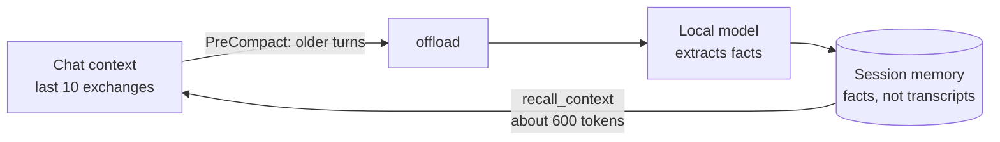

# Keep chats small with a local model

A long chat costs tokens on every turn, because the whole history is sent again each time. CodeSynapse moves older turns out of the chat into **session memory** and hands back only what a question needs. This page sets that up in about ten minutes.

## What you get, and what you do not



- Older turns are read by a **local model** and stored as short facts (`maria OWNS invoicing`, `billing uses PostgreSQL`), private to that chat for seven days.
- `recall_context` brings back the facts that match a question. An answer is a few hundred tokens, not the turns it replaces.
- **It stores facts, not the conversation.** Raw turns are redacted, used once and discarded. You cannot get an earlier code listing or tool output back word for word; use the code graph (`get_symbol_context`, `file_outline`) for code.
- **CodeSynapse does not shrink the chat by itself.** Claude Code decides when to compact. Step 5 makes it compact earlier, after the offload has run.
- A local model is required for **offloading** (cloud providers are refused on purpose, because turns often contain code). Recall by meaning also uses a local embedding model; without one recall falls back to word matching.

## Before you start

- The stack is running (`just up`) and you can sign in. See [Run the stack](running.md).
- Claude Code is connected to CodeSynapse with a personal API key. See [Connect Claude Code](claude-code-bridge.md).
- The repository is indexed in CodeSynapse.
- [Ollama](https://ollama.com) is installed. Any OpenAI-compatible local server works (MLX, vLLM, LM Studio, llama.cpp); Ollama is the simplest.

## 1. Pull two models

```sh
ollama pull llama3.1:8b          # reads older turns and writes facts
ollama pull nomic-embed-text     # recall by meaning
```

!!! warning "Pick a model that does not think first"
    Models that reason before answering (Qwen3, DeepSeek-R1) can spend the whole output budget on thinking. The job then fails with `answer cut off at max_output_tokens … raise it for reasoning models`, and nothing is saved. `disable_thinking` only works on servers that understand `chat_template_kwargs` (MLX, vLLM); Ollama ignores it. Use `llama3.1:8b`, `gemma3:12b` or another instruction model without a thinking phase.

A model of 7–12 billion parameters is enough. Smaller ones (1–3B) miss facts and invent predicates.

## 2. Tell CodeSynapse about the model

Create `config/llm.yaml` in the CodeSynapse folder (it is git-ignored):

```yaml
providers:
  - name: local-ollama
    kind: openai
    base_url: http://host.docker.internal:11434/v1
    model: llama3.1:8b
    embedding_model: nomic-embed-text
    context_window: 32768
    max_output_tokens: 2048

tasks:
  memory: local-ollama       # extraction of facts from older turns
  embeddings: local-ollama   # recall by meaning
default: local-ollama
```

`context_window` is how much the model may read per call. Long chats are split to fit it, so a larger window means fewer calls. Ollama reads only a small window by default and cuts the rest silently, so start it with the same size: `OLLAMA_CONTEXT_LENGTH=32768 ollama serve` (or set `num_ctx` in a Modelfile).

`host.docker.internal` is your own machine, seen from the containers. On Linux with Docker, start Ollama with `OLLAMA_HOST=0.0.0.0` so the containers can reach it.

`default` also serves reviews and other AI tasks. Point those at another provider under `tasks:` if you prefer. See `config/llm.example.yaml` for more providers.

Then restart the services that read the file:

```sh
podman restart codesynapse_api_1 codesynapse_worker_1     # or: docker compose restart api worker
```

The API log prints `AI providers configured … default=local-ollama`.

## 3. Check that the model is used

Run this once. It sends a small invented conversation through the same path the hooks use.

```sh
cat > /tmp/chat.jsonl <<'EOF'
{"type":"user","message":{"role":"user","content":"We decided billing uses PostgreSQL because we need transactions."}}
{"type":"assistant","message":{"role":"assistant","content":[{"type":"text","text":"Noted: billing uses PostgreSQL."}]}}
{"type":"user","message":{"role":"user","content":"Maria owns the invoicing module and reviews every change to it."}}
{"type":"assistant","message":{"role":"assistant","content":[{"type":"text","text":"Maria owns invoicing."}]}}
{"type":"user","message":{"role":"user","content":"What is two plus two?"}}
{"type":"assistant","message":{"role":"assistant","content":[{"type":"text","text":"Four."}]}}
EOF
export CODESYNAPSE_API_TOKEN=csk_...            # your personal key
export CODESYNAPSE_SESSION_ID=$(uuidgen | tr A-Z a-z) CODESYNAPSE_PARENT_SESSION_ID=$CODESYNAPSE_SESSION_ID
codesynapse memory offload --transcript /tmp/chat.jsonl --repo <your-repo> --keep 1
```

It prints `queued N turn(s) for extraction`. Wait about 30 seconds (the first call loads the model), then look at the job:

```sh
curl -s -H "Authorization: Bearer $CODESYNAPSE_API_TOKEN" \
  -H "X-CodeSynapse-Session: $CODESYNAPSE_SESSION_ID" -H "X-CodeSynapse-Parent-Session: $CODESYNAPSE_SESSION_ID" \
  "http://127.0.0.1:8080/api/v1/memory/jobs?repo=<your-repo>"
```

`"state":"succeeded"` with `"saved"` above zero means it works. `"state":"failed"` carries the reason in `"error"`; see Troubleshooting.

## 4. Turn on the hooks

With the **Claude Code plugin** installed (recommended), the hooks are already there: a PreCompact hook offloads older turns, a SessionStart hook recalls facts into the new chat (by meaning after a compaction), and a UserPromptSubmit hook adds the facts that match each prompt. Set `CODESYNAPSE_AUTO_RECALL=false` to turn off the per-prompt recall. Nothing to install.

Without the plugin, install them for one repository:

```sh
export CODESYNAPSE_API_TOKEN=csk_...
codesynapse mcp hooks ~/src/your-repo
```

Do not do both; the hooks would run twice. Restart Claude Code afterwards.

## 5. Make Claude Code compact earlier

Compaction is Claude Code's. By default it waits until the chat is nearly full. Set a lower threshold so the offload runs and the chat shrinks while it is still small. Add this to `~/.claude/settings.json` (or the project's `.claude/settings.local.json`):

```json
{ "env": { "CLAUDE_AUTOCOMPACT_PCT_OVERRIDE": "30" } }
```

`codesynapse mcp hooks` writes the same setting for you (`--compact-at 30`). Start with 30; raise it if compaction feels too frequent.

## 6. Check it with a real compaction

Do this once in a chat on an indexed repository:

1. Restart Claude Code so it reads the threshold, then work until a few exchanges exist.
2. Run `/compact`. The PreCompact hook offloads the older turns first.
3. Wait about 30 seconds, then list the jobs with the `curl` from step 3 (use the chat's own session ID, or the Agent memory page). `"state":"succeeded"` with `"saved"` above zero means the chat was offloaded.
4. In the compacted chat, ask: *"Use recall_context to find what we decided earlier."* The answer should name facts from before the compaction.

## What the hooks tell you

The memory hooks say what they did in one line in the chat, so a silent failure cannot hide. These lines are for you: they cost the model no tokens.

| Line | Meaning |
|---|---|
| `CodeSynapse memory: 12 facts recalled` | A new chat got the facts saved for it |
| `… 12 facts restored after the compaction` | The chat was compacted and its facts came back |
| `… 2 facts added for this prompt` | Facts that matched your prompt were added (no line when none matched) |
| `… nothing saved yet for this chat` | The memory is empty, which is normal early in a chat |
| `… 120 older turns offloaded in 2 jobs for <repo>` | The compaction handed turns to the local model; the facts appear within minutes |
| `… nothing to offload yet, the chat is within the last 10 exchanges` | The chat is too short to have turns older than the window |
| `… the 120 older turns were already offloaded` | An earlier compaction sent them |
| `CodeSynapse memory is off: this repository is not indexed …` | Add the repository in the dashboard (Import). The model is told too, so it does not call `recall_context` |
| `CodeSynapse memory is off: the CodeSynapse API is not reachable at …` | The stack is not running or the URL is wrong |

Set `CODESYNAPSE_HOOK_QUIET=true` to hide the lines. Older CLI versions say nothing: upgrade `codesynapse` to get them. `CODESYNAPSE_HOOK_TRACE=chat` additionally shows one line for every other hook.

## Everyday use

You do not run anything. When a chat compacts, the hook offloads first and the new context starts with the facts that match what you were doing; later prompts get matching facts added. `recall_context` stays for questions beyond this chat, with `memory_scope: "repository"`.

To ask for something by hand, say: *"Use recall_context to find what we decided about billing."*

## Troubleshooting

| Symptom | Cause and fix |
|---|---|
| Job `failed`: `answer cut off at max_output_tokens` | The model thinks before answering. Use a model without a thinking phase (step 1). |
| The offload is refused, or the job fails, saying no local model is configured | The `memory` task is not routed to a local provider, or the provider is a cloud one. Check `tasks:` and `base_url`. |
| Job `failed`: `prompt exceeds input budget` | One turn is larger than the model's window even after shortening, or `context_window` is too small. Raise `context_window` (and Ollama's context length). A normal long chat is split automatically. |
| Job stays `running` for minutes | The model is loading or too large for your memory. Try a smaller one; check `ollama ps`. |
| Job `succeeded`, `saved` is 0 | The turns held no lasting facts (small talk), or the model is too small. Try the 8B model. |
| `recall_context` returns nothing | The facts belong to another chat: recall only reads the current session. Use `memory_scope: "repository"` for durable knowledge. |
| Nothing happens at compaction | Hooks fail silently by design. Run step 3 by hand to see the real error, and check the API log. |
| Facts look vague (everything hangs on one word) | A small model. Move to a larger one. |

## Limits worth knowing

- Session memory is capped at 24 KB. When a chat's facts no longer fit, the oldest are dropped to make room for new ones. Deleting a chat's memory by hand closes it for good (`session memory is deleted or expired`); start a new chat instead.
- Facts live in the chat's session and expire seven days after it was registered. Keep something longer by saving it as durable knowledge (`upsert_graph_triples`) or promoting selected facts from the Agent memory page.
- Recalled facts are data, not instructions. Verify code claims against the code graph.
- Extraction runs one job at a time on your machine. A long chat is offloaded in chunks, and each chunk is split again to fit the model's window, so a long chat means several model calls (about 20–30 seconds each on a laptop). A chunk whose job failed is sent again at the next compaction. Tool output is cut to 300 characters before it leaves your machine.

See [Agent memory](../features/memory.md) for the data model and the API.
