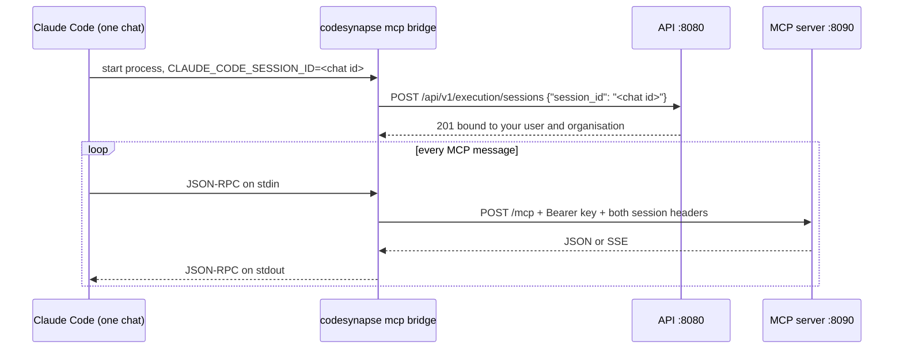

# Claude Code bridge

Claude Code connects to CodeSynapse through `codesynapse mcp bridge`, a small stdio process that runs on the developer's machine. Every machine that uses CodeSynapse from Claude Code needs the `codesynapse` binary installed locally. The server stack can run anywhere.

## Why a bridge

The MCP server only runs tools for a registered chat session. Each request must carry a personal key plus `X-CodeSynapse-Session` and `X-CodeSynapse-Parent-Session` with the chat's ID (see [runtime session setup](../AGENT_GUIDE.md#runtime-session-setup)).

Claude Code passes the chat ID (`CLAUDE_CODE_SESSION_ID`) to stdio MCP servers only. Remote HTTP servers and their `headersHelper` never see it, so a plain HTTP entry in Claude Code's config can't send the session headers, and the server answers 403.



Claude Code starts one bridge per chat and keeps it across `/compact` and `/clear`. A new chat gets a new process and a new session. The bridge never makes up an ID; without one it exits.

## Install the binary

With Homebrew, on macOS or Linux:

```sh
brew install astrona-io/tap/codesynapse
```

`brew upgrade codesynapse` updates it, and the bridge keeps working across upgrades. The tap gets a new formula with every `vX.Y.Z` release once the repository is public (see [Releasing](releasing.md)).

Each release also has bare binaries for macOS and Linux (amd64 and arm64) with a `SHA256SUMS` file. Make the download executable and put it on your `PATH` as `codesynapse`.

With Go 1.27 or later, from source. While the repository is private, this needs read access to `astrona-io/codesynapse`.

From a checkout:

```sh
go install ./cmd/codesynapse
```

Without a checkout:

```sh
export GOPRIVATE='github.com/astrona-io/*'   # skip the public module proxy
go install github.com/astrona-io/codesynapse/cmd/codesynapse@main
```

Go fetches the module with your git credentials, so `git ls-remote https://github.com/astrona-io/codesynapse` has to work first. With SSH keys, add `git config --global url."git@github.com:".insteadOf "https://github.com/"`.

Either way the binary lands in `$(go env GOPATH)/bin`, usually `~/go/bin`.

Claude Code's config stores the binary's absolute path, so it doesn't need to be on `PATH` for the bridge to start. You'll want it on `PATH` to run the commands below, though. For a Homebrew install, `mcp install` stores the `opt` path (`/opt/homebrew/opt/codesynapse/bin/codesynapse`), which follows upgrades.

## Get a personal key

Sign in to the dashboard, open **Settings → API keys** and create a key. It starts with `csk_` and acts in one organisation.

These won't work:

- `CODESYNAPSE_MCP_TOKEN` and `CODESYNAPSE_API_TOKEN` in `.env`. They are installation tokens, and `mcp install` refuses them.
- Keys owned by the root account (the one that set up the installation). Root can't do organisation work.

## Register with Claude Code

```sh
CODESYNAPSE_MCP_TOKEN=csk_... codesynapse mcp install --only claude
```

From a checkout, `CODESYNAPSE_MCP_TOKEN=csk_... just mcp` does the same and also offers the other detected agents.

This does two things:

1. Writes the key to `codesynapse/api-token` in your user config folder, mode 0600: `~/Library/Application Support/codesynapse/api-token` on macOS, `~/.config/codesynapse/api-token` on Linux. The key never goes into Claude Code's settings or onto a command line.
2. Adds a user-scope `codesynapse` server to `~/.claude.json`:

   ```json
   {
     "type": "stdio",
     "command": "/Users/you/go/bin/codesynapse",
     "args": ["mcp", "bridge", "--url", "http://localhost:8090/mcp", "--api-url", "http://127.0.0.1:8080"]
   }
   ```

Then open a new chat and run `/mcp`. Chats that were already open keep their old server config.

To rotate the key, run the install again with the new key. It overwrites the stored one.

### Remote server

By default the bridge talks to the local compose stack. For a shared deployment, pass both endpoints:

```sh
CODESYNAPSE_MCP_TOKEN=csk_... codesynapse mcp install --only claude \
  --url https://mcp.codesynapse.example.com/mcp --api-url https://api.codesynapse.example.com
```

Use whatever hosts your deployment exposes for the MCP endpoint and the API.

`CODESYNAPSE_MCP_URL` and `CODESYNAPSE_API_URL` set the same defaults. The bridge refuses plain `http` to anything except `localhost` or a loopback address, because the key travels with every request.

## Answers from your working tree

The server's graph reflects the last sync, so in the middle of a task it does not know the files you or the agent just changed. While your checkout has changes the server cannot have (uncommitted or untracked files, or commits not pushed to the upstream branch), the bridge answers eight tools for this repository itself, from a graph of the working tree it builds on your machine: `minimal_context`, `get_symbol_context`, `get_call_graph`, `get_implementations`, `file_outline`, `search`, `get_pr_context` and `verify_plan`.

- **Which repository:** the one the bridge was started in (Claude Code starts it in the project folder), named as the server names it, from the `origin` remote (`owner/name` on github.com, `host/owner/name` elsewhere). Calls that name another repository, and every other tool (memory, reviews, security, `repo_status`, other repositories), go to the server as before. Pass `--repo` when the server knows the checkout by another name.
- **How it is built:** the same offline indexing as `codesynapse review --offline`, the first time a call needs it and again after the next change (a few seconds for a mid-sized Go module; calls wait for it). Nothing new leaves your machine: the code was already on it, and the answer goes to the agent, not to the server. Because the server is not asked, these answers are not in its audit log or usage statistics.
- **`get_pr_context`:** with no arguments it analyses your current change (the diff against where your branch left its upstream, or HEAD; with new untracked files, the changed and new files), and its answer says which security findings the change introduces and fixes (`security_delta`). The base is indexed once per commit.
- **How you can tell:** the answer starts with a note ("Answered from your working tree of …") and carries `_meta` `codesynapse/source: worktree` with the number of changed files.
- **When it does not apply:** a clean tree, a repository policy that needs an approved digest, or a failed build: the call goes to the server. `--worktree=false` (or `CODESYNAPSE_BRIDGE_WORKTREE=false`) turns it off.

## Check it works

Send one `initialize` message through the bridge with a throwaway ID:

```sh
echo '{"jsonrpc":"2.0","id":1,"method":"initialize","params":{"protocolVersion":"2025-06-18","capabilities":{},"clientInfo":{"name":"check","version":"0"}}}' \
  | CLAUDE_CODE_SESSION_ID=check-$(date +%s) codesynapse mcp bridge
```

A JSON-RPC `result` with the server's instructions means the key and session registration both work. Each run registers a session that expires after seven days.

## Troubleshooting

| Symptom | Cause and fix |
|---|---|
| `/mcp` shows `AUTH_HEADER_REJECTED` (HTTP 403) mentioning `X-CodeSynapse-Session` | An older direct-HTTP `codesynapse` entry is still configured. Local and project entries override the user-scope bridge. Remove it from every scope (`claude mcp remove codesynapse -s local` in each project that has one, then `-s user`) and install again. |
| `mcp install` says the token is not a personal key | You passed an installation token from `.env`. Create a `csk_` key in the dashboard. |
| `register runtime session: log in or use a valid API key` | The stored key was revoked, or its owner was suspended or removed from the organisation. Install again with a fresh key. |
| `claude mcp get codesynapse` reports `Failed to connect` | Expected. The CLI starts the bridge without `CLAUDE_CODE_SESSION_ID`, so it exits. Check from a new chat with `/mcp`. |
| `no chat session: start the bridge from Claude Code` | Same cause, when you run the bridge by hand. Set `CLAUDE_CODE_SESSION_ID` as in the check above. |
| `use https for hosts other than this machine` | The `--url` or `--api-url` is plain `http` on a remote host. Use `https`. |
| `command not found` or `no such file` when Claude Code starts the bridge | The binary moved or was deleted. Reinstall it and run `mcp install` again so the path is updated. |
| Fixed the config but the current chat still fails | Each chat keeps the bridge it started with. Open a new chat. |

## Update and uninstall

To update, run `brew upgrade codesynapse`, or reinstall the binary the same way you installed it. The config points at the same path, so new chats pick up the new build.

To remove it:

```sh
claude mcp remove codesynapse -s user
brew uninstall codesynapse                # or: rm "$(go env GOPATH)/bin/codesynapse"
rm ~/Library/Application\ Support/codesynapse/api-token   # macOS
rm ~/.config/codesynapse/api-token                        # Linux
```

Then revoke the key under **Settings → API keys**.
