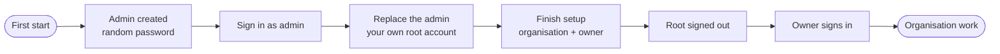

# First run and sign-in

The first start of an empty installation **creates an administrator for you**: user `admin`, with a **random password** that is generated for that installation. You sign in with it, then replace it with your own account. Until an organisation connects single sign-on, everyone signs in with the local user database.

!!! warning "There is no shared default password"
    Every installation gets its own random password. Nothing in an image or a repository can sign in anywhere else. The password is stored where you deploy: in `.env` with Docker Compose, in a Secret with Kubernetes.

## 1. Find the admin password

| How you run it | Where the password is |
|---|---|
| `just up` (Docker Compose) | `ADMIN_PASSWORD` in `.env`. `just init` (run by `just up`) writes a random one. `grep ADMIN_PASSWORD .env` |
| Kubernetes (Helm chart) | The Secret `<release>-admin`, key `CODESYNAPSE_ADMIN_PASSWORD`, generated by the chart and kept across upgrades. `kubectl get secret <release>-admin -o jsonpath='{.data.CODESYNAPSE_ADMIN_PASSWORD}' \| base64 -d` |
| Plain `codesynapse-api serve` | `CODESYNAPSE_ADMIN_PASSWORD` if you set it; otherwise a random one is printed **once** in the API log at first start (`username` and `password` fields). |

The password is created only when the installation has no accounts. Restarting or upgrading never creates a second admin and never changes the password.

## 2. Sign in and follow the welcome guide

1. Open the dashboard, `http://localhost:3000`. The sign-in page reminds you where the password is.
2. Sign in as `admin` (or `admin@codesynapse.local`) with that password.
3. You land on the administration overview. A notice says you are on the **admin account made at first start**, and a **welcome guide** lists what to do next. Nothing is forced: follow the steps in any order, or choose **Skip the guide**. You can reopen it any time from your account menu (**Welcome guide**).

The guide for root has two steps:

| Step | What it does |
|---|---|
| **Replace the admin account** | Enter your name, email, username and a password of at least 12 characters. In one step your account becomes the root account, the auto-created one is deleted with its sessions, and you are signed out. Sign in again with the new account. |
| **Create the first organisation** | Name the organisation and create its **owner** account (a different person or address than root, which only administers the platform). Root is then signed out; sign in as the owner for all organisation work. |

The owner gets their own guide on first sign-in: add a first repository, connect a coding agent, and (for owners and admins) invite the team. Steps that can be detected tick themselves; the others tick when you open them. Skipping is remembered per person in that browser.

Until you replace the auto-created admin, a banner stays at the top of every page. The replacement is audited (`setup.root_replaced`) and can be done once: only the account made at first start can be replaced, never one you made yourself. Until the organisation exists, other sign-ups stay closed even with `CODESYNAPSE_SIGNUP_OPEN=true`.

Until you replace it, a banner stays at the top of every page. The replacement is audited (`setup.root_replaced`) and can be done once: only the account made at first start can be replaced, never one you made yourself.

!!! tip "Prefer to choose the first account yourself?"
    Set `CODESYNAPSE_AUTO_ADMIN=false` (Helm: `admin.enabled: false`). Nothing is created at start, and the first sign-up on the dashboard becomes the root account instead.

## Locked out or lost the password

An operator with access to the deployment can reset the root account at any time. It sets a new password, lifts a suspension and ends all of its sessions. It is audited as `setup.root_reset`, and it works on the root whether or not it is the auto-created one.

| How you run it | Command |
|---|---|
| Docker Compose | `just admin-reset` sets the password to `ADMIN_PASSWORD` from `.env`. `just admin-reset generate` prints a new random one instead. |
| Kubernetes | `kubectl exec deploy/<release>-api -- codesynapse-api reset-admin --generate` prints a new random password once. Without `--generate` it uses `CODESYNAPSE_ADMIN_PASSWORD` from the Secret. |
| Plain binary | `CODESYNAPSE_DATABASE_URL=... codesynapse-api reset-admin [--generate]` |

On an installation with no accounts, `reset-admin` creates the administrator instead. Forgot an organisation owner's password? Root can run the audited owner-recovery action under Administration.

Upgraded from an installation older than root separation? The root is identified from setup history at start-up. If that history is missing, run `codesynapse-api designate-root --email <root>`. See [root bootstrap](../ROOT_BOOTSTRAP_PLAN.md).

## Sign in with email or username

The sign-in page asks for **Email or username**. Both work with the same password, and both are matched without regard to case.

| Field | Rules |
|---|---|
| Email | Required. Unique. Contains an `@`. |
| Username | Optional. Unique. 3 to 32 letters, digits, dots, dashes or underscores, starting with a letter or digit. Never contains `@`, which is how the sign-in page tells the two apart. |

So the auto-created admin signs in as `admin` or `admin@codesynapse.local`, and the account you replace it with can use its own pair.

- Set the username when you replace the admin, when root creates the organisation's owner on **Finish setup**, or later under **Settings → Profile → Username**. Leave the field empty to remove it.
- Accounts that existed before usernames have none and keep signing in with their email.
- Accounts created through single sign-on have no username unless the person adds one in their profile.
- Usernames are for signing in only. People are shown by name, and invitations and sharing still use email.
- The login rate limit counts attempts per email or username and per client address, so a username is no easier to guess than an email.
- API clients can send `{"login": "admin", "password": "..."}` to `POST /api/v1/auth/login`; the older `email` field still works. API keys (`csk_...`) and sessions are unchanged.

## What root can and cannot do

| Root account | Organisation owner |
|---|---|
| Platform settings, health, telemetry, AI routing | Repositories, reviews, memory, statistics |
| People administration, suspending accounts | Members, teams, grants, API keys |
| Audit log: view, verify, export | Git tokens, single sign-on for the organisation |
| Setup and owner recovery | Everything root cannot do |

Root never reads repositories, symbols, reviews or memory, and its API keys are refused. This is enforced by the API and by the MCP server on every call, not only hidden in the UI. See [Accounts and access](accounts-access.md#root-account-and-sign-up).

!!! tip "Keep root for emergencies"
    Treat root like a break-glass account: a long unique password in your password manager, used for platform administration only. Daily work happens as an organisation owner or member.

## Where users come from

| Setup | Who can sign in | Where identities live |
|---|---|---|
| **Default** (nothing configured) | The admin made at first start, then accounts created by root, owners (members) or sign-up | The local user database: email, optional username and argon2id password hash in PostgreSQL |
| **Sign-up open** (`CODESYNAPSE_SIGNUP_OPEN=true`) | Also anyone who signs up, each with a personal organisation | Local user database |
| **Single sign-on** (per organisation) | People of that organisation through their provider, plus local accounts | Provider for credentials; the account and membership are still rows in PostgreSQL |

Local sign-in is always the default. Nothing changes until an organisation owner or admin adds a provider under **Settings → Single sign-on** (Keycloak, Entra ID, Okta, Google Workspace, Authentik and other OpenID Connect providers). Passwords keep working for everyone else, and root never signs in through SSO, so a broken provider cannot lock you out of administration.

Setting up Keycloak or another provider:

1. Set `CODESYNAPSE_SECRET_KEY` (it seals the client secret) and `CODESYNAPSE_PUBLIC_URL` (the dashboard address).
2. In the provider, register `CODESYNAPSE_PUBLIC_URL` + `/sso/callback` as the redirect URI.
3. As owner or admin, open **Settings → Single sign-on**, enter the issuer, client ID and secret, and map the provider's groups to roles and teams.
4. Share the sign-in link the page shows.
5. Self-hosted provider on a private network? Set `CODESYNAPSE_SSO_ALLOW_PRIVATE=true`.

Details and the security rules are in [single sign-on](../SSO_PLAN.md).

## Settings that matter at first run

| Variable | Default | Effect |
|---|---|---|
| `CODESYNAPSE_DATABASE_URL` | set by compose | Turns accounts on. Without it the installation is single-tenant with bearer tokens and has no root or users |
| `CODESYNAPSE_ADMIN_PASSWORD` | random (`.env`, Secret) | Password of the admin made at first start. At least 12 characters; the `change-me` placeholder is ignored |
| `CODESYNAPSE_AUTO_ADMIN` | `true` | `false`: no admin at start; the first sign-up becomes root |
| `CODESYNAPSE_SIGNUP_OPEN` | `false` | Lets others sign up after setup |
| `CODESYNAPSE_SECRET_KEY` | empty | Needed for organisation Git tokens and SSO secrets |
| `CODESYNAPSE_PUBLIC_URL` | `http://localhost:3000` | Dashboard address; the SSO return address |
| `CODESYNAPSE_COOKIE_SECURE` | `false` | Set `true` behind TLS |
