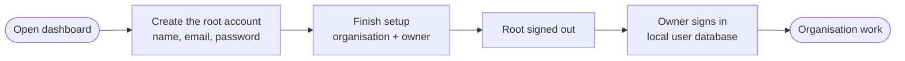

# First run and sign-in

A fresh installation has no accounts and **no default password**. The first person to open the dashboard creates the **root account**, and everyone signs in with the local user database until an organisation connects single sign-on.

!!! warning "No built-in admin/admin"
    CodeSynapse never ships a default username or password. The root credentials are chosen by the operator at first sign-up, so there is nothing to find in an image or a repository and nothing to forget to change.

## Create the root account

1. Start the stack (`just up`) and open the dashboard, `http://localhost:3000`.
2. The page asks you to **Set up CodeSynapse**. Enter a name, an email address and a password of at least 12 characters, then choose **Create the root account**. Use a real, reachable address such as `admin@your-company.example`; the email is the login name.
3. You are signed in as root and land on **Finish setup**. Create the first organisation and the **owner** account (a different person or address than root), then choose **Create the organisation and its owner**.
4. Root is signed out. Sign in again as the owner for all organisation work.

The first sign-up is serialised in PostgreSQL, so two people opening a new installation at the same moment still produce exactly one root account. Until setup is complete, every other sign-up is refused.

## What root can and cannot do

| Root account | Organisation owner |
|---|---|
| Platform settings, health, telemetry, AI routing | Repositories, reviews, memory, statistics |
| People administration, suspending accounts | Members, teams, grants, API keys |
| Audit log: view, verify, export | Git tokens, single sign-on for the organisation |
| Setup and owner recovery | Everything root cannot do |

Root never reads repositories, symbols, reviews or memory, and its API keys are refused. This is enforced by the API and by the MCP server on every call, not only hidden in the UI. See [Accounts and access](accounts-access.md#root-account-and-sign-up).

!!! tip "Keep root for emergencies"
    Treat root like a break-glass account: a long unique password in your password manager, used for platform administration only. Daily work happens as an organisation owner or member.

## Where users come from

| Setup | Who can sign in | Where identities live |
|---|---|---|
| **Default** (nothing configured) | Accounts created by root, owners (members) or sign-up | The local user database: email and argon2id password hash in PostgreSQL |
| **Sign-up open** (`CODESYNAPSE_SIGNUP_OPEN=true`) | Also anyone who signs up, each with a personal organisation | Local user database |
| **Single sign-on** (per organisation) | People of that organisation through their provider, plus local accounts | Provider for credentials; the account and membership are still rows in PostgreSQL |

Local sign-in is always the default. Nothing changes until an organisation owner or admin adds a provider under **Settings → Single sign-on** (Keycloak, Entra ID, Okta, Google Workspace, Authentik and other OpenID Connect providers). Passwords keep working for everyone else, and root never signs in through SSO, so a broken provider cannot lock you out of administration.

Setting up Keycloak or another provider:

1. Set `CODESYNAPSE_SECRET_KEY` (it seals the client secret) and `CODESYNAPSE_PUBLIC_URL` (the dashboard address).
2. In the provider, register `CODESYNAPSE_PUBLIC_URL` + `/sso/callback` as the redirect URI.
3. As owner or admin, open **Settings → Single sign-on**, enter the issuer, client ID and secret, and map the provider's groups to roles and teams.
4. Share the sign-in link the page shows.
5. Self-hosted provider on a private network? Set `CODESYNAPSE_SSO_ALLOW_PRIVATE=true`.

Details and the security rules are in [single sign-on](../SSO_PLAN.md).

## Settings that matter at first run

| Variable | Default | Effect |
|---|---|---|
| `CODESYNAPSE_DATABASE_URL` | set by compose | Turns accounts on. Without it the installation is single-tenant with bearer tokens and has no root or users |
| `CODESYNAPSE_SIGNUP_OPEN` | `false` | Lets others sign up after setup |
| `CODESYNAPSE_SECRET_KEY` | empty | Needed for organisation Git tokens and SSO secrets |
| `CODESYNAPSE_PUBLIC_URL` | `http://localhost:3000` | Dashboard address; the SSO return address |
| `CODESYNAPSE_COOKIE_SECURE` | `false` | Set `true` behind TLS |

## Lost access

- **Forgot the owner password:** root can run the audited owner-recovery action under Administration.
- **Forgot root's password:** an operator resets it directly in PostgreSQL by writing a new argon2id hash. This is a disaster-recovery step and appears in your own change records, not in the audit chain.
- **Upgraded from an older installation:** the root is identified from setup history at start-up. If that history is missing, run `codesynapse-api designate-root --email <root>`. See [root bootstrap](../ROOT_BOOTSTRAP_PLAN.md).
