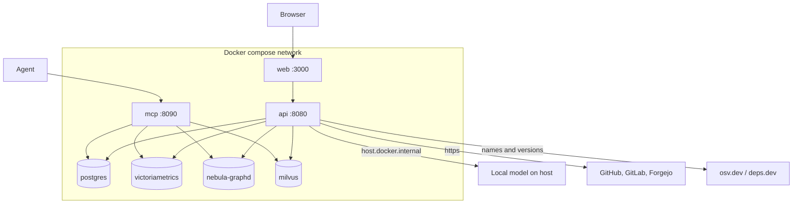
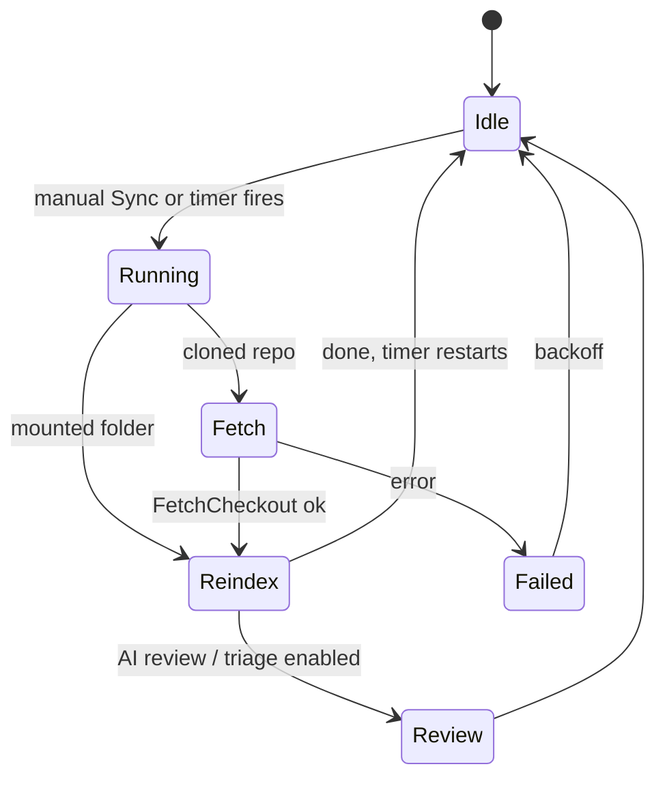
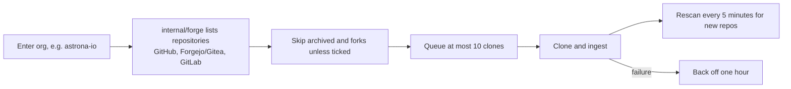
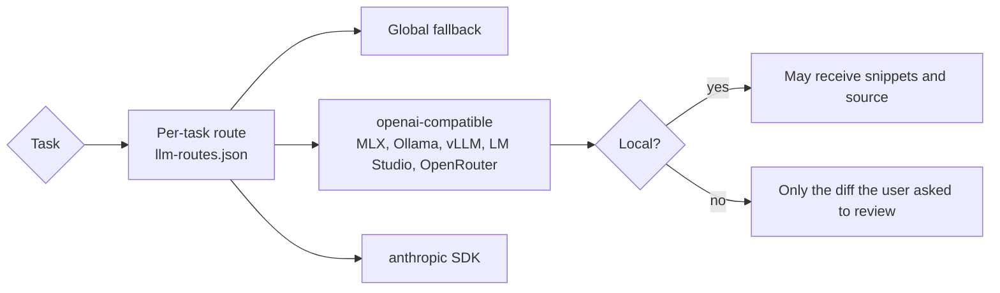

# Running the stack

## Quick start

Requires [just](https://github.com/casey/just) and Docker or Podman (`podman machine start` plus `docker-compose` on the PATH). The justfile picks whichever is installed; set `COMPOSE="docker compose"` to force one.

```sh
just up                       # writes .env with random secrets, builds and starts everything
open http://localhost:3000    # sign in as admin (password in .env), replace it, create your organisation
just ingest ~/src/my-service  # copies the checkout into ./sources and indexes it
just mcp                      # register the MCP server with your agents
```

### Getting a local checkout into your organisation

`just ingest <dir>` runs the CLI inside the **worker** (the API image has no Go toolchain) and writes the graph, named after the checkout's `origin` remote the way the dashboard names a repository added by URL (`owner/name` on github.com, `host/owner/name` elsewhere; `just ingest <dir> <name>` names it yourself, and a checkout without an origin is indexed under its directory name and cannot be linked). The index belongs to no organisation yet, so nobody sees it. Module downloads follow `CODESYNAPSE_ALLOW_NETWORK` (off by default): with it off, Go packages whose dependencies the worker has not cached are reported as `package_load_failed`; set it to `true` for a checkout you trust.

To make it visible, sign in as an **owner** of your organisation, open **Repositories**, choose **Add** and paste the origin's address. The dashboard recognises the existing index of the same remote and links it instead of cloning, records the first admin grant and applies the usual access checks; a private repository needs your organisation's Git token to prove access first. The same address added without `just ingest` is cloned and indexed by the worker.

There is no database-free MCP server: every tool call needs accounts and a registered runtime session (see [session context](../SESSION_CONTEXT_PLAN.md#runtime-integration)). Develop against `just up` and register an agent with `just mcp`.

| URL | What |
|---|---|
| http://localhost:3000 | Dashboard |
| http://localhost:8080 | API (bearer `CODESYNAPSE_API_TOKEN`) |
| http://localhost:8090/mcp | MCP over streamable HTTP (bearer `CODESYNAPSE_MCP_TOKEN`) |

All ports bind to 127.0.0.1.

The dashboard supports sign-in, governance, repository browsing and execution controls such as cloning, sync and model tasks. A signed-in browser gets its own runtime session binding for those (see [session context](../SESSION_CONTEXT_PLAN.md#runtime-integration)); agents and API clients register theirs.

The API records those jobs, and the `worker` service runs them. Jobs survive restarts, and a job a stopped worker left behind is picked up again with the requester's access checked anew. Add workers with `docker compose up --scale worker=3`, or limit one to some roles with `CODESYNAPSE_WORKER_ROLES=ingest` (`ingest`, `ai`, `fix`). Without a worker, `codesynapse-api serve` runs jobs itself, as in development.

## Deployment topology



The compose API container reaches model servers on the host through `host.docker.internal`.

## Daily development

| Recipe | Does |
|---|---|
| `just test` | `go test -race ./...` |
| `just lint` | golangci-lint, must report 0 issues |
| `just web-check` | Nuxt typecheck and build |
| `just ci` | All of the above |
| `just dev-web` | Nuxt dev server against the API of `just up` |
| `just test-integration` | `test-nebula`, `test-postgres` and `test-metrics` together |
| `just test-postgres` | Accounts contract on a throwaway PostgreSQL |
| `just test-nebula` | NebulaGraph/Milvus store contract |
| `just test-metrics` | Telemetry and series queries on a throwaway VictoriaMetrics |
| `just check-test-images` | The integration recipes, `docker-compose.yml` and the Helm chart use the same store images |
| `just review` | Offline review pack for the current branch |

The integration recipes run the store images that `docker-compose.yml` ships (PostgreSQL, NebulaGraph, Milvus, VictoriaMetrics), read from it by `.github/scripts/compose-image.sh`, so a version bump there, which Renovate makes in one place, changes what the contracts test. CI runs all three suites on store, accounts, telemetry, series, dependency and recipe changes, nightly and on demand, with a 30 minute job limit and bounded container start-up waits.

Run `just test` and `just lint` before calling a Go change done, and `just web-check` for anything under `services/web/`.

## Sync and scheduling



- **Sync** fetches the chosen branch (cloned repositories) or re-indexes the folder (mounted sources). The branch picker lists every branch of the remote (cloned) or of the checkout (mounted; only the checked-out one can be synced).
- **Auto-sync** runs every 30 minutes by default for every repository. The countdown starts when a sync finishes, and first runs are spread over the interval so repositories do not sync together. Per repository you can switch it off, or pick 5 or 15 minutes, hourly, every 6 hours or daily, with pause/resume. Status ("next in 3 min", "paused") shows on the repository card and summary. Schedules require an explicit delegated identity and current repository admin.
- **Gone repositories:** when the provider confirms that a cloned repository no longer exists (a clean 404 from its API, three scheduled syncs in a row), its graph, schedule and clone are removed. Network errors, rate limits and refused requests never count, and mounted folders are never removed.
- **Remove** a repository from its card or summary; a confirmation asks for the name and offers to delete the cloned files too.

## Organisations



On the **Organisations** page enter `astrona-io` (or `https://github.com/astrona-io/*`). GitHub (also Enterprise Server), Forgejo/Gitea/Codeberg and GitLab are supported: pick the provider and host, or paste a URL such as `https://codeberg.org/team/*` (github.com, gitlab.com and codeberg.org are recognised on their own). Archived repositories and forks are skipped unless you tick them. With auto-index off it only lists, and you index repositories one by one. Stopping to watch keeps the repositories already indexed.

Repository names are `owner/name` on github.com and `host/owner/name` elsewhere, so identical names on two providers never collide.

### Private repositories

`just git-token <host>` asks for a token (input hidden), stores it in `.env` as `CODESYNAPSE_GIT_TOKENS` (`host=token,host2=token2`) and restarts the API. Run it once per git host (`just git-token`, `just git-token codeberg.org`, ...). Each token is sent to its own host only. Use a read-only token (fine-grained GitHub token with *Contents* read). To let fix branches push, put a second token with write access in `CODESYNAPSE_GIT_PUSH_TOKENS` (same format): only the fix worker receives it, so the workers that read untrusted repositories never hold write access. The single `CODESYNAPSE_GIT_TOKEN` + `CODESYNAPSE_GIT_TOKEN_HOST` pair still works. Hosts on a private network need `CODESYNAPSE_ALLOW_PRIVATE_GIT=true`; hosts with a port are not supported. Pull requests for fix branches are opened on github.com only; other hosts get the pushed branch.

With accounts, organisations use their own tokens instead; see [Organisation Git tokens](accounts-access.md#organisation-git-tokens).

## Kubernetes

To try it on a cluster, `codesynapse install --local` installs the chart with random credentials and waits for every service; `codesynapse status` checks it and `codesynapse uninstall` removes it. See [the chart README](https://github.com/astrona-io/codesynapse/blob/main/deploy/helm/codesynapse/README.md#install-with-the-cli).

Releases publish signed multi-arch images, `ghcr.io/astrona-io/codesynapse-{api,worker,mcp,web}`, and the Helm chart at the same version:

```sh
helm install codesynapse oci://ghcr.io/astrona-io/charts/codesynapse --version X.Y.Z
```

The chart runs the four services and, unless you point it at your own, PostgreSQL, NebulaGraph, Milvus, VictoriaMetrics and VictoriaTraces as subcharts. It uses one Secret for every credential, network policies, non-root pods and a `helm test`. See the [chart README](https://github.com/astrona-io/codesynapse/blob/main/deploy/helm/codesynapse/README.md), [Releasing](releasing.md) and [Upgrading](upgrading.md).

Verify an image:

```sh
cosign verify ghcr.io/astrona-io/codesynapse-api:1.3.0 \
  --certificate-identity-regexp 'https://github.com/astrona-io/codesynapse/' \
  --certificate-oidc-issuer https://token.actions.githubusercontent.com
```

Building and testing locally:

```sh
just image-build v0.1.0     # api, worker, mcp and web images (PLATFORM=linux/amd64, REGISTRY=ghcr.io/you)
just scan-image ghcr.io/astrona-io/codesynapse-web:v0.1.0   # fixable HIGH/CRITICAL vulnerabilities, as CI checks
just scan-chart-images      # report-only scan of the chart's store images (`just scan-chart-images grype` for Grype), as Artifact Hub shows them
just chart-check            # helm lint, kubeconform, kube-linter, kubesec
just chart-e2e              # the chart on a throwaway kind cluster: build, load, install, helm test
just kind-down
```

Test the chart only on the throwaway kind cluster these recipes create, with `--context` set explicitly, never on a shared or production cluster.

## AI models

Providers are configured in `config/llm.yaml` (copy `config/llm.example.yaml`; it is gitignored).



- `kind: openai` covers anything with an OpenAI-compatible `/v1/chat/completions`: MLX (`mlx_lm.server`), Ollama, vLLM, LM Studio, llama.cpp, OpenRouter. An API key is optional (`api_key_env` names the environment variable).
- `kind: anthropic` uses the official SDK; the key comes from `ANTHROPIC_API_KEY`.
- The compose API container reaches services on your Mac through `host.docker.internal` (for example `http://host.docker.internal:9080/v1`).
- `disable_thinking: true` turns off reasoning for Qwen-style models, which otherwise spend the whole output budget thinking. It works on MLX, vLLM and SGLang; Ollama ignores it, so on Ollama set `effort: none` instead.
- `effort` on a `kind: openai` provider is sent as `reasoning_effort` (`none`, `low`, `medium`, `high`, as the server allows).
- Set `context_window` to the model's real context (for MLX models it is `max_position_embeddings` in the model's `config.json`). Each request then gets everything up to the window minus `max_output_tokens`, and the work per request grows with it: more findings per triage batch, more changed symbols and longer code excerpts per review. Without `context_window` it stays at a safe 32k in / 8k out. Lower `max_input_tokens` if answers get too slow; the timeout scales with the budget. See [prompt budgets](../PROMPT_BUDGETS.md).

On the **AI models** page you pick a global model, the fallback for everything, and optionally a different one per area: code review, security analysis and briefings. The choice is saved in `workspace/.codesynapse/llm-routes.json`. Remote providers never receive source code beyond the diff you ask them to review; local providers also get short snippets around findings. Model answers are treated as untrusted text and redacted before they are stored.

Three tasks run **only on a local model**, because they read a private change, the cleanup plan or the developer's files: `pr-summary` (a plain-language summary of a pasted diff: what changed, the riskiest parts, a merge checklist), `cleanup-briefing` (the ranked cleanup plan as what to do first and what is safe and quick) and `local-answer` (the `ask_local` tool: a coding agent hands files and a question to the local model and reads a short cited answer instead of the files, which saves its cloud tokens). With no route set they use the first local provider (the global model if it is local); with no local provider they do not appear, and routing them to a cloud provider is refused. The first two start from the repository's **AI assistant** page and save a report under Reviews; `local-answer` runs only for agents through the bridge and stores nothing.

You can also skip the provider: with the `security-triage`, `code-review` and `briefing` MCP prompts your own agent does the work and submits it with `submit_review`, so no key is needed.

## Statistics

The compose stack runs [VictoriaMetrics](https://victoriametrics.com/) (Apache-2.0). The API and MCP services push metrics to it every 15 seconds, and the **Statistics** page charts them per minute, 5 or 15 minutes, hour or 6 hours (`/stats?range=1h|6h|24h|7d|30d`):

- **Tokens and model cost:** provider-reported input, output and cached tokens, estimated spend and prompt-cache savings, and calls with missing usage or prices.
- **Network and cloud bandwidth:** MCP request/response payload bytes and cloud model request bytes. Avoided cloud traffic stays "Not measured" until an equivalent fallback provides a comparable baseline.
- **Database performance:** request volume, latency percentiles, errors/timeouts, graph rows returned and vector matches. Returned rows do not measure internal nodes traversed.
- **Agent memory and offloading:** current durable facts, recalls, saved-fact operations, offloaded turns and MCP activity. Fact counts refresh every 30 seconds, deduplicate API replicas and disappear from the chart after 90 seconds without a successful observation.
- **MCP usage:** sessions and tool calls per day, the most used tools, clients and repositories, tokens served and an estimate of tokens avoided. The MCP server records only daily counters (never arguments or results); turn it off with `CODESYNAPSE_MCP_USAGE=false`.

Ordinary panels show your organisation's activity, including when you are a platform administrator. The Administration area has separate platform-wide panels. Metrics never contain prompts, queries, file paths, repository names or user/session IDs. Missing model prices mean unknown cost; cached tokens may still be billed. Application payload bytes exclude HTTP headers, TLS and TCP overhead.

Metrics use OpenTelemetry cumulative OTLP/HTTP by default. Set `CODESYNAPSE_METRICS_URL` to the internal VictoriaMetrics base URL; the exporter appends `/opentelemetry/v1/metrics`. Authentication uses `CODESYNAPSE_METRICS_USER` and `CODESYNAPSE_METRICS_PASSWORD` from the environment. `CODESYNAPSE_ENVIRONMENT` optionally identifies the deployment environment, otherwise `unknown` is used. Each process has a separate opaque instance ID so replicas and restarts do not share a cumulative stream; this ID is unrelated to agent sessions. Without `CODESYNAPSE_METRICS_URL`, export is disabled and the Statistics page explains how to enable it.

`CODESYNAPSE_METRICS_EXPORTER=prometheus` selects the legacy Prometheus-text push path for rollback; the default is `otlp`. Restart the services when switching and use one exporter per process. No scrape endpoint is exposed. Failed exports do not block requests, and shutdown flushing has a five-second deadline.

Traces go to [VictoriaTraces](https://docs.victoriametrics.com/victoriatraces/) (Apache-2.0), also in compose. A dashboard click, its job on the worker, the graph store calls and the model calls form one trace. Its ID is the `X-Request-ID` and the audit entry's request ID, and it appears as `trace_id` in log lines. Search traces at http://localhost:10428/select/vmui, using the metrics login (user `codesynapse`, `METRICS_PASSWORD` from `.env`). Spans carry no content: no paths, repository names, people, prompts or code. See [traces](../TELEMETRY_PLAN.md#traces).

## Building this documentation

```sh
pip install -r docs/requirements.txt
mkdocs serve        # http://127.0.0.1:8000
mkdocs build --strict
```
