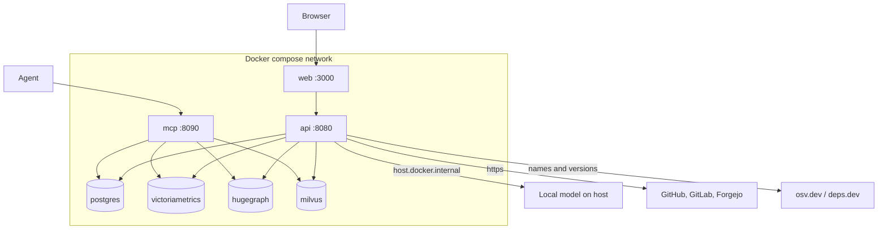
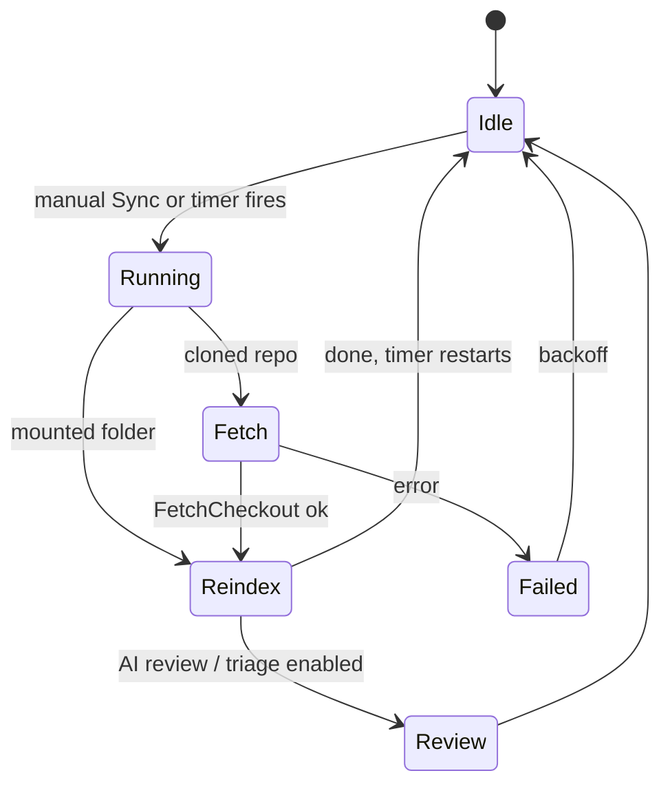
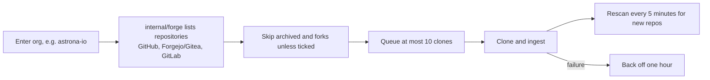
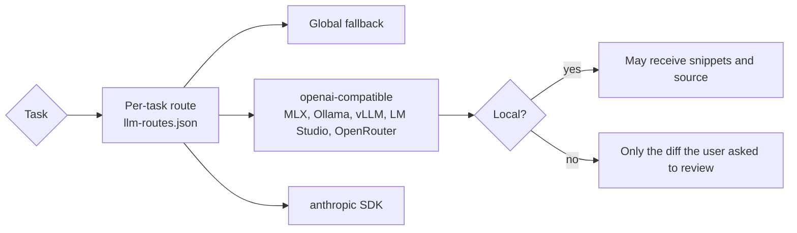

# Running the stack

## Quick start

Requires [just](https://github.com/casey/just) and Docker or Podman.

```sh
just up                       # writes .env with random secrets, builds and starts everything
just ingest ~/src/my-service  # copies the checkout into ./sources and indexes it
just mcp                      # register the MCP server with your agents
open http://localhost:3000
```

| URL | What |
|---|---|
| http://localhost:3000 | Dashboard |
| http://localhost:8080 | API (bearer `CODESYNAPSE_API_TOKEN`) |
| http://localhost:8090/mcp | MCP over streamable HTTP (bearer `CODESYNAPSE_MCP_TOKEN`) |

All ports bind to 127.0.0.1.

## Deployment topology



Dashed boxes are the optional HugeGraph/Milvus backend (`docker-compose.hugegraph.yml`). The compose API container reaches model servers on the host through `host.docker.internal`.

## Daily development

| Recipe | Does |
|---|---|
| `just test` | `go test -race ./...` |
| `just lint` | golangci-lint, must report 0 issues |
| `just web-check` | Nuxt typecheck and build |
| `just ci` | All of the above |
| `just dev-mcp` | MCP on stdio with an in-memory graph of the checkout (no database) |
| `just dev-web` | Nuxt dev server against the API of `just up` |
| `just test-integration` | `test-hugegraph` and `test-postgres` together |
| `just test-postgres` | Accounts contract on a throwaway PostgreSQL |
| `just test-hugegraph` | HugeGraph/Milvus contract and parity |
| `just test-metrics` | Telemetry on a throwaway VictoriaMetrics |
| `just review` | Offline review pack for the current branch |

Run `just test` and `just lint` before calling a Go change done, and `just web-check` for anything under `services/web/`.

## Sync and scheduling



Auto-sync runs every 30 minutes by default. The countdown starts when a sync finishes, and first runs are spread over the interval so repositories do not sync together. Schedules require an explicit delegated identity and current repository admin.

## Organisations



Repository names are `owner/name` on github.com and `host/owner/name` elsewhere, so identical names on two providers never collide.

## Kubernetes

Manifests live in `deploy/k8s` (Kustomize base + dev/prod overlays). Test them only on a throwaway kind cluster with `--context` set explicitly, never on a shared or production cluster. See `deploy/k8s/README.md`.

## AI models

Providers are configured in `config/llm.yaml` (copy `config/llm.example.yaml`; it is gitignored).



Set `context_window` to the model's real context so budgets scale; without it, the safe default is 32k in / 8k out.

## Statistics

The API and MCP push metrics to VictoriaMetrics every 15 seconds; the **Statistics** page charts agent sessions, tool calls, latency, tokens, AI cost, database latency and memory use per organisation. Without `CODESYNAPSE_METRICS_URL` the page explains how to enable it.

## Building this documentation

```sh
pip install -r docs/requirements.txt
mkdocs serve        # http://127.0.0.1:8000
mkdocs build --strict
```
