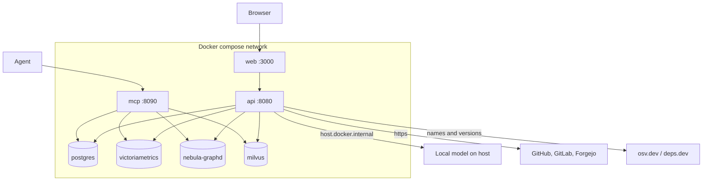
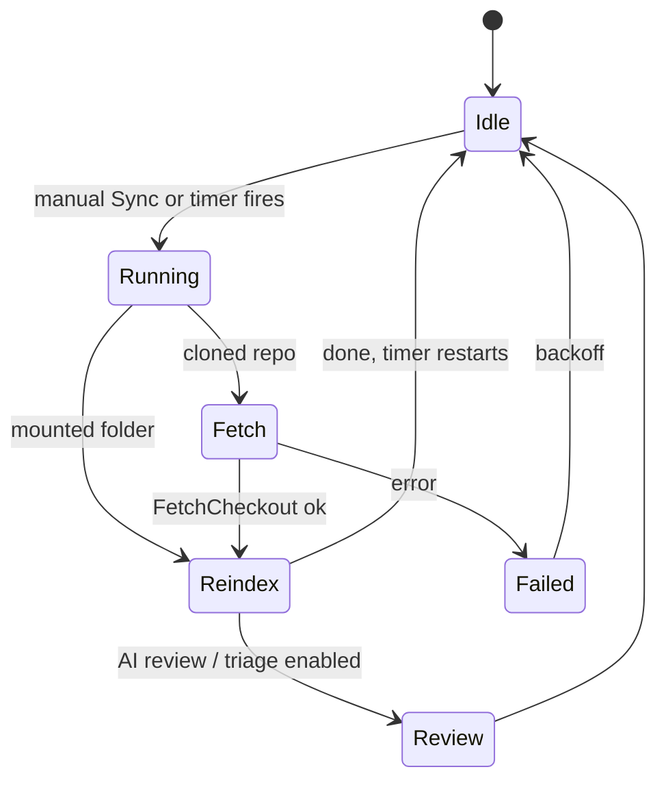
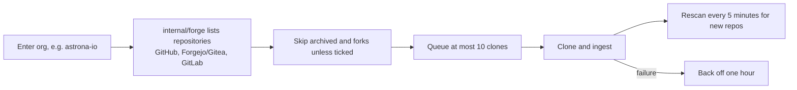
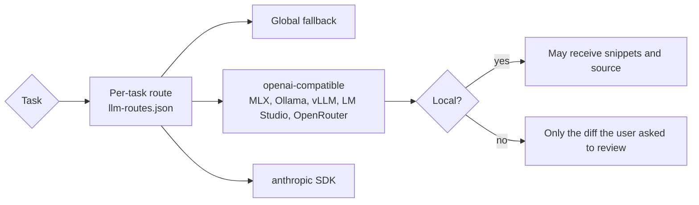

# Running the stack

!!! info "In plain words"
    CodeSynapse is not one program. It is a small set of programs that start together: a website (the **dashboard**), a service behind it (the **API**), a helper that does slow jobs (the **worker**), a service your coding assistant talks to (the **MCP server**), and a few databases. A tool called Docker (or Podman) starts them all with one command, `just up`. This page shows that command, how the pieces fit, and the settings you will most often change. Unknown word? See the [glossary](../GLOSSARY.md).

## Quick start

You need two tools first:

- [just](https://github.com/casey/just), a small command runner. Every `just ...` line on this page is a shortcut defined in the project's `justfile`.
- Docker or Podman, which run the programs in containers. With Podman, run `podman machine start` first and make sure `docker-compose` is on your PATH. The justfile uses whichever one is installed; set `COMPOSE="docker compose"` to force Docker.

Then run these four steps in order:

1. `just up` writes a `.env` file with random secrets, builds the images and starts everything.
2. Open `http://localhost:3000` and sign in as `admin`. The password is in `.env`. Replace it and create your organisation (see [First run and sign-in](first-run.md)).
3. `just ingest ~/src/my-service` copies a checkout into `./sources` and indexes it (reads it and stores its structure in the graph).
4. `just mcp` registers the MCP server (the service your coding assistant talks to) with your agents.

### Getting a local checkout into your organisation

`just ingest <dir>` indexes a folder you already have on your machine. It works in two stages.

**Stage 1: indexing.** The command runs inside the **worker**, because the API image has no Go toolchain. The result is stored under a name taken from the checkout's `origin` remote, the same way the dashboard names a repository you add by URL:

- `owner/name` on github.com.
- `host/owner/name` on any other host.
- Your own name, if you run `just ingest <dir> <name>`.
- The directory name, if the checkout has no origin. Such an index cannot be linked later.

Right after indexing, the index belongs to no organisation, so nobody can see it yet.

**Go dependencies.** The worker downloads Go dependencies it has not cached from the public proxy.golang.org, and from nowhere else. This is `CODESYNAPSE_GO_MODULE_DOWNLOAD`, on by default. The checksum database stays on, no version-control access is allowed, and only module paths and versions leave your machine. Set it to `false` for offline use; affected packages are then reported as `dependencies_unavailable`. A broader switch, `CODESYNAPSE_ALLOW_NETWORK` (off by default), also allows private modules and direct fetches. Set it to `true` only for a checkout you trust.

**Stage 2: making it visible.**

1. Sign in as an **owner** of your organisation.
2. Open **Repositories** and choose **Add**.
3. Paste the origin's address.

The dashboard sees that an index of the same remote already exists and links it instead of cloning again. It records the first admin grant and applies the usual access checks. A private repository first needs your organisation's Git token to prove you have access. If you add the same address without running `just ingest`, the worker clones and indexes it for you.

There is no database-free MCP server. Every tool call needs accounts and a registered runtime session (see [session context](../SESSION_CONTEXT_PLAN.md#runtime-integration)), which is how CodeSynapse knows who is asking. So even for development, start the stack with `just up` and register an agent with `just mcp`.

These are the addresses you will use:

| URL | What |
|---|---|
| http://localhost:3000 | Dashboard |
| http://localhost:8080 | API (bearer `CODESYNAPSE_API_TOKEN`) |
| http://localhost:8090/mcp | MCP over streamable HTTP (bearer `CODESYNAPSE_MCP_TOKEN`) |

All ports bind to 127.0.0.1, so only your own machine can reach them.

In the dashboard you can sign in, manage access, browse repositories and start work such as cloning, syncing and model tasks. A signed-in browser gets its own runtime session for that work (see [session context](../SESSION_CONTEXT_PLAN.md#runtime-integration)). Agents and API clients register theirs.

Slow work runs as **jobs**. The API writes each job down, and the `worker` service carries it out. Jobs survive restarts: if a worker stops halfway, another worker picks the job up again, and the requester's access is checked again first.

- To run more workers: `docker compose up --scale worker=3`.
- To limit a worker to some kinds of work: `CODESYNAPSE_WORKER_ROLES=ingest`. The roles are `ingest`, `ai` and `fix`.
- With no worker at all, `codesynapse-api serve` runs jobs itself. That is how development works.

## Deployment topology



The compose API container reaches model servers on the host through `host.docker.internal`.

## Daily development

| Recipe | Does |
|---|---|
| `just test` | `go test -race ./...` |
| `just lint` | golangci-lint, must report 0 issues |
| `just web-check` | Nuxt typecheck and build |
| `just ci` | All of the above |
| `just dev-web` | Nuxt dev server against the API of `just up` |
| `just test-integration` | `test-nebula`, `test-postgres` and `test-metrics` together |
| `just test-postgres` | Accounts contract on a throwaway PostgreSQL |
| `just test-nebula` | NebulaGraph/Milvus store contract |
| `just test-metrics` | Telemetry and series queries on a throwaway VictoriaMetrics |
| `just check-test-images` | The integration recipes, `docker-compose.yml` and the Helm chart use the same store images |
| `just review` | Offline review pack for the current branch |

The integration recipes test against the same database images that `docker-compose.yml` ships (PostgreSQL, NebulaGraph, Milvus, VictoriaMetrics). `.github/scripts/compose-image.sh` reads the image names from that file, so when Renovate bumps a version there, the tests use the new version too. CI runs all three suites when stores, accounts, telemetry, series, dependencies or recipes change, plus nightly and on demand. Each job has a 30 minute limit and waits only a bounded time for containers to start.

Run `just test` and `just lint` before calling a Go change done, and `just web-check` for anything under `services/web/`.

## Sync and scheduling



A **sync** brings the index up to date with the code. The diagram above shows the steps.

- **Sync** downloads the chosen branch (for cloned repositories) or re-indexes the folder (for mounted sources). The branch picker lists every branch of the remote (cloned) or of the checkout (mounted; only the checked-out branch can be synced).
- **Auto-sync** runs every 30 minutes by default, for every repository. The countdown starts when a sync finishes. First runs are spread over the interval, so repositories do not all sync at once. For each repository you can switch it off, or pick 5 or 15 minutes, hourly, every 6 hours or daily, and pause or resume it. The repository card shows the status, for example "next in 3 min" or "paused". Schedules need an explicit delegated identity and a current repository admin.
- **Gone repositories:** if the provider says a cloned repository no longer exists, CodeSynapse removes its graph, schedule and clone. It does this only after a clean 404 from the provider's API on three scheduled syncs in a row. Network errors, rate limits and refused requests never count. Mounted folders are never removed.
- **Remove** a repository from its card or summary. A confirmation asks you to type the name and offers to delete the cloned files too.

## Organisations



An *organisation* here means a whole account on a git host, such as `astrona-io` on GitHub. Instead of adding repositories one at a time, you can ask CodeSynapse to find them all.

1. Open the **Organisations** page.
2. Enter `astrona-io` (or `https://github.com/astrona-io/*`). To use another host, pick the provider and host, or paste a URL such as `https://codeberg.org/team/*`. GitHub (also Enterprise Server), Forgejo/Gitea/Codeberg and GitLab are supported, and github.com, gitlab.com and codeberg.org are recognised on their own.
3. Choose whether to include archived repositories and forks. They are skipped unless you tick them.

With auto-index off, CodeSynapse only lists the repositories and you index them one by one. If you stop watching an organisation, the repositories already indexed stay.

Repository names are `owner/name` on github.com and `host/owner/name` elsewhere, so identical names on two providers never collide.

### Private repositories

A private repository needs a **token** (a password-like string from your git host) so CodeSynapse may read it.

1. Run `just git-token <host>`. It asks for the token with the input hidden.
2. The command stores it in `.env` as `CODESYNAPSE_GIT_TOKENS` (the format is `host=token,host2=token2`) and restarts the API.
3. Repeat once per git host: `just git-token`, `just git-token codeberg.org`, and so on.

Good to know:

- Each token is sent to its own host only.
- Use a read-only token. On GitHub that is a fine-grained token with *Contents* read access.
- To let fix branches push, put a second token with write access in `CODESYNAPSE_GIT_PUSH_TOKENS` (same format). Only the fix worker receives it, so the workers that read untrusted repositories never hold write access.
- The older single `CODESYNAPSE_GIT_TOKEN` plus `CODESYNAPSE_GIT_TOKEN_HOST` pair still works.
- Hosts on a private network need `CODESYNAPSE_ALLOW_PRIVATE_GIT=true`. Hosts with a port are not supported.
- Pull requests for fix branches are opened on github.com only. On other hosts you get the pushed branch.

With accounts, organisations use their own tokens instead; see [Organisation Git tokens](accounts-access.md#organisation-git-tokens).

## Kubernetes

Sizing, and what a highly available install with failover needs: [Requirements](requirements.md).

To try it on a cluster, `codesynapse install --local` installs the chart with random credentials and waits for every service; `codesynapse status` checks it and `codesynapse uninstall` removes it. See [the chart README](https://github.com/astrona-io/codesynapse/blob/main/deploy/helm/codesynapse/README.md#install-with-the-cli).

Releases publish signed multi-arch images, `ghcr.io/astrona-io/codesynapse-{api,worker,mcp,web}`, and the Helm chart at the same version:

```sh
helm install codesynapse oci://ghcr.io/astrona-io/charts/codesynapse --version X.Y.Z
```

The chart runs the four services and, unless you point it at your own, PostgreSQL, NebulaGraph, Milvus, VictoriaMetrics and VictoriaTraces as subcharts. It uses one Secret for every credential, network policies, non-root pods and a `helm test`. See the [chart README](https://github.com/astrona-io/codesynapse/blob/main/deploy/helm/codesynapse/README.md), [Releasing](releasing.md) and [Upgrading](upgrading.md).

Verify an image:

```sh
cosign verify ghcr.io/astrona-io/codesynapse-api:1.3.0 \
  --certificate-identity-regexp 'https://github.com/astrona-io/codesynapse/' \
  --certificate-oidc-issuer https://token.actions.githubusercontent.com
```

Building and testing locally:

```sh
just image-build v0.1.0     # api, worker, mcp and web images (PLATFORM=linux/amd64, REGISTRY=ghcr.io/you)
just scan-image ghcr.io/astrona-io/codesynapse-web:v0.1.0   # fixable HIGH/CRITICAL vulnerabilities, as CI checks
just scan-chart-images      # report-only scan of the chart's store images (`just scan-chart-images grype` for Grype), as Artifact Hub shows them
just chart-check            # helm lint, kubeconform, kube-linter, kubesec
just chart-e2e              # the chart on a throwaway kind cluster: build, load, install, helm test
just kind-down
```

Test the chart only on the throwaway kind cluster these recipes create, with `--context` set explicitly, never on a shared or production cluster.

## AI models

CodeSynapse can use an AI model for tasks such as code review, security analysis and briefings. A model's connection settings are called a **provider**. Providers are configured in `config/llm.yaml`. Copy `config/llm.example.yaml` to create it; the file is gitignored, so your keys stay out of git. To choose and set up a model on your own machine, and for what it needs and saves, see [Local models](local-models.md).

The diagram shows how a task finds its model. A "local" provider runs on your own machine, so it may receive code snippets. A cloud provider never receives more than the diff you ask it to review.



Settings you will meet in `config/llm.yaml`:

- `model: auto` (and `embedding_model: auto`) on a local provider lets CodeSynapse choose for you. Every five minutes it looks at what the server offers and picks the chat model with the most parameters, using that model's own context window, plus an embedding model. With no provider configured, a local Ollama or LM Studio found at start-up is used this way. See [Local models](local-models.md#set-it-up-with-ollama).
- Prices (`price_input_per_mtok` and the rest) drive the cost and savings estimates. Say where they come from with `price_source` (for Claude, the [pricing page](https://platform.claude.com/docs/en/about-claude/pricing)) and `price_checked` (the date you read it); both are shown beside every figure that uses them. Or set `price_feed: openrouter` on a cloud provider to read its prices from OpenRouter's public model list once a day: a plain download of the whole list, looked up locally, so nothing about you is sent. The figures then cite that list and the day it was read. Anthropic publishes no price API of its own.
- `kind: openai` covers anything with an OpenAI-compatible `/v1/chat/completions`: MLX (`mlx_lm.server`), Ollama, vLLM, LM Studio, llama.cpp, OpenRouter. An API key is optional (`api_key_env` names the environment variable).
- `kind: anthropic` uses the official SDK; the key comes from `ANTHROPIC_API_KEY`.
- The compose API container reaches services on your Mac through `host.docker.internal` (for example `http://host.docker.internal:9080/v1`).
- `kv_cache` (`auto`, `on`, `off`), `kv_cache_server` (`ollama`, `llamacpp`, `vllm`, `other`) and `kv_cache_ttl` control the prompt cache of a local server, which lets repeated prompts skip re-reading the shared start. `kv_cache_ttl` is how long a cached prompt is kept: a duration up to `24h`, `0` for not at all, or `forever`; the default is `15m`, and a top-level `kv_cache_ttl` sets it for every provider. Ollama gets `keep_alive`, llama.cpp gets `cache_prompt`, and vLLM needs `--enable-prefix-caching` on the server (its cache cannot be expired from here). Cached tokens show up in the usage figures when the server reports them. Remote providers ignore all three.
- `disable_thinking: true` turns off reasoning for Qwen-style models, which otherwise spend the whole output budget thinking. It works on MLX, vLLM and SGLang; Ollama ignores it, so on Ollama set `effort: none` instead.
- `effort` on a `kind: openai` provider is sent as `reasoning_effort` (`none`, `low`, `medium`, `high`, as the server allows).
- Set `context_window` to the model's real context (for MLX models it is `max_position_embeddings` in the model's `config.json`). Each request then gets everything up to the window minus `max_output_tokens`, and the work per request grows with it: more findings per triage batch, more changed symbols and longer code excerpts per review. Without `context_window` it stays at a safe 32k in / 8k out. Lower `max_input_tokens` if answers get too slow; the timeout scales with the budget. See [prompt budgets](../PROMPT_BUDGETS.md).

On the **AI models** page you pick a global model, which is the fallback for everything. You can also pick a different model for each area: code review, security analysis and briefings. The choice is saved in `workspace/.codesynapse/llm-routes.json`. Remote providers never receive source code beyond the diff you ask them to review. Local providers also get short snippets around findings. Model answers are treated as untrusted text and have secrets removed (redacted) before they are stored.

Four tasks run **only on a local model**, because they read a private change, the cleanup plan or the developer's files: `pr-summary` (a plain-language summary of a pasted diff: what changed, the riskiest parts, a merge checklist), `cleanup-briefing` (the ranked cleanup plan as what to do first and what is safe and quick) and `local-answer` (the `ask_local` tool: a coding agent hands files and a question to the local model and reads a short cited answer instead of the files, which saves its cloud tokens) and `local-draft` (the `local_draft` tool: the local model drafts self-contained code from a task and files, and the agent checks the draft before applying it with its own edit). With no route set they use the first local provider (the global model if it is local); with no local provider they do not appear, and routing them to a cloud provider is refused. The first two start from the repository's **AI assistant** page and save a report under Reviews; `local-answer` and `local-draft` run only for agents through the bridge and store nothing.

You can also skip the provider: with the `security-triage`, `code-review` and `briefing` MCP prompts your own agent does the work and submits it with `submit_review`, so no key is needed.

## Statistics

The compose stack runs [VictoriaMetrics](https://victoriametrics.com/) (Apache-2.0), a database for numbers over time. The API and MCP services send it their metrics (counts and timings) every 15 seconds. The **Statistics** page charts them per minute, 5 or 15 minutes, hour or 6 hours (`/stats?range=1h|6h|24h|7d|30d`). It shows:

- **Tokens and model cost:** provider-reported input, output and cached tokens, estimated spend and prompt-cache savings, and calls with missing usage or prices.
- **Network and cloud bandwidth:** MCP request/response payload bytes and cloud model request bytes. Avoided cloud traffic stays "Not measured" until an equivalent fallback provides a comparable baseline.
- **Database performance:** request volume, latency percentiles, errors/timeouts, graph rows returned and vector matches. Returned rows do not measure internal nodes traversed.
- **Agent memory and offloading:** current durable facts, recalls, saved-fact operations, offloaded turns and MCP activity. Fact counts refresh every 30 seconds, deduplicate API replicas and disappear from the chart after 90 seconds without a successful observation.
- **MCP usage:** sessions and tool calls per day, the most used tools, clients and repositories, tokens served and an estimate of tokens avoided. The MCP server records only daily counters (never arguments or results); turn it off with `CODESYNAPSE_MCP_USAGE=false`.

Ordinary panels show your organisation's activity, including when you are a platform administrator. The Administration area has separate platform-wide panels. Metrics never contain prompts, queries, file paths, repository names or user/session IDs. Missing model prices mean unknown cost; cached tokens may still be billed. Application payload bytes exclude HTTP headers, TLS and TCP overhead.

Metrics use OpenTelemetry cumulative OTLP/HTTP by default. Set `CODESYNAPSE_METRICS_URL` to the internal VictoriaMetrics base URL; the exporter appends `/opentelemetry/v1/metrics`. Authentication uses `CODESYNAPSE_METRICS_USER` and `CODESYNAPSE_METRICS_PASSWORD` from the environment. `CODESYNAPSE_ENVIRONMENT` optionally identifies the deployment environment, otherwise `unknown` is used. Each process has a separate opaque instance ID so replicas and restarts do not share a cumulative stream; this ID is unrelated to agent sessions. Without `CODESYNAPSE_METRICS_URL`, export is disabled and the Statistics page explains how to enable it.

`CODESYNAPSE_METRICS_EXPORTER=prometheus` selects the legacy Prometheus-text push path for rollback; the default is `otlp`. Restart the services when switching and use one exporter per process. No scrape endpoint is exposed. Failed exports do not block requests, and shutdown flushing has a five-second deadline.

Traces go to [VictoriaTraces](https://docs.victoriametrics.com/victoriatraces/) (Apache-2.0), also in compose. A dashboard click, its job on the worker, the graph store calls and the model calls form one trace. Its ID is the `X-Request-ID` and the audit entry's request ID, and it appears as `trace_id` in log lines. Search traces at http://localhost:10428/select/vmui, using the metrics login (user `codesynapse`, `METRICS_PASSWORD` from `.env`). Spans carry no content: no paths, repository names, people, prompts or code. See [traces](../TELEMETRY_PLAN.md#traces).

Log lines of every service also go to [VictoriaLogs](https://docs.victoriametrics.com/victorialogs/) (Apache-2.0), still written to stderr as before. Search them at http://localhost:9428/select/vmui with the same login, for example `service:codesynapse-api AND trace_id:<id>` for one request. The structured `audit` lines are there too, with actor emails and client addresses, so treat the store like the audit log: keep it internal and give only operators the password. Lines are kept for `LOGS_RETENTION` (default 30 days); the hash-chained audit log in PostgreSQL stays the record. See [logs](../TELEMETRY_PLAN.md#logs).

Alerts for operators are optional: `COMPOSE_PROFILES=alerting just up` adds vmalert, which checks rules in `deploy/alerts` against VictoriaMetrics and sends what fires to the Alertmanager-compatible receiver in `ALERTMANAGER_URL`. See [Alerting](alerting.md).

## Building this documentation

```sh
pip install -r docs/requirements.txt
mkdocs serve        # http://127.0.0.1:8000
mkdocs build --strict
```
