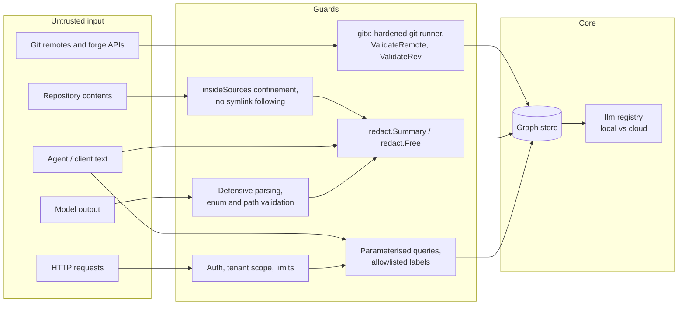
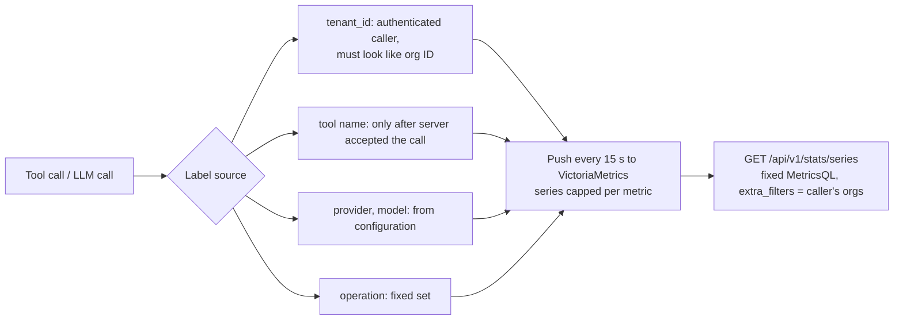
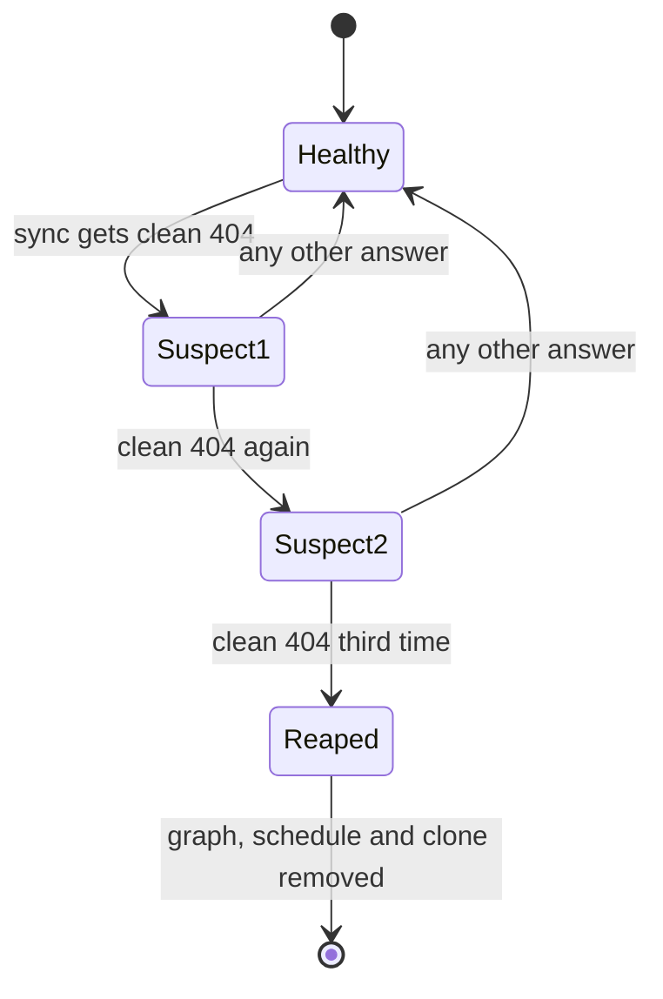

# Security model

!!! info "In plain words"
    CodeSynapse reads code that other people wrote and shows pieces of it to AI models. That is risky: a repository can hide tricks, and an AI can be talked into things. So everything that comes in is treated as untrusted and checked at fixed gates. This page lists the gates and the rule at each. The rules are meant to stay strict; loosening one needs a deliberate decision.

    Words used below: *LLM* is a large language model, the AI behind chat assistants. *Redaction* removes secrets (passwords, keys) and personal data from text before it is stored. A *parameterised query* hands the database the question and the values separately, so a value can never be mistaken for part of the question.

CodeSynapse reads untrusted repositories and serves their contents to LLMs. Each boundary below has a rule that must not be loosened.

## Trust boundaries

## Rules by area

| Area | Rule |
|---|---|
| Cypher | Values only through parameters. Labels, types, depth and ORDER BY only from `model` allowlists, `store.ClampDepth` or `metricCypher` |
| nGQL | Statements are constants; values travel as parameters, tags and columns are quoted from allowlists, and vertex IDs (no parameters in nGQL) are hashes checked by `literal`. Always password-protected, never published, no raw-nGQL tool. Tenant data statements filter on `tenant_id` and `ns` first |
| Vectors | Filter templates with `exprParams`; every item has a tenant; `vector.Isolate` drops foreign hits |
| git | Only through `gitx.Run`: no fsmonitor, hooks, external diff or textconv; ignores global config; no shell |
| go list | `CGO_ENABLED=0`, `GOTOOLCHAIN=local`, `GOPROXY=off` unless opted in |
| Filesystem | API ingest confined to `CODESYNAPSE_SOURCES_ROOT`; docs walking never follows symlinks |
| Graph content | No source bodies or YAML values; hashes, signatures, key paths, line ranges, redacted summaries |
| Remote git | `gitx.Clone` / `FetchCheckout` / `RemoteBranches`; https only, no credentials in URLs, no private hosts unless `CODESYNAPSE_ALLOW_PRIVATE_GIT`; tokens via `GIT_CONFIG_*` env, never argv |
| Forges | One client per host, no redirects; clone URLs built from validated host, allowlisted login and `validRepoSegment` name, never taken from API answers |
| Dependency data | Only ecosystem, name and version leave the machine |
| MCP tools | Read-only (`ReadOnlyHint`), except review tools and memory tools, which write only to their own stores. No raw-Cypher tool (read transactions still allow `LOAD CSV`) |
| LLM calls | Only through `services/api/internal/llm`; prompts pass `redact.Free`; system prompts constant for cache; no source to non-local providers except a diff the user asked to review; keys from `api_key_env` |
| Network services | Refuse non-loopback bind without bearer token (`app.ErrTokenRequired`) |
| Web proxy | Rejects cross-origin mutations; forwards only `cs_session` and `X-CodeSynapse-Org`, never the API token with accounts on; fails closed on unreadable mode |
| Proxies | Client address from `X-Forwarded-For` only from `CODESYNAPSE_TRUSTED_PROXIES` |
| Secrets | From the environment, never flags or logs |

## Telemetry cardinality

Metrics carry only bounded labels. Prompt text, queries, paths, repository names and user IDs never become labels; they belong in logs.

The database enforces the tenant scope; cross-tenant panels are platform-only.

## Destructive actions

Delete repository and delete review are confirmed in the UI. The one automatic removal is `reapIfGone`: a cloned repository is removed only after the provider API answers a clean 404 three scheduled syncs in a row. Deleting cloned files is limited to a single directory inside the workspace, and mounted sources are never deleted.

## Limits

`store.MaxLimit`, `store.MaxDepth`, request body caps and query timeouts. Memory is capped at 10,000 facts per repository; scans queue at most 10 clones each and back off an hour after a failure.
